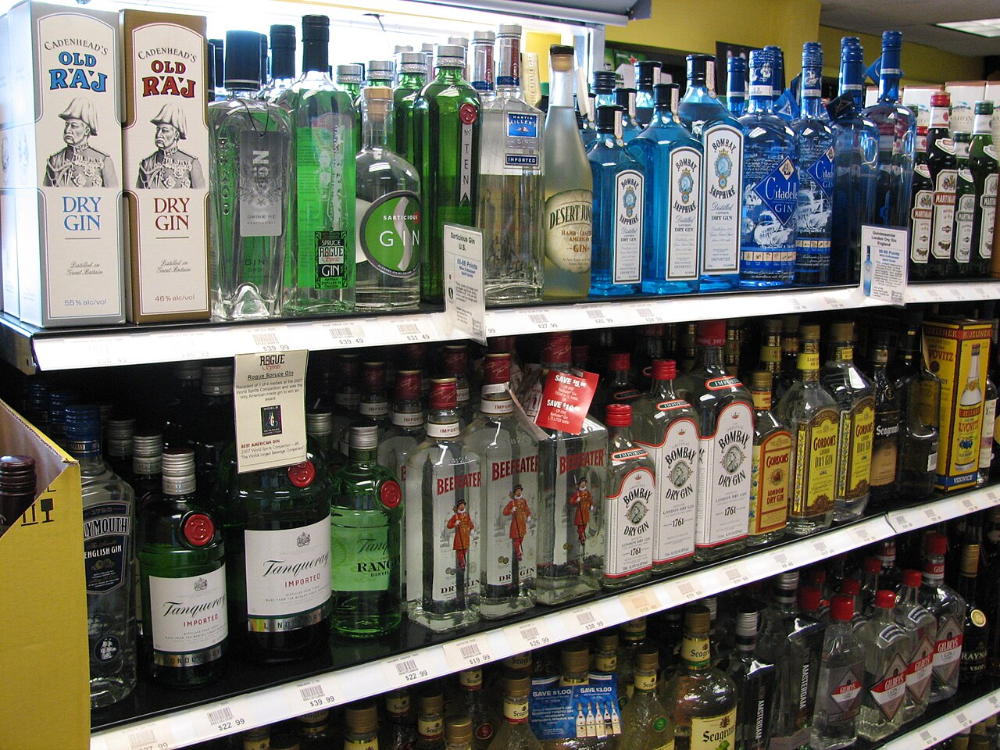

# Beefeater London Dry Gin

Beefeater is a London dry [gin](ref:gin) founded in 1863 by James Burrough, with its distillery in Kennington, London. It is [distilled](ref:distillation) with juniper, citrus peel, angelica, liquorice and about nine botanicals in total, and is commonly 40% ABV. Juniper leads the flavour, citrus keeps it fresh, spice is clear and the body finishes dry.

Figure: Beefeater London Dry Gin. Photograph: File:DecaturGins.jpg. Credit: Decatur Wine & Spirits, CC BY-SA 3.0 ([source page](https://commons.wikimedia.org/wiki/File:DecaturGins.jpg)). Category image; not a claim that it shows the exact product, site or event.

## Definition and identity

London Dry Gin is a production category, not a geographical indication: it does not have to be made in London. What it does require is that the botanicals be added during distillation, that the product not rely on added essences for its main flavour, and that added sugar stay below a very low limit. Beefeater is one brand inside that category, not a synonym for every London dry gin.

Juniper is the core of gin. Brands add citrus peel, angelica, orris root, liquorice, almond, coriander seed and other botanicals to build their own aromatic profile. Beefeater's public material describes a framework of "nine botanicals", but the exact proportions and handling are brand information that outsiders cannot fully verify. Read gin first as "juniper-led with a botanical blend", then look at brand differences.

## History

In 1863 James Burrough began distilling in London and later built the brand that took the name Beefeater. The name refers to the guards of the Tower of London, a marketing and cultural symbol rather than a statement about the recipe. From the late nineteenth century into the twentieth, Beefeater became one of the representative London dry gins and entered export markets.

In the later twentieth century gin consumption went through ups and downs, but Beefeater held influence through classic cocktails and exports. Ownership and production facilities have changed, and distillery locations have shifted with urban redevelopment; public sources can confirm the brand's origins and its London distilling tradition, while site and equipment details change over time. A historical year and the production batch of a particular bottle are not the same thing.

## Region and ingredients

Beefeater's distillation and bottling sit within the United Kingdom, and London is the centre of its history and production narrative. Ingredients include neutral grain alcohol, water and botanicals: juniper gives pine and resin, citrus peel gives fresh fruit, angelica and orris root give earth and floral notes, and liquorice adds sweetness and a lingering finish. The proportions decide the front, middle and back of the aroma.

London dry gin usually starts from neutral alcohol and redistils it with the botanicals so that the aromatics enter the liquid. Compared with a macerated gin, redistillation gives a clearer, more concentrated spirit that is also easier to produce consistently at scale. Raw material quality, still shape and the cut points all affect the final style, so botanical count alone cannot be used to judge quality.

## Production and distillation

The public framework is straightforward: prepare neutral alcohol, put juniper and the other botanicals into the distillation system, and bring the aromatics into the liquid through [distillation](ref:distillation); then make the cut, separating heads, heart and tails and keeping only the balanced heart; finally add water to reach the target strength and bottle. London dry gin does not allow main flavour to be faked by adding essences afterwards.

"Nine botanicals" does not mean "nine flavours in equal measure". Juniper must lead while the others modify and layer it; if citrus or liquorice dominates, the gin loses its backbone. Batches also vary slightly, which is normal for agricultural materials and distillation. Taste for balance rather than for the "purity" of a single botanical.

## Flavour and tasting

Beefeater's typical aromas are juniper, lemon peel, orange peel, the earthy note of angelica, the floral side of orris root and the sweetness of liquorice. It enters dry with a clear alcohol presence, pine and spice appear in the middle, and the finish carries a citrus bitterness. It has more backbone than lighter gins and suits cocktails that need a defined structure.

To taste, begin with a small amount neat in a small glass; add a little water and see whether the juniper-to-citrus ratio shifts; finally add ice and tonic and compare how bubbles and bitterness change the aromatics. Do not evaluate gin by large mouthfuls, because high strength masks botanical detail.

## Drinking and pairing

Gin and tonic is the most common serve: the ratio of gin to tonic is usually between 1:2 and 1:3, with plenty of ice and lime or lemon peel. A martini puts the emphasis on the gin itself, with only a small amount of dry vermouth; a Negroni combines equal parts gin, Campari and sweet vermouth, where the juniper supports the bitter and sweet components. Beefeater also works in a highball or with grapefruit.

Before a meal it pairs with olives, nuts, savoury snacks and seafood; the bitterness and bubbles of a gin and tonic cut through fat. With very sweet desserts the sugar overwhelms juniper and citrus and the gin loses clarity. As a cocktail base its strength strongly affects the balance of the finished drink, so the sugar and acid in the recipe need adjusting.

## Common misconceptions

First, that London dry gin must be made in London. It is a production category, not a geographical indication.
Second, that gin is simply "vodka with flavourings". Gin is juniper-led and its flavour structure differs from neutral vodka.
Third, that more botanicals are always better. More botanicals do not automatically mean more complexity; balance and proportion matter more.
Fourth, that Beefeater is a vodka or a liqueur. It is a gin, with different strength and flavour logic.
Fifth, ignoring version differences. Strength and recipe can differ between markets and versions, so the label is authoritative.

**In brief:** A London dry gin founded in 1863 by James Burrough, distilled in Kennington with about nine botanicals and commonly 40% ABV.

For Beefeater London Dry Gin, begin with the base and the stated strength. Then look at the sweetness or bitterness, and finally ask how it is served. The answers point to different choices, not to a single score.

[Gin](ref:gin) and [Gin](ref:gin) answer different questions about Beefeater London Dry Gin: style and region and vintage. Read them as a pair, not as alternatives.

**Key facts.**

| Item | Detail |
| --- | --- |
| In one line | A London dry gin founded in 1863 by James Burrough, distilled in Kennington with about nine botanicals and commonly 40% ABV. |
| Style | Gin |
| ABV | 40–40% vol |

## Further reading

- [Gin](ref:gin): the category and production framework to which Beefeater belongs.
- [Distillation](ref:distillation): the key step that brings botanical aromas into the liquid.
