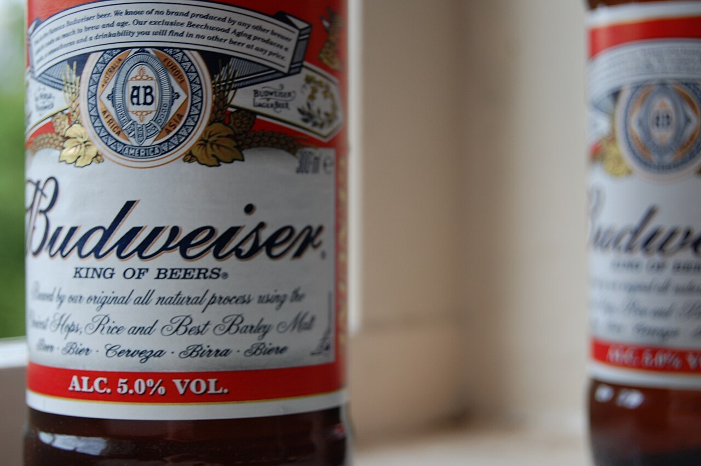

# Budweiser

In 1876, Adolphus Busch, a German immigrant in St. Louis, put a pale lagered beer into glass bottles and handed it to the railways for national distribution. America did not yet have true national beer brands: refrigerated rail cars and pasteurisation had only just made it possible to ship beer across state lines without spoilage. Budweiser was born at that technical and commercial moment, rather than as a style definition that later acquired a famous name. Today it is commonly 5.0% vol in 355 mL, and it is one of the largest-selling beer brands in the world.

Figure: Budweiser. Photograph: Budweiser bottle close-up. Credit: Sam, CC BY-SA 2.0, via Wikimedia Commons ([source](https://commons.wikimedia.org/w/index.php?curid=20085117)).

## A product, not a style

Three layers are easily confused. Anheuser-Busch is the producer, Budweiser is the brand, and the beer in the bottle is the product. The product is defined by strength, volume, origin and batch; when the brand is licensed in another country, water, raw-material proportions and labelling law all change.

American lager is a style: pale, low in bitterness, highly carbonated, clean-finishing, and permitted to use rice or maize as adjuncts. Budweiser is one of the most representative commercial examples, but a style name is not a product name. Calling it an American lager is classification; calling it Budweiser is identification.

## From immigrant brewery to rail network

The company grew out of Eberhard Anheuser's St. Louis brewery. After Adolphus Busch joined, he concentrated on two things that were then unusual: pasteurisation to keep beer stable in transit, and refrigerated rail cars to sell it in distant markets. Together these conditions turned a local brewery into a plausible national brand.

In 1876 Budweiser appeared as a pale lager. Its name borrowed the reputation of the German-speaking beer town of Budweis, now České Budějovice in the Czech Republic, which is also the origin of a trademark dispute lasting more than a century. The reasons for its success were not mysterious: a mild taste, controllable cost and steady supply suited European immigrant workers and, later, an American market that still wanted pale beer before and after Prohibition.

## Why rice is in the recipe

The published raw materials are barley malt, rice, water and hops. Rice is not filler but part of the design: it supplies fermentable sugar with almost no protein or polyphenol, so the body becomes lighter, the colour paler and the flavour cleaner. American six-row barley is relatively high in protein, and a measured adjunct also helps avoid an excessively full body or haze.

This logic differs from the European purity-law tradition. Many German and Czech lagers allow only barley malt, so the malt backbone is more prominent and the flavour feels "thicker"; American lager thins the backbone in exchange for drinkability and consistency. These are two design goals, not a contest between authentic and inauthentic.

## Mashing, fermentation and beechwood ageing

The process is standard bottom fermentation: mashing, boiling with hops, cooling, pitching yeast for a cool fermentation, then conditioning and clarification. Low temperature and long conditioning let yeast settle and flavours tighten, which is why the finished beer is clean with little ester.

One widespread claim needs correcting: Budweiser's "beechwood ageing" does not mean ageing in beechwood barrels. Treated beechwood slats are laid in horizontal conditioning tanks to give residual yeast a surface to settle on, helping clarity; the wood does not impart vanilla or toast the way an oak barrel does. It is a process aid, not a flavour source.

## Flavour coordinates: low bitterness, high carbonation, dry finish

The beer is pale gold with a white head that falls fairly quickly. Aroma is grainy sweetness with a faint herbal hop note and no obvious ester or yeast character. Carbonation is high on entry, the front palate is lightly sweet, the middle has little pressure, and the finish is clean and fairly dry with a brief bitterness.

Set beside Czech pilsner, the difference is clear: pilsner is more bitter, more hop-forward and more complete in malt structure, while Budweiser pushes bitterness very low so that thirst-quenching comes before contemplation. That is also why it suits heavy chilling and long draughts, although chilling further suppresses what little aroma it has.

## Specifications, origins and global licensing

The US version is commonly 5.0% vol in 355 mL cans and bottles; Europe and other markets are mostly brewed by licensed local plants, often at 4.5%–5.0% vol, with pack sizes adjusted to local habit as 330 mL, 440 mL or 500 mL. Licensed production means the recipe must fit local water, raw-material supply and labelling law, so the result cannot be identical to the St. Louis original.

The most reliable information is on the back label: producer, packaging location, strength, net volume and shelf life. Price differences between imported and local versions usually come from duty, channel and packaging rather than from the liquid itself.

## Price band and drinking occasions

In its home market Budweiser sits at a mass-market price; in China it is positioned more as a mid-priced imported lager, competing with domestic mainstream lagers and entry-level craft beer. Its strongest occasions are barbecue, hotpot, ball games and parties, where the need is a cold, plentiful drink that does not compete with food rather than a complex flavour to analyse.

This also explains the packaging strategy: large formats, easy-open ends and an emphasis on ice-cold service. Approached as a tasting object it disappoints; approached as a table beer it rarely goes wrong.

## The Czech Budweiser dispute

The Budweiser Budvar brewery in České Budějovice is a separate company using a similar place-based name, and the two sides have litigated the word "Budweiser" in many European countries for decades. A 2011 judgment of the Court of Justice of the European Union allowed the two marks to coexist within their existing scopes, but national outcomes still differ.

For drinkers the test is simple: read the producer and the origin. The US product names Anheuser-Busch; the Czech product names Budějovický Budvar. The styles differ too: the Czech beer is closer to a traditional pilsner, with more bitterness and malt.

## Common misconceptions

First, that Budweiser is a Czech beer. It is an American product that shares a place-name root with the Czech brewery.
Second, that rice as an adjunct means cutting corners. The adjunct is a stylistic choice that shapes body, colour and cost.
Third, that beechwood ageing means barrel ageing. It is a tank process using wood slats, mainly to help yeast settle.
Fourth, that Budweiser tastes the same everywhere. Licensed plants, water and regulation all create differences.
Fifth, judging flavour by sales volume. Volume reflects supply chain and distribution, not complexity.
Sixth, that pale lager involves no craft. Cool fermentation, conditioning and stability control are precisely the hardest parts of industrial lager brewing.

**At a glance:** A pale lager brewed by Anheuser-Busch in St. Louis since 1876, usually 5.0% vol in 355 mL; known for rice as an adjunct and for beechwood ageing in conditioning tanks, with a clean, crisp style, and one of the world's largest-selling beer brands. 

## Further reading

- [Lager](ref:lager): the beer category and bottom-fermentation logic behind Budweiser.
- [United States](ref:usa): the brand's origin and main market.
- [Barley](ref:barley), [rice](ref:rice) and [water](ref:water): the main materials that build the body.
- [Fermentation](ref:fermentation): the core step of cool fermentation and conditioning.
