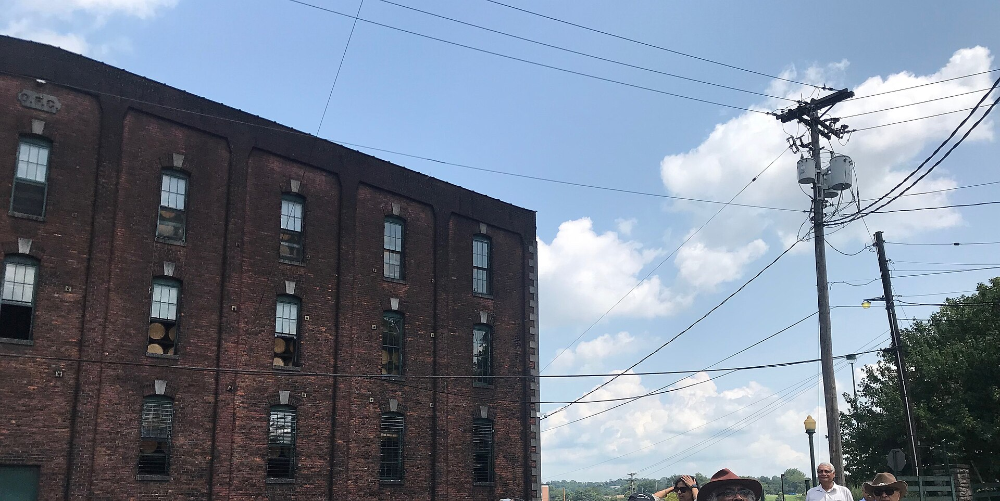

# Buffalo Trace

Buffalo Trace is a Kentucky straight bourbon from Frankfort, Kentucky, made mainly from corn with rye and malted barley and aged in new charred oak barrels, commonly at 45% ABV in 750 mL bottles. The bottle carries no age statement, so it is a regular non-age-stated bourbon.

Figure: Related photograph of Buffalo Trace. Image: Jaimin Trivedi, CC BY-SA 4.0, via Wikimedia Commons ([source page](https://commons.wikimedia.org/wiki/File:Buffalo_Trace_Distillery_Barrel_Aging_Warehouse_(outside).jpg)).

## Definition and position

Separate the levels first: whisky is the broad category, bourbon is a legal American type, Kentucky straight bourbon is a more specific label category, and Buffalo Trace is a brand and specific product. Keeping the four apart prevents confusion between region, ingredient rules and brand positioning.

"Straight" has a defined meaning in U.S. rules: produced in one distilling season at one distillery, with no added spirits or flavourings other than water for reduction, and aged in new charred oak. It does not mean single barrel, and it does not mean single vintage; these concepts need separating.

## Producer and brand

Buffalo Trace is made at the Buffalo Trace Distillery in Frankfort, Kentucky, where distilling on the site goes back to the late 18th century (the exact year should be checked against distillery material); it now belongs to the Sazerac Company. The distillery also produces several bourbon and rye whisky brands.

Brand, distillery and product are three levels: the distillery answers equipment, ingredients and warehouses, the brand answers positioning and range, and the product answers ABV, volume and age statement. Distillery history is background and cannot replace the specification and batch on the label.

## Region and ingredients

Bourbon must be made in the United States, and Buffalo Trace comes from Kentucky in the [USA](ref:usa). The core ingredient is [maize](ref:maize), which U.S. rules require to make up at least 51% of the grain recipe; Buffalo Trace also adds rye and malted [barley](ref:barley), with rye supplying spice and structure and malted barley supplying enzymes and malt flavour.

The exact grain proportions are distillery recipe information, and public material usually describes the structure rather than precise figures. The grains are milled and mashed, then [fermented](ref:fermentation) with [water](ref:water) and yeast before distillation. Water and grain quality shape the new spirit, but distillation and cask decide most of the final style.

## Production

The fermented liquid is [distilled](ref:distillation) to raise its strength, and the selected fraction is filled into new charred oak casks for [ageing](ref:oak-ageing). U.S. rules require new charred oak for bourbon; the inside of the cask is charred with open flame, which brings vanilla, caramel and coconut sweetness.

A new cask is normally not reused for bourbon, a key difference from many other American whiskies. Maturation warehouses are usually multi-storey timber buildings, and temperature differences between floors make some casks mature faster; distilleries usually keep the style stable through cask selection and batch blending.

## Specification and label

The common [alcohol by volume](ref:abv) is 45% ABV (90 proof), usually in 750 mL bottles. The label should be checked for brand, Kentucky straight bourbon type, ABV, net content, distillery and batch details; U.S. labeling rules are explicit about age statements.

Where no age appears on the bottle, U.S. labeling rules mean the spirit has reached the threshold above which an age statement is not required (bourbon under 4 years must state its age); the exact figure should still be checked against distillery material. The local-language back label, importer and anti-counterfeit information support identity checks.

## Flavour and tasting

Typical aromas are vanilla, caramel, honey, orange peel and mint, with oak and light spice. The palate is distinctly sweet with a medium body, rye adds spice, and the finish is warm with wood and citrus peel. At 45% ABV it has more drive than the common 40% ABV bourbon, and water opens the aroma further.

Taste it neat at room temperature first, then add a few drops of water; ice lowers the temperature and dilutes the sweetness. Check for sharp solvent notes or excessive bitterness, which may relate to the batch or storage. Small variation between batches is normal.

## Drinking and pairing

Neat, with a little water or with ice all work. It is also a common base for classic bourbon cocktails, since its sweetness and spice work with other ingredients. Roasted meat, nuts, cheese and dark chocolate pair well; avoid very sweet or very acidic dishes at the same time.

After opening, store upright in a dark, cool place to limit aroma loss and oxidation; refrigeration is unnecessary, but heat and sharp temperature swings should be avoided. Excessive drinking is harmful to health, and minors should not drink; do not drive or operate machinery after drinking.

## Buying and storage

Buy through regular channels and check anti-counterfeit marks, the local back label, importer and batch number. Prices move with market and batch, so this entry gives no figures; other brands from the same distillery should be checked separately rather than generalised from Buffalo Trace's specification.

An unopened bottle can be kept for years in a dark, cool place, standing upright to limit contact between liquid and cork. Once opened, the whisky oxidises slowly and its aroma shifts month by month, so it is best finished within a few months; heat and strong light accelerate decline.

## Common misconceptions

First, treating "straight" as "single barrel". Straight describes ingredient and cask rules, not a single cask.
Second, treating the lack of an age statement as no maturation. Under U.S. rules, bourbon under 4 years must state its age.
Third, assuming bourbon must come from Kentucky. Bourbon can be made in several U.S. states, and Kentucky is the main region.
Fourth, treating the corn share as the whole recipe. Corn must be over half, but rye and barley proportions also shape the style.
Fifth, judging authenticity by packaging or gift boxes. Channel, anti-counterfeit marks and label information are more reliable.

For Buffalo Trace, begin with the base and the stated strength, then the sweetness or bitterness, and finish with how it is served; that order keeps the account grounded.

Start with [Bourbon Whiskey](ref:bourbon) for style, then read [Maize](ref:maize) for region and vintage. Seeing both keeps Buffalo Trace from being confused with a neighbouring idea.

## Further reading

- [Bourbon](ref:bourbon): legal requirements and the style range.
- [USA](ref:usa): the American drinks map and the place of Kentucky.
- [Maize](ref:maize): the main ingredient of bourbon.
- [Barley](ref:barley): the role of malted barley in mashing.
- [Water](ref:water): the basis of mashing, fermentation and dilution.
- [Fermentation](ref:fermentation): the basic logic of grain fermentation.
- [Distillation](ref:distillation): the basic flow of bourbon distillation and the cut.
- [Oak ageing](ref:oak-ageing): how new charred casks shape flavour.
- [Alcohol by volume](ref:abv): the conversion between 45% ABV and proof.
- [Jack Daniel's Old No. 7](ref:jackdaniels): a comparative read on Tennessee whisky.
