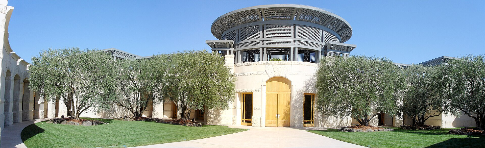

# Opus One

Opus One is a Bordeaux-style [red wine](ref:red-wine) from Oakville in the [Napa Valley](ref:napa-valley), California, created in 1979 by Robert Mondavi and Baron Philippe de Rothschild. The first vintage was 1979, and the 1979 and 1980 wines were released together in 1984. It is led by [Cabernet Sauvignon](ref:cabernet), commonly 750 mL at about 14% ABV.

Figure: Related photograph of Opus One. Image: Jim G, CC BY 2.0, via Wikimedia Commons ([source page](https://commons.wikimedia.org/wiki/File:Panorama,_Opus_One,_Napa_Valley,_California,_USA.jpg)).

## 1979: A Handshake in Oakville

In 1978 Mondavi and Baron Philippe met at Château [Mouton Rothschild](ref:mouton) and settled the outline of a joint venture. The idea was deliberately narrow: not a portfolio, but one wine, made from Napa grapes with Bordeaux [blending](ref:blending) logic and both teams of winemakers. The first vintage was made in 1979 at the Mondavi winery. Construction of a dedicated estate began in 1989, and the winery opened in 1991, its limestone, arcades and tower echoing a Médoc château.

## From Napa Medoc to Opus One in 1982

The project was first called “Napa Medoc”, sometimes written “Napamedoc”, a literal stitching together of Napa and Médoc. In 1982 it was renamed Opus One. “Opus” is Latin for a work, and in music it marks a composer's first numbered piece, so the name carries both “first” and “the only one”. The change was more than marketing: it moved the product from “a Bordeaux made in Napa” to “the first joint work of two families”.

## Four Parcels, About 170 Acres

The estate farms four parcels in western Oakville, totalling about 170 acres (roughly 69 hectares): two inside the To Kalon vineyard, plus Ballestra and River. The first 35 acres came from To Kalon's Q Block and were bought in 1981; further purchases of 48 and 100 acres followed. Published figures vary between roughly 55 and 70 hectares depending on how the parcels are counted, so the winery's own technical material should be treated as the reference.

## The 2023 Blend: 81% Cabernet Sauvignon

The 2023 wine is 81% Cabernet Sauvignon, 7% [Merlot](ref:merlot), 6% Cabernet Franc, 5% Petit Verdot and 1% Malbec. Cabernet Sauvignon supplies the skeleton, colour and ageing potential; Merlot adds roundness and mid-palate fruit; Cabernet Franc brings florals and a herbal lift; Petit Verdot adds colour and tannin; Malbec contributes a little spice. The proportions move with the vintage — in 2022 Cabernet Sauvignon was 80% and Petit Verdot 8% — so a percentage quoted for one year should not be applied to another.

## Twenty-Two Days of Maceration, Nineteen Months in New French Oak

The 2023 wine was macerated for 22 days, then aged for 19 months in entirely new French oak. Some winery material says 18 months, a difference that reflects different vintages and different counting points; for any single year, the technical sheet for that year is the authority. New oak brings vanilla, toast, cedar and sweet spice, but it only works when the fruit is ripe enough to carry it. Grapes are picked by hand, sorted, fermented parcel by parcel in temperature-controlled tanks, and moved by gravity where possible to reduce pumping.

## Overture: The Second Wine's Job

Overture is Opus One's second wine, made since 1993; 2021 was the first vintage-dated release. The 2023 Overture is 91% Cabernet Sauvignon, 4% Merlot, 3.4% Petit Verdot, 1% Cabernet Franc and 0.5% Malbec, also macerated for 22 days and aged 19 months in new French oak. It drinks earlier, shows more direct fruit and softer tannin, and costs less. It is not a defective Opus One; it is a deliberate separation of the more open-textured lots from the same estate.

## Why It Tastes More Graphite Than Almaviva

Compared with [Almaviva](ref:almaviva), Opus One carries more Cabernet Sauvignon (81% against 70%), uses no Carmenère, farms a warmer site in Oakville, uses a higher share of new oak (about 100% against 76%) and ages longer (19 months against 18). The result leans towards blackcurrant, graphite, cedar, vanilla and tobacco, with finer-grained tannin. Almaviva, at about 650 metres in Puente Alto, has cooler nights and a slice of Carmenère that brings black pepper, bay leaf and dark chocolate. Both are Bordeaux-style blends shaped by Rothschild involvement, but climate and variety pull them apart.

## Prices and Auction Records: US$490 on Release

Winery prices in November 2026 were US$490 per bottle for Opus One 2023 and US$210 for Overture 2023; a mature vintage such as 2010 was listed at US$710. Overture therefore sits at roughly forty percent of the grand vin, and the two should not be quoted as one price. Auction is a separate market: at the first Napa Valley Wine Auction in 1981, a case of the 1979 Opus One sold for US$24,000 before the wine was officially released. Later vintages trade actively on the secondary market, but results depend on vintage, provenance, condition and the buyer, so a single record is not a general price.

## Misconception: Opus One Is Not a French Wine

The most common misunderstanding is that Opus One is a French wine, because a Rothschild is involved, because it ages in French oak and because the name is Latin. Its origin is Oakville in the Napa Valley; it is labelled under US rules administered by the TTB, and the grapes are American. The French partner and the French barrels shape the style, not the country of origin. A second misunderstanding treats Overture as a counterfeit or inferior Opus One; it is the estate's official second wine, with different selection and a different drinking window.

## Serving, Decanting and Pairing

Serve at 16–18°C. Young bottles benefit from an hour or two of air; older bottles should spend less time in the decanter so the aroma is not lost. Pair with steak, roast lamb, duck breast, hard cheese and mushroom dishes. The graphite and cedar notes suit red meat with a charred crust, while the vanilla and toast echo smoke and grill. Stopper and refrigerate an opened bottle and finish it within a few days.

## How to Check Vintage and Batch

The front label should show the brand, vintage, Oakville or Napa Valley appellation, alcohol level, net volume and production details; US labelling is administered by the TTB, and appellation and variety statements must follow the rules. The back label carries the importer and, in China, the Chinese translation, which should match the original. Bottle codes and anti-counterfeit marks are more useful than price for judging provenance, and dates such as the 1984 release or the 1991 winery opening help place an older bottle in a plausible range.

## Further Reading

- [Red wine](ref:red-wine): the category Opus One belongs to.
- [Wine](ref:wine): definitions and broad classifications.
- [United States](ref:usa): the national background to Napa Valley.
- [Napa Valley](ref:napa-valley): the region behind Oakville and To Kalon.
- [Cabernet Sauvignon](ref:cabernet): the dominant variety in the grand vin.
- [Merlot](ref:merlot): the source of roundness and fruit.
- [Fermentation](ref:fermentation): parcel-by-parcel fermentation and maceration.
- [Oak ageing](ref:oak-ageing): 19 months in new French oak.
- [Blending](ref:blending): proportions that shift with the vintage.
- [Mouton Rothschild](ref:mouton): the Bordeaux reference on the Rothschild side.
- [Almaviva](ref:almaviva): the Chilean Rothschild-linked comparison.

For Opus One, begin with the base and the stated strength. Then look at the sweetness or bitterness, and finally ask how it is served. The answers point to different choices, not to a single score.

**At a glance:** Opus One is a Bordeaux-style dry red made in Oakville, Napa Valley, founded in 1979 by Robert Mondavi and Baron Philippe de Rothschild; the first vintage was 1979, released in 1984, and this page explains the 1982 renaming, the four parcels, the 2023 blend, Overture and the auction record.

**Key facts.**

| Item | Detail |
| --- | --- |
| In one line | Opus One is a Bordeaux-style dry red made in Oakville, Napa Valley, founded in 1979 by Robert Mondavi and Baron Philippe de Rothschild; the first vintage was 1979, released in 1984, and this page explains the 1982 renami… |
| Style | Red wine |
| Region | United States、Napa Valley |

**Sources and limits.** The key claims about Opus One are checked against the following sources: Opus One Winery, Langton's, The Buyer and 6 sources in total. Prices, batches and status change; the body is project-written and does not reproduce source text.
