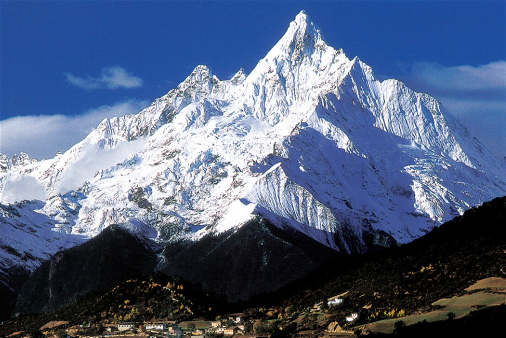

# Ao Yun

Ao Yun is a [Cabernet Sauvignon](ref:cabernet) dry red from the high-altitude Shangri-La area of Diqing, Yunnan, developed with LVMH backing; the first vintage was 2013. The wine belongs to [red wine](ref:red-wine), commonly 750 mL at about 13%-14% ABV, with vintage, bottling batch and label details to be checked on the bottle.

Figure: Ao Yun. Image: Charlie fong, Public domain, via Wikimedia Commons ([source page](https://commons.wikimedia.org/wiki/File:%E6%A2%85%E9%87%8C%E9%9B%AA%E5%B1%B1.jpg)).

## Definition and position

Ao Yun is a specific wine product and an international brand made in a high-altitude region of China. Within the classification of [wine](ref:wine), it is a still red wine, neither fortified nor sparkling. The product name and the origin name are not the same thing: Ao Yun answers "which wine", while Shangri-La answers "grown where".

The project is positioned as a premium dry red: Cabernet Sauvignon as the main variety, grown and vinified on high-altitude parcels, then aged in oak. The premium positioning comes from origin conditions and craft input rather than from the name itself; judging a specific wine still depends on vintage, batch and label.

## Origin and climate

The origin lies around Shangri-La in Diqing Tibetan Autonomous Prefecture, north-western Yunnan, with vineyards on valley slopes at altitudes above about 2,200 metres. High altitude brings intense sunlight, large day-night temperature swings and a long ripening season: sugars and flavour accumulate by day, while low night temperatures help retain acidity.

The climate is affected by the monsoon, and the rainy period may overlap with harvest, so frost, hail and rain are risks. Parcels at different altitudes, aspects and soils ripen on different schedules, and the estate must harvest and select in batches. High altitude is not a quality guarantee; it changes the balance between ripeness and acidity.

## Varieties and viticulture

Ao Yun is based on Cabernet Sauvignon, often with Cabernet Franc, Syrah and Petit Verdot. Cabernet Sauvignon provides the skeleton, colour and ageing potential, while other varieties add aromatic and structural layers. The proportions shift with vintage and parcel, and the exact formula is usually not fully declared on the label.

Vineyard management on high-altitude parcels requires careful pruning, crop control and disease management. Yield control can raise concentration, but too low a yield may also ripen too fast and lose acidity. Viticultural decisions and vintage conditions together determine fruit quality, and "high altitude" alone cannot summarise it.

## Production

Harvesting is usually done by hand, and after sorting, destemming and crushing the fruit undergoes temperature-controlled [fermentation](ref:fermentation). Different parcels and varieties are often handled in separate tanks; maceration time and temperature affect the extraction of colour, tannin and aroma, and [blending](ref:blending) follows.

After fermentation the wine goes into [oak ageing](ref:oak-ageing). The share of new barrels, the ageing period and the frequency of racking are estate process decisions that public material may not disclose year by year. Oak softens tannin and adds aromatic layers, but it cannot replace the ripeness of the fruit itself.

## Specification and label

The common format is a 750 mL bottle at about 13%-14% ABV, as a dry red wine. The label usually carries the brand name, vintage, origin, strength, net volume and production information; imported wines also carry a Chinese label, and the Chinese label should correspond to the original information.

For imported wine, the Chinese back label is an important basis for identification. The producer, bottling location, importer and batch information on the label are more reliable than promotional language; if label information is missing or inconsistent with the product, purchase should be treated with caution.

## Flavour and tasting

When young the wine often shows blackcurrant, black cherry, violet and spice, with fine but supportive tannin and relatively high acidity. With age it develops cedar, tobacco and dried-flower notes, and the body moves from firm to supple.

Serve at about 16-18°C. Too warm accentuates alcohol, too cold suppresses aroma. Young wines can be left to breathe for a while, while older wines should spend less time in contact with air so that aroma is not lost too quickly.

## Drinking and pairing

Ao Yun suits steak, roasted lamb, duck breast and hard cheese. Tannin binds with protein to soften astringency, while acidity cuts through fat. Dishes with spice and mushroom notes also echo the spice and aged aromas in the wine.

For Ao Yun, if a bottle is not finished, cork it tightly, refrigerate and drink within a few days. Red wine oxidises with prolonged air contact, and fruit aroma turns to sour and nutty notes; decanting into a smaller bottle or using a vacuum stopper slows the process.

## Buying and storage

Buy through regular channels and check the Chinese back label, vintage, origin, strength and importer information. Production in high-altitude regions is limited, so price and supply fluctuate with vintage; a promotional price does not represent long-term positioning and cannot be used to infer quality.

For Ao Yun, unopened wine should be stored on its side, away from light, at a steady temperature, ideally 12-16°C, avoiding sharp temperature swings and strong odours. Home storage cannot replicate cellar conditions, and long ageing needs stable temperature and humidity, so the year of purchase should not be equated simply with an improvement in quality.

## Common misconceptions

First, treating high altitude as a quality guarantee. Altitude changes ripening conditions but does not make every vintage outstanding.

Second, confusing the brand name with the origin name. Ao Yun is the product, Shangri-La is the origin.

Third, treating the Chinese label on imported wine as decoration. It is the basis for checking identity and compliance.

Fourth, judging quality by price alone. Channel, vintage and storage condition matter equally.

For Ao Yun, a common mistake is treating ageing potential as indefinite storage. Past its drinking window, aroma and structure decline.

**Short definition:** A Cabernet Sauvignon dry red from the high-altitude Shangri-La area of Diqing, Yunnan, developed with LVMH backing; the first vintage was 2013, commonly 750 mL at about 13%-14% ABV, with vintage and batch to be checked on the label.

For Ao Yun, begin with the base and the stated strength. Then look at the sweetness or bitterness, and finally ask how it is served. The answers point to different choices, not to a single score.

[Red wine](ref:red-wine) and [China](ref:china) are the two useful reference points for Ao Yun. [Red wine](ref:red-wine) sets out style; [China](ref:china) brings in region and vintage. Read them together.

**Key facts.**

| Item | Detail |
| --- | --- |
| In one line | A Cabernet Sauvignon dry red from the high-altitude Shangri-La area of Diqing, Yunnan, developed with LVMH backing; the first vintage was 2013, commonly 750 mL at about 13%-14% ABV, with vintage and batch to be checked o… |
| Style | Red wine |
| Region | China |

The wine standard cited is GB/T 15037-2006.

## Further reading

- [Red wine](ref:red-wine): category and basic process.
- [Wine](ref:wine): the broad category and classification system.
- [China](ref:china): the Chinese wine-region landscape.
- [Cabernet Sauvignon](ref:cabernet): variety characteristics and style.
- [Fermentation](ref:fermentation): skin fermentation and maceration.
- [Oak ageing](ref:oak-ageing): shaping aroma and tannin.
- [Blending](ref:blending): balancing varieties and parcels.
- [Beverage-alcohol terminology and classification](ref:gb-class): wine's position in the classification system.
