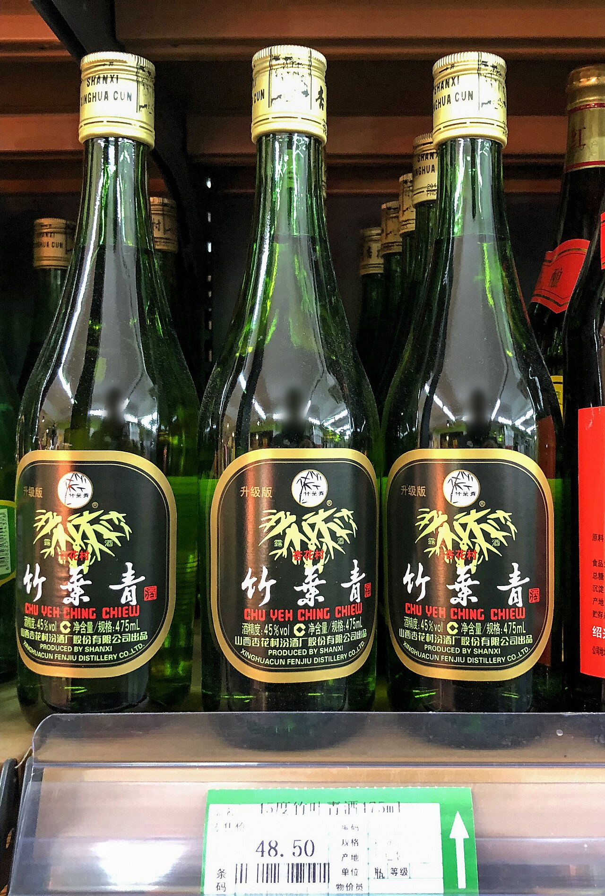

# Zhuyeqing

Zhuyeqing is a blended spirit made from [Fenjiu](ref:baijiu) as its base, with bamboo leaf, various botanical ingredients and sugar, typically about 38% vol and produced in Xinghua Village, Fenyang, Shanxi. It is light and sweet with a herbal aroma and is one of the better-known [blended spirits](ref:medicinal).

Figure: Zhuyeqing. Image: N509FZ, CC BY-SA 4.0, via Wikimedia Commons ([source page](https://commons.wikimedia.org/wiki/File:Chu_Yeh_Ching_Chiew_in_glass_bottle_(20191118165928).jpg)).

## Definition and position

This drink is a blended spirit (liqueur-style spirit) produced by [Shanxi Xinghua Village Fenjiu Factory Co., Ltd.](ref:producer) and carried by the [Fenjiu](ref:brand) brand. Within the product range it serves the "lower strength, easy to drink, herbal" position, which differs from that of light-aroma baijiu.

Three levels need separating: baijiu is the base category, blended spirit is the finished category, and Zhuyeqing is a specific product. The base is Fenjiu, but the finished drink is not plain baijiu and should not be judged by light-aroma baijiu standards alone.

## Producer and brand

The drink is produced by [Shanxi Xinghua Village Fenjiu Factory Co., Ltd.](ref:producer) and carried by the [Fenjiu](ref:brand) brand. The production area is Xinghua Village in Fenyang, Shanxi, one of the core areas for light-aroma baijiu in China.

Company, brand and product are three levels: the brand answers "what is it called and who is it for", the company answers "who holds the trademark and who carries legal responsibility", and the product answers the specific ingredients, ABV and volume. Applying the base spirit's origin and process directly to the finished drink is a common confusion of levels.

## Region and ingredients

Xinghua Village lies in Fenyang, Shanxi, with a temperate continental monsoon climate, four distinct seasons and a large day-night temperature range. Local water and microbial environment are important conditions for light-aroma baijiu.

The base spirit is made from sorghum and other grains through solid-state fermentation and distillation. The finished drink also contains bamboo leaf, various botanical ingredients and sugar; the exact list and proportions are the company's formula, labels usually disclose only part of the information, and the bottle label should be trusted.

## Blending process

The basic route is: make the base spirit by the light-aroma baijiu process, extract flavours from the botanicals by maceration and similar methods, [blend](ref:blending) with the base spirit, sugar liquid and other components according to the formula, then filter, store, inspect and bottle.

The [distillation](ref:distillation) quality of the base spirit governs the cleanliness and frame of the finished drink; the botanical types, amounts and extraction method set the aroma direction; the sugar amount affects sweetness and body. Any change alters the product, so ABV alone is not enough.

## Specification and label

Common formats are 500 mL bottles, with ABV typically around 38% vol, and other strength versions also exist. Producer, product name, ingredients, ABV, net volume, standard and origin on the label are the basics for identifying a product.

Ingredients and labelling for blended spirits are governed by national standards. The botanicals and sugars in the ingredient list are important clues to the flavour direction; content not listed should not be filled in by assumption.

## Flavour and tasting

The aroma is led by herbal freshness, sweetness and the grain aroma of the base spirit; the entry is on the sweet side, the body relatively light, and the finish clean. Too low a temperature suppresses the aroma, while too high a temperature makes sweetness and alcohol heat more prominent.

When tasting, smell first and judge the ratio of herbal to base-spirit aroma; then sip to see whether sweetness covers the base spirit and whether the botanicals turn bitter; finally check whether the finish is clean. Ice or soda changes sweetness and aroma presentation, but that is a way of drinking, not part of the formula.

## Drinking and pairing

Zhuyeqing suits room temperature or a little ice and is often used as a before-meal drink. Pair it with nuts, braised dishes, cold dishes and simple savoury snacks; sweeter versions do not suit very sweet food.

It can also be served with ice or soda, but dilution lowers sweetness and herbal concentration, so the ratio should be adjusted to the glass. Do not drink when driving, taking medication or pregnant.

## Buying and storage

Buy through regular channels and check anti-counterfeit marks, producer and batch. Different strength and volume versions should be checked against the label, not treated as different wine.

Unopened bottles should be stored upright, away from light, in a cool place, avoiding heat and strong odours. After opening, seal, refrigerate and finish soon; long exposure to air loses aroma.

## Common misconceptions

First, treating Zhuyeqing as plain baijiu. It is a blended spirit, and the base spirit is only one ingredient.

Second, treating herbal aroma as a medicinal effect. Aroma and efficacy are different things, and this entry makes no efficacy claims.

Third, assuming a lower ABV means less intoxication. Sweetness masks the alcohol and encourages faster drinking.

Fourth, filling in botanicals not listed on the label. The formula is company information; trust the label.

Fifth, treating ice or soda as a change of formula. That is a way of drinking, not the product itself.

**In brief:** A liqueur-style blended spirit made from Fenjiu as its base, with bamboo leaf, various botanical ingredients and sugar; typically about 38% vol and produced in Xinghua Village, Fenyang, Shanxi; light, sweet and herbal in aroma. 

Start with the base and the stated strength. From there, consider the sweetness or bitterness, then how it is served. That is how a practical judgment about Zhuyeqing is built.

[Medicinal liquor](ref:medicinal) and [Fenjiu](ref:brand) answer different questions about Zhuyeqing: style and region and vintage. Read them as a pair, not as alternatives.

**Key facts.**

| Item | Detail |
| --- | --- |
| In one line | A liqueur-style blended spirit made from Fenjiu as its base, with bamboo leaf, various botanical ingredients and sugar; typically about 38% vol and produced in Xinghua Village, Fenyang, Shanxi |
| Style | Medicinal liquor、Baijiu |
| Region | China |
| Producer or brand | Shanxi Xinghuacun Fenjiu Group Co., Ltd.、Fenjiu |

**Sources and limits.** The key claims about Zhuyeqing are checked against the following sources: Industry body (Used to check the base spirit, botanical direction, volume and ABV range; Used to check the position of blended spirits in the drinks classification), Shanxi Xinghuacun Fenjiu Distillery Co., Ltd. (Used to check the base spirit, ingredients and corporate background of Zhuyeqing), State Administration for Market Regulation, Standardization Administration of China (Used to check the scope, terminology and classification of GB/T 27588-2011; no text copied). Prices, batches and status change; the body is project-written and does not reproduce source text.

## Further reading

- [Fenjiu](ref:brand): brand and light-aroma product lines.
- [Shanxi Xinghua Village Fenjiu Factory Co., Ltd.](ref:producer): company and production area.
- [Qinghua Fen 30](ref:qinghua-fen): a light-aroma baijiu from the same brand, for comparing the base style.
- [Blended spirit](ref:medicinal): the position of liqueur-style spirits in the classification.
- [Baijiu](ref:baijiu): the broad category of the base spirit.
- [Distillation](ref:distillation): the core of base-spirit production.
- [Blending](ref:blending): the logic of combining flavours in a blended spirit.
- [Alcohol by volume](ref:abv): what different versions around 38% vol mean.
- [China](ref:china): the Chinese drinks landscape and regional organisation.
