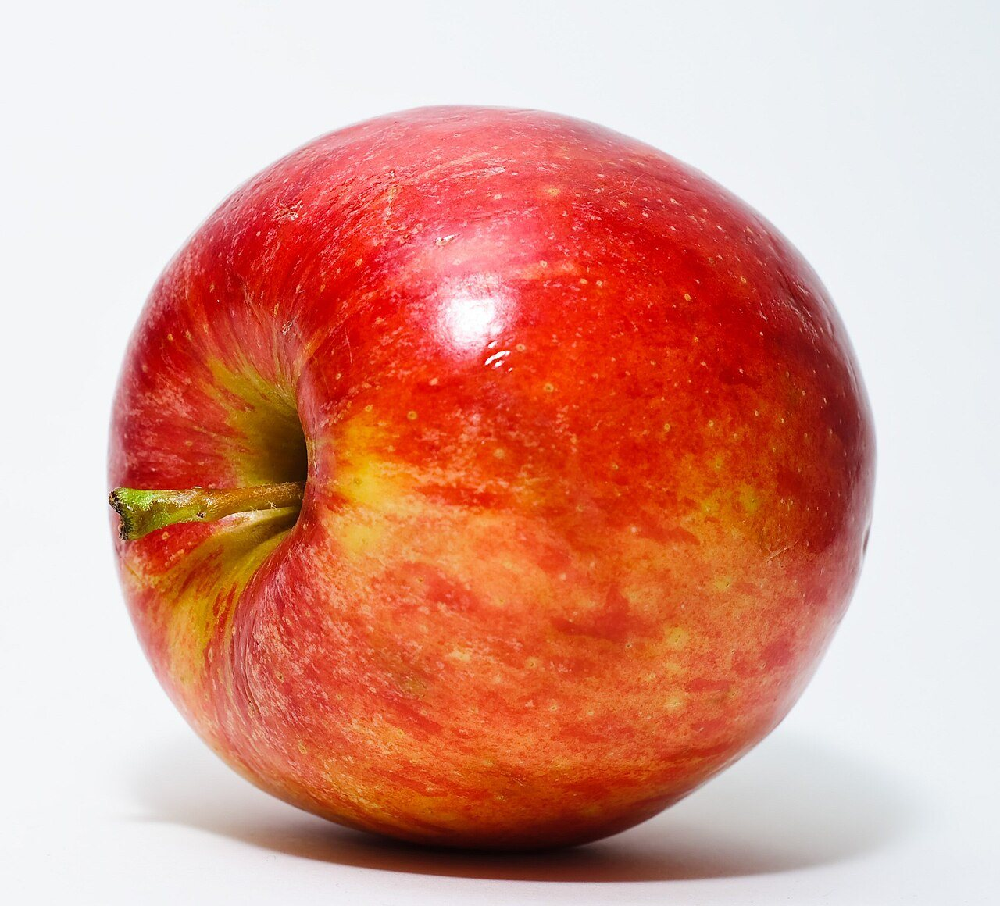

# Apple

The apple (Malus domestica) is the fruit of a deciduous tree in the rose family. Dessert apples are bred for sweetness, crispness and juice; cider apples are bred for acidity, tannin and aroma, which are almost opposite goals. Apple juice becomes [cider](ref:cider) through [fermentation](ref:fermentation), and cider can be [distilled](ref:distillation) into apple brandy; in Normandy, France, that route is fixed by the origin rules of [Calvados](ref:brandy).

Figure: A dessert red apple. Cider apples are usually smaller, more acidic or more astringent, bred for a different purpose. Image: Abhijit Tembhekar, CC BY 2.0, via [source page](https://commons.wikimedia.org/wiki/File:Red_Apple.jpg).

## Rose-family fruit and composition

The edible part is about 85% of the fruit, with roughly 85% water. Sugar is mainly fructose, glucose and sucrose at 10–14 g/100 g. Malic acid dominates the organic acids, with smaller amounts of citric and quinic acid. The skin and the tissue around the core are rich in polyphenols, including procyanidins, chlorogenic acid, phloridzin and anthocyanins; these form the [tannin](ref:tannin) skeleton that shapes bitterness, colour and ageing capacity.

## Malic acid, sugar and tannin

Malic acid supplies the refreshing bite of cider and is the substrate for malolactic fermentation. After the alcoholic ferment, lactic acid bacteria convert malic acid to lactic acid, lowering acidity and rounding the palate, a common step in ciders described as malolactic. Tannin comes mainly from skin and seeds: low-molecular-weight fractions give astringency, while larger polymers help fining and settling.

Sugar, acid and tannin must balance. High sugar with low acid tastes cloying, high acid with low sugar tastes sharp, and too much tannin turns bitter. Cidermakers blend juices from different varieties to reach the target.

## Cider fermentation

Apple juice usually sits at 10–14°Brix and ferments to about 5–8% ABV. Yeast may be a commercial wine or cider strain, or the wild yeast on the fruit skin in a spontaneous ferment. Cool fermentation at 12–18°C preserves fruit aroma; warm fermentation is faster but loses delicacy.

Before [fermentation](ref:fermentation), juice is often treated with pectinase and clarified to limit pectin haze; for a cloudy style, settling is shortened. Low-nitrogen juice needs yeast-assimilable nitrogen, or hydrogen sulphide may appear.

## Cider apple classes and regions

The National Association of Cider Makers classifies cider apples by acidity and tannin into four groups: sweet (acid below 0.45%, tannin below 0.2%), sharp (acid above 0.45%, low tannin), bittersweet (low acid, tannin above 0.2%) and bittersharp (high acid and high tannin). The figures are percentages by volume, and the scheme is basic vocabulary for blending.

Normandy and Brittany in France, Somerset and Herefordshire in England, the Basque Country in Spain, and Virginia and Washington State in the United States are important regions. Climate affects ripeness and acidity; cool regions generally give higher acid.

## Distillation and Calvados

Distilling cider in a pot still gives apple brandy, normally with two runs and a cut that keeps the middle. Calvados in Normandy is bound by AOC rules: local apples, with a little pear permitted, are fermented into cider, distilled and aged in oak. French appellation rules set the raw-material share, distillation method and minimum ageing.

Distillation magnifies the faults of cider. Ethyl acetate smells of fruit at low concentration and of nail polish remover at high concentration, so cider for distillation should be clean and moderately acidic.

## Blending and substitutes

Dessert apples can make cider, but their low acid and tannin usually need support from sharp or bittersweet juice. Pear can replace part of the apple to make perry, and a small pear share is allowed in Calvados. Commercial apple concentrate raises sugar but loses aroma and tannin; it suits a neutral base rather than a premium product.

Ripeness sets the sugar-to-acid ratio. Fruit picked too early is high in acid with immature aroma precursors, while overripe fruit is sugary, low in pectin and prone to browning. Cideries often press early sharp apples and late bittersweet apples separately, then blend for stable acidity and tannin. If juice sits in air, polyphenol oxidase darkens colour and dulls aroma, so ascorbic acid or inert gas is used. Pomace can be composted or used for pectin extraction, but in the cidery the priority is rapid handling, because wild yeast and acetic acid bacteria in the pomace can contaminate the next juice lot.

## Sensory impact

Cider aroma runs from green apple, pear and citrus to honey, cinnamon and baked apple. Acidity sets freshness, tannin sets structure and ageing potential, and residual sugar sets sweetness. Bittersweet apples give grip and bitterness that suit food, while sweet apples make easy young drinking. Calvados develops vanilla, caramel and dried-apple notes in oak.

## Common misconceptions

First, any apple makes good cider. Dessert fruit is low in acid and tannin and needs blending. Second, the sweeter the cider the better. Sweetness is only one style variable; acid and tannin matter equally. Third, Calvados is just apple brandy. It is a specific origin-protected category, and not every apple distillate may use the name. Fourth, cider is always gluten-free. Apples are gluten-free, but equipment and additives can cause cross-contact.

## See also

- [Cider](ref:cider): the main destination for apples.
- [Brandy](ref:brandy): Calvados and apple distillates.
- [France](ref:france): Normandy and Brittany.
- [Fermentation](ref:fermentation): malolactic conversion and yeast.
- [Distillation](ref:distillation): pot stills and spirit cuts.
- [Tannin](ref:tannin): structure and ageing in cider.

Begin with the form and provenance, move on to the preparation, and finish with how it behaves in the drink. That order keeps the reading of Apple practical.

**Short definition:** The apple is the fruit of Malus domestica in the rose family, and the combination of sugar, acid and tannin defines cider style; cider apples are grouped as sweet, sharp, bittersweet and bittersharp by acidity and tannin, and the fruit can also be distilled into apple brandy and Calvados. 

A common mistake is to treat Apple as a finished drink. Start with what it is, then check what the label says. If they conflict, trust the more specific source.

Cider apples are classified as sweet, sharp, bittersweet and bittersharp by acidity and tannin.

**Key facts.**

| Item | Detail |
| --- | --- |
| In one line | The apple is the fruit of Malus domestica in the rose family, and the combination of sugar, acid and tannin defines cider style; cider apples are grouped as sweet, sharp, bittersweet and bittersharp by acidity and tannin… |
| Material | The apple is the fruit of Malus domestica in the rose family, and the combination of sugar, acid and tannin defines cider style |
| Use | cider apples are grouped as sweet, sharp, bittersweet and bittersharp by acidity and tannin, and the fruit can also be distilled into apple brandy and Calvados. |

**Sources and limits.** The key claims about Apple are checked against the following sources: Oxford University Press (Used for entries on cider, apple brandy and Calvados), National Association of Cider Makers (NACM) (Used to check the classification of cider apples by acidity and tannin), Institut national de l'origine et de la qualité (INAO) (Used to check the appellation framework for Calvados) and 4 sources in total. Prices, batches and status change; the body is project-written and does not reproduce source text.
