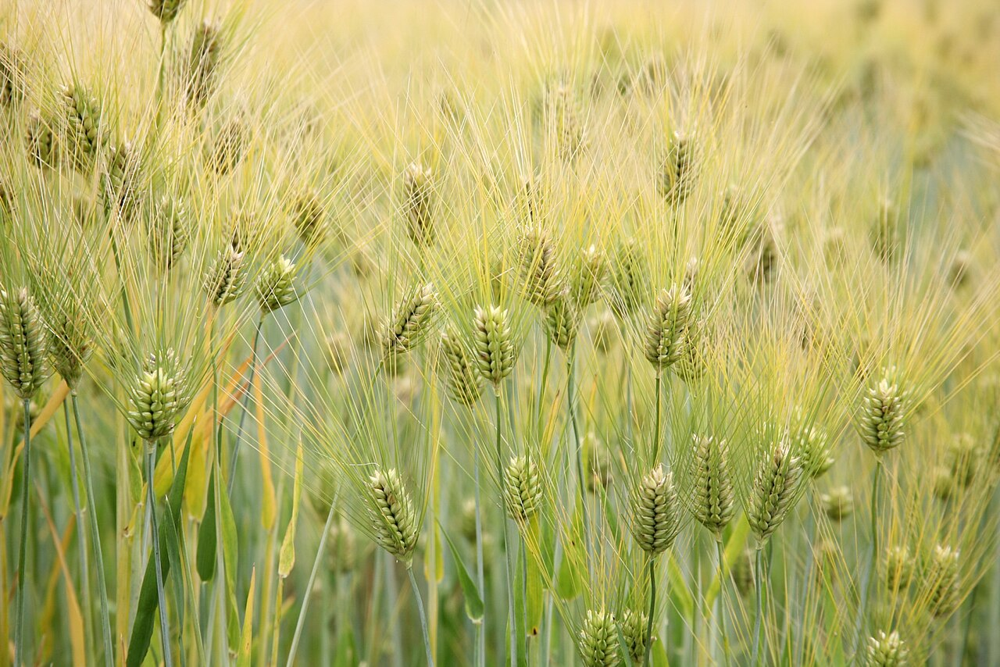

# Barley

Barley is an annual cereal of the genus Hordeum in the grass family, with the cultivated species usually written Hordeum vulgare. It tolerates cold and adapts widely, serving as food and feed as well as the base material for beer and whisky. Its most important processed form is malt: after the grain germinates, starch enzymes are produced that break starch into fermentable sugar, and this step determines the saccharifying capacity of beer and whisky.

Figure: Barley. Image: Cliff from Arlington, Virginia, USA, CC BY 2.0, via Wikimedia Commons ([source page](https://commons.wikimedia.org/wiki/File:Barley_(Hordeum_vulgare)_-_United_States_National_Arboretum_-_24_May_2009.jpg)).

## Definition and forms

A barley kernel is enclosed in husks; by whether the husk adheres, barley can be divided into covered and naked types. Brewing and malting usually use covered barley, because the husk protects the germ during germination and drying and forms a natural filter bed during lautering. By the arrangement of kernels on the spike, barley can be two-row or six-row: two-row barley has larger kernels and lower protein and is often used for malting, while six-row barley yields more but may differ in kernel uniformity and protein proportion.

Barley starch contains both amylose and amylopectin, and its protein content is moderate. During malting, the grain absorbs water and germinates, activating the enzyme system; drying and kilning stop germination and fix flavour. The colour and kilning degree of malt change the colour, aroma and fermentability of beer.

## Main producing regions

Barley is grown in temperate and high-altitude regions, with Russia, France, Germany, Canada, Australia and China among important producers. Two-row barley is widely used in European and North American malting, while six-row barley is also grown in some regions. Climate affects grain protein, starch and germination rate, and therefore malt quality.

Malting is a separate processing step. The same lot of barley can yield different enzyme activity, moisture and kilned flavour under different malting conditions. Breweries and distilleries usually choose malt types according to product needs rather than looking only at barley origin.

## Role in beer

[Beer](ref:beer) is made mainly from malt. After barley germinates, starch enzymes are produced, and during [saccharification](ref:saccharification) they break starch into maltose and dextrins that yeast can use. Malt also brings colour, aroma and body, and different kilning levels create clear style differences.

Not every beer uses only barley malt. Wheat malt, oats, maize and rice can adjust body, foam and cost, but barley malt remains the saccharification base of most beers. Malt proportion, saccharification temperature and yeast type together determine sweetness, alcohol content and flavour.

## Role in whisky

In [whisky](ref:whisky), Scotch malt whisky is required to be made from malted barley, then saccharified, fermented, distilled and aged in oak casks. Barley malt supplies fermentable sugar and flavour precursors, and peat-kilned malt adds smoky phenolic compounds. Malt treatment, distillation equipment and cask ageing in different regions create stylistic differences.

Grain whisky may use maize, wheat or other cereals, with malted barley often serving as the enzyme source for saccharification. Barley's place in whisky is not "the only raw material" but the basis of saccharifying capacity and flavour. Applying the raw material rules of malt whisky to all whisky ignores the process differences of grain whisky.

## Role in baijiu daqu

In [baijiu](ref:baijiu), daqu is not based mainly on germinated barley, but barley is often one of the qu-making raw materials. During [qu making](ref:qu-making), barley is paired with wheat and peas to supply starch, protein and nutrients for microbial growth. The microbial community and culture temperature of daqu determine saccharifying power, fermenting power and flavour.

The barley proportion in daqu varies by aroma style, region and distillery. Unlike in beer, it does not supply enzymes in malted form but participates in open culture as a qu block material. Understanding this prevents confusing beer malting with baijiu qu making.

| Drink | Form of barley | Key processes |
| --- | --- | --- |
| Beer | Barley malt | Malting, saccharification, lautering, boiling, fermentation |
| Malt whisky | Malted barley | Malting, saccharification, fermentation, distillation, cask ageing |
| Baijiu | Barley as a qu-making raw material | Qu making, solid-state fermentation, distillation |

## Protein, enzymes and process fit

Barley protein content affects malt quality. Too much protein leads to uneven modification, viscous mash and difficult lautering; too little leaves yeast undernourished and reduces foam stability. Malting controls enzyme activity and modification through steeping, germination and drying, while breweries adjust through saccharification temperature and rests.

The barley enzyme system is central to saccharification. Amylases, proteases and beta-glucanases work together to break starch and protein into forms yeast can use. Too little enzyme activity means poor saccharification and a thin body; too much can over-degrade and affect foam and mouthfeel.

## Buying and storage

When buying barley, look at kernel plumpness, germination rate, protein, moisture and impurities. Malting barley needs a high germination rate, uniform kernels and few mouldy grains. Malt should be checked for colour, aroma, moisture and storage conditions, since damp malt loses enzyme activity.

Store in a dry, ventilated, dark place away from moisture, pests and mould. Home brewers buying malt should choose intact packaging and a recent production date, and use it soon after crushing to limit enzyme decline.

## Common misconceptions

First, that barley is only feed. It is a core raw material for beer and whisky.

Second, that barley and wheat can be swapped freely. Protein, enzymes and malting behaviour differ.

Third, that all whisky uses malted barley. Grain whisky uses other cereals.

Fourth, that darker malt is always better. Kilning level serves style, not a quality grade.

Fifth, that baijiu daqu is malt. Qu making and malting are different processes.

For Barley, begin with the form and provenance. Then look at the preparation, and finally ask how it behaves in the drink. The answers point to different choices, not to a single score.

**At a glance:** An annual cereal of the genus Hordeum; after malting it becomes the base material for beer and whisky, and in baijiu daqu it is often paired with wheat and peas.

**Key facts.**

| Item | Detail |
| --- | --- |
| In one line | An annual cereal of the genus Hordeum; after malting it becomes the base material for beer and whisky, and in baijiu daqu it is often paired with wheat and peas. |
| Material | An annual cereal of the genus Hordeum |
| Use | after malting it becomes the base material for beer and whisky, and in baijiu daqu it is often paired with wheat and peas. |

**Sources and limits.** The key claims about Barley are checked against the following sources: Industry body (Used to check terms for baijiu qu making and raw materials; Used to check the classification of alcoholic drinks and the terminology framework for raw materials), Scotch Whisky Association (SWA) (Used to check the legal framework under which Scotch whisky is made from malted barley), FAO (the entry's background, terminology and regulatory context). Prices, batches and status change; the body is project-written and does not reproduce source text.

## Further reading

- [Beer](ref:beer): the basic framework of malt, saccharification and fermentation.
- [Whisky](ref:whisky): the raw material and process route of malt whisky.
- [Baijiu](ref:baijiu): where barley sits in qu making.
- [Qu making](ref:qu-making): daqu raw materials and the culture process.
- [Saccharification](ref:saccharification): how malt enzymes turn starch into sugar.
