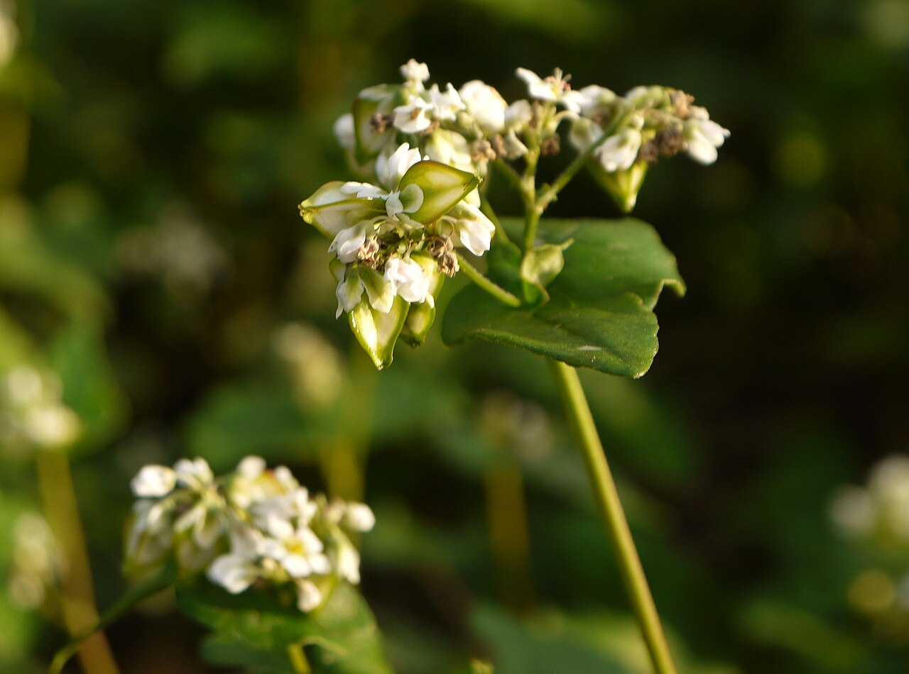

# Buckwheat

Buckwheat (Fagopyrum esculentum) belongs to the Polygonaceae family. Its seed is a triangular achene rather than a true cereal grain, which is why it is classed as a pseudocereal. It contains no gluten of the kind found in wheat or barley, yet it brings starch, protein and flavonoids such as rutin into a fermentation. World production is small next to wheat, but in [beer](ref:beer), Japanese [soba shochu](ref:shochu) and some regional [baijiu](ref:baijiu) it supplies nutty, honeyed and earthy notes that are hard to obtain elsewhere.

Figure: Buckwheat. Image: STRONGlk7, CC BY-SA 3.0, via Wikimedia Commons ([source page](https://commons.wikimedia.org/wiki/File:Japanese_Buckwheat_Flower.JPG)).

## Botany and grain composition

Buckwheat is an annual herb with upright, often reddish stems, white or pale pink flowers and a hard triangular seed coat. Cultivated types divide into common buckwheat and tartary buckwheat. Common buckwheat has larger flowers and seeds with milder bitterness; tartary buckwheat (F. tartaricum) has small seeds and a much higher rutin content, which is why it is used in functional foods. The crop prefers cool conditions and a short season, allowing it to grow at altitude or between other crops.

USDA FoodData Central lists about 71.5 g carbohydrate, 13.2 g protein, 3.4 g fat and 10 g dietary fibre per 100 g of raw buckwheat groats. Amylopectin dominates the starch, which gelatinises at roughly 68–76°C. The protein is mainly albumin and globulin with little prolamins, explaining why buckwheat cannot form a gluten network.

## Malting, saccharification and fermentation

Buckwheat can be steamed directly or malted. Malting requires gentle steeping, germination and drying; over-long germination oxidises lipids and produces stale notes. Buckwheat malt has lower amylase activity than barley malt, so it cannot convert its own starch completely. Brewers usually add a portion of barley malt or exogenous enzymes and hold [saccharification](ref:saccharification) at 62–65°C to balance fermentable sugar and dextrin.

During [fermentation](ref:fermentation), the relatively rich free amino acid pool encourages higher alcohol formation. A warm ferment buries the delicate floral note under solvent-like aromas. Because buckwheat lacks gluten, the mash has no husk-built filter bed, so breweries extend settling or use filtration aids.

## Origins and varieties

Buckwheat originated in Asia. China, Russia, Ukraine, France, Japan and the United States are important growers. Northern and southwestern China keep many landraces; Brittany in France is known for buckwheat galettes; Nagano and Hokkaido in Japan support both soba culture and the raw material for soba shochu. Tartary buckwheat is more common in the highlands of Sichuan, Yunnan and Guizhou.

## Substitutes among gluten-free grains

In gluten-free beer, buckwheat is often grouped with sorghum, millet and quinoa. Sorghum gives a more neutral grain backbone, millet adds soft sweetness, and buckwheat is the most aromatic and darkest of the three, and is usually kept below 10% of the grist because too high a share dries out the body. When the aim is a wheat-beer-like fullness, oats or a little rice syrup are better tools than simply raising the buckwheat proportion.

## Aroma and palate

Buckwheat aroma changes markedly between raw grain, malt and finished ferment. Raw groats smell grassy and nutty; roasting or kilning brings caramel, coffee and toast; after fermentation the usual descriptors are honey, nuts, earth and a light grain astringency. Rutin in tartary buckwheat leaves a lingering bitterness that can add layers at low levels and taste medicinal when excessive.

## Regulation and quality control

A gluten-free claim is not automatic just because the raw material is gluten-free. The US Food and Drug Administration sets a threshold below 20 ppm gluten for foods labelled gluten-free, and EU rules use the same 20 mg/kg limit. Buckwheat itself contains no gluten, but shared milling, conveying and fermentation equipment can cause cross-contact, so segregated cleaning and testing are needed. Chinese buckwheat products must also meet grain hygiene limits for moisture, impurities and mycotoxins.

Oat-like in its fat profile, buckwheat is rich in unsaturated fatty acids. Whole groats keep well when cool, dry and dark, but milling or crushing speeds oxidation and stale notes. Distilleries normally dry buckwheat malt below 5% moisture and test enzyme activity, mycotoxins and foreign matter before use, because poor germination or mould lowers both sugar yield and flavour quality. Compared with wheat, buckwheat moves in smaller lots and varies more between batches, so consistency depends on intake testing rather than on the reputation of an origin. Some Japanese shochu makers buy koji-grade and mash-grade buckwheat separately, the former for even grain and low contamination, the latter for aroma. Served cold, the nutty note is clearer; as the spirit warms, alcohol and bitterness move forward.

## Common misconceptions

First, buckwheat is a cereal. It is a Polygonaceae pseudocereal. Second, buckwheat beer is always gluten-free. A gluten-free raw material does not guarantee a finished product that passes testing. Third, soba shochu is vodka. It relies on koji saccharification and single distillation, so its aroma has a different origin. Fourth, the more bitter the tartary buckwheat the better. Bitterness comes from rutin and related flavonoids, and suitability depends on the target style and the blend.

## See also

- [Beer](ref:beer): gluten-free brewing and buckwheat malt.
- [Soba shochu](ref:shochu): the Japanese single-distillation route.
- [Japan](ref:japan): shochu regions and drinking culture.
- [Baijiu](ref:baijiu): buckwheat as a regional adjunct.
- [Fermentation](ref:fermentation): temperature, yeast and higher alcohols.
- [Saccharification](ref:saccharification): remedies for low enzyme activity.

**At a glance:** Buckwheat is a pseudocereal in the Polygonaceae family and contains no gluten; it is used in buckwheat beer, soba shochu and some regional baijiu, bringing earthy, honeyed and grainy notes, while its protein and starch require separate adjustments in saccharification and fermentation. 

Start with the form and provenance. From there, consider the preparation, then how it behaves in the drink. That is how a practical judgment about Buckwheat is built.

[Beer](ref:beer) and [Japan](ref:japan) answer different questions about Buckwheat: plant or material identity and origin. Read them as a pair, not as alternatives.

A finished drink is not a safe shorthand for Buckwheat. Check what it is, then what the label claims; where they diverge, prefer the specific source.

Buckwheat is gluten-free and needs careful saccharification because its starch gelatinises differently.

**Key facts.**

| Item | Detail |
| --- | --- |
| In one line | Buckwheat is a pseudocereal in the Polygonaceae family and contains no gluten; it is used in buckwheat beer, soba shochu and some regional baijiu, bringing earthy, honeyed and grainy notes, while its protein and starch r… |
| Material | Buckwheat is a pseudocereal in the Polygonaceae family and contains no gluten |
| Use | it is used in buckwheat beer, soba shochu and some regional baijiu, bringing earthy, honeyed and grainy notes, while its protein and starch require separate adjustments in saccharification and fermentation. |

**Sources and limits.** The key claims about Buckwheat are checked against the following sources: Oxford University Press (Used for entries on buckwheat malt and gluten-free beer; Used for entries on soba shochu and buckwheat spirits), Food and Agriculture Organization of the United Nations (FAO) (Used to check the broad picture of buckwheat cultivation and use), U.S. Department of Agriculture (Used to check carbohydrate, protein, fat and fibre values for buckwheat groats) and 7 sources in total. Prices, batches and status change; the body is project-written and does not reproduce source text.
