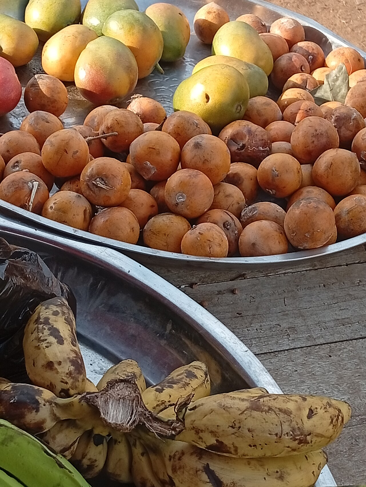

# Cherry

Cherry is a Prunus fruit, with sweet and sour types; sour cherry (Prunus cerasus) is high in acid and aroma and central to Black Forest cake, kirsch and cherry brandy.

Figure: Cherry: Cherry 18th march 2025 (Wikimedia Commons). Image: Natashadonoh, CC0, via Wikimedia Commons ([source page](https://commons.wikimedia.org/wiki/File:Cherry_18th_march_2025.jpg)).

## Definition and naming

Cherry is a stone fruit in the genus Prunus. Cultivated types are mainly sweet cherry (Prunus avium) and sour cherry (Prunus cerasus). Sweet cherries are large, sugary and relatively low in acid, good for fresh eating; sour cherries are smaller, sharper and more aromatic, better for cooking, fermentation and distillation. Ornamental flowering cherries and fruit cherries are not the same thing, even though both carry the name.

“Cherry flavour” is a food-industry compound, not a one-to-one copy of the fruit. Real cherry aroma comes from flesh, pit and fermentation by-products: sweet cherries lean floral and fruity, sour cherries lean tart and almond-like. Read a label for cherry juice, cherry flavouring and cherry pomace as separate materials.

## Origin and spread

Sweet cherry cultivation is usually traced to Europe, western Asia and Anatolia; sour cherry is closer to wild populations of Europe and western Asia. Cherries were cultivated in Roman times and later spread through migration, trade and horticultural selection to temperate zones in Europe, North America, Chile and Australia.

Kirsch is a clear cherry brandy made by fermenting and distilling cherry juice or pomace; the Black Forest in Germany, Alsace in France and Switzerland are core regions. Belgium is known for kriek, a sour-cherry beer that undergoes a second fermentation with wheat beer; there the cherry supplies flavour and acidity, not wine grapes.

## Botany and cultivation

A cherry is a drupe: fleshy fruit around a hard stone, with the seed inside. Most sweet cherry cultivars are self-incompatible and need cross-pollination; some sour cherries self-pollinate. Growers manage chilling requirement, spring frost, soil drainage and rootstock compatibility, because rootstock affects vigour, precocity and orchard life.

Pruning, branch training, thinning and harvest date decide fruit quality. Cherries crack easily when rain arrives near ripening, and fresh fruit softens quickly after harvest, so the chain needs cooling. Sour cherries for processing can be picked slightly later, but overripe fruit loses aroma and flesh colour.

## Style and palate

Kirsch is usually clear, with cherry, almond and floral notes and a dry, sharp finish; traditional versions may include pits, which add a faint bitter-almond note. Cherry liqueur is sweetened with sugar or syrup, rounder and lower in alcohol than most brandies. “Cherry brandy” is a loose term that may mean kirsch or a compounded cherry spirit, so read the raw material and process.

Cherries also go into chocolate, preserves, Black Forest cake and cherry beer. Sour cherry acidity balances malt sweetness, while skin and pit add colour and tannin. Sweet cherries suit fresh eating, candying and liqueur; their aroma is easily lost at high fermentation temperatures.

## Main regions and representative products

The Black Forest in Germany, Alsace in France, Switzerland, Italy and Turkey are important sweet-cherry and kirsch regions; Black Forest kirsch often appears with cherry cake and chocolate. Belgian kriek uses sour cherries and wheat beer, with lambic and Flanders interpretations differing. Sweet cherries from the United States, Chile and Australia mostly enter the fresh market.

“Cherry wine” can mean fermented cherry wine, infused liqueur or distilled brandy in different languages. When a label says cherry wine, kirsch, cherry brandy or cherry liqueur, identify whether it is fermented, infused or distilled before translating the name.

## How to drink and pair

Kirsch is served at room temperature in a small tulip or brandy glass, sipped in modest amounts; its aroma is concentrated and does not need ice. Cherry liqueur can be chilled or topped with soda and suits desserts and chocolate. Kriek is served cold; its acidity and bubbles cut fat and work with grilled meat, cheese and fruit tarts.

Cherries pair naturally with almond, chocolate, pork, duck and soft cheese; sour-cherry acidity balances cream and sugar. Drinkers sensitive to alcohol should note that kirsch is usually strong, while liqueur sweetness can encourage faster drinking.

## Buying and common misreadings

First, treating kirsch and cherry liqueur as the same product: the first is usually distilled, the second sweetened. Second, treating a “cherry-flavoured” drink as cherry wine. Third, assuming deeper red means more natural; kirsch is usually colourless, and colour may come from infusion or additives. Fourth, ignoring pits and added sugar. Check ingredients, alcohol content and producer.

Cherry is not a grape, so clone, rootstock, old-vine and grape-tannin language do not apply. Its real variables are sweet versus sour type, ripeness, pit handling, fermentation or infusion, and whether the product is distilled.

Cherry choice also follows use: fresh markets value size, firmness, sugar-acid balance and colour, while processing values acid, aroma, the ratio of fruit to pit and juice yield. A “cherry-flavoured” label says nothing about juice, pomace or distillation, and sugar, base spirit and steeping time change the final drink.

## Further reading and see also

- Related: [brandy](ref:brandy), [liqueur](ref:liqueur), [distillation](ref:distillation), [terroir](ref:terroir), [france](ref:france).
- This ingredient offers no plant identification, prices or shopping channels; a label name is not a botanical identification.

Start with the form and provenance. From there, consider the preparation, then how it behaves in the drink. That is how a practical judgment about Cherry is built.

Start with [Brandy](ref:brandy) for plant or material identity, then read [Distillation](ref:distillation) for origin. Seeing both keeps Cherry from being confused with a neighbouring idea.

**Short definition:** Cherry is a Prunus fruit, with sweet and sour types; sour cherry (Prunus cerasus) is high in acid and aroma and central to Black Forest cake, kirsch and cherry brandy.

Cherry flavours in drinks come from fruit, kernels or oak; maraschino is a cherry liqueur, while kirsch is a clear cherry brandy. Cherry juice and syrup are common in cocktails, but the fruit's acidity and sugar vary by variety. A label that says cherry should be checked for whether it means fruit, flavour or liqueur.

**Key facts.**

| Item | Detail |
| --- | --- |
| In one line | Cherry is a Prunus fruit, with sweet and sour types; sour cherry (Prunus cerasus) is high in acid and aroma and central to Black Forest cake, kirsch and cherry brandy. |
| Material | Cherry is a Prunus fruit, with sweet and sour types |
| Use | sour cherry (Prunus cerasus) is high in acid and aroma and central to Black Forest cake, kirsch and cherry brandy. |

**Sources and limits.** The key claims about Cherry are checked against the following sources: FAO (crop, production-region and processing background), USDA (agricultural, botanical and nutritional material), CGIAR (crop germplasm and agricultural research frameworks) and 4 sources in total. Prices, batches and status change; the body is project-written and does not reproduce source text.

For Cherry, this ingredient was last checked in 2026; prices, batches and availability change, so confirm them against the sources below.
