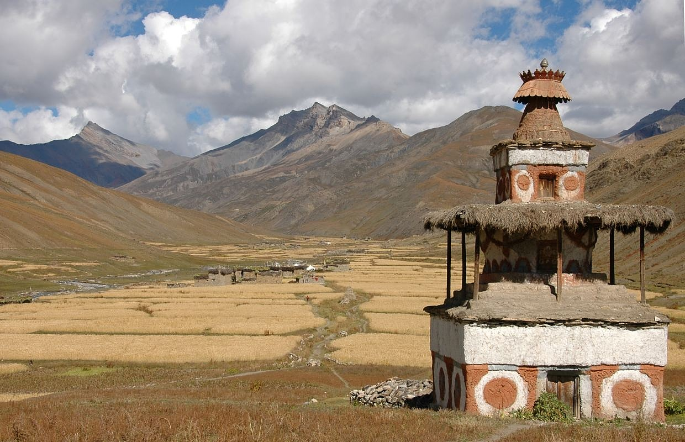

# Highland Barley

Naked barley of the Tibetan Plateau, cold- and drought-tolerant and early-ripening, the base of tsampa, barley wine and everyday diet in Tibetan areas; high fibre, beta-glucan and a low glycaemic profile have made it a health grain in recent years.

Figure: Highland Barley: Chorten and barley fields (Wikimedia Commons). Image: Carsten.nebel, Public domain, via Wikimedia Commons ([source page](https://commons.wikimedia.org/wiki/File:Chorten_and_barley_fields.jpg)).

## Definition and naming

Highland barley is the Tibetan name for naked barley in the grass family. Unlike hulled barley, its husk falls off easily during threshing and the grain is exposed, hence “naked barley”. It is not a separate species but a group of landraces and ecotypes shaped by the plateau environment and farmer selection.

In Chinese, qingke can mean the crop, the grain or the flour; Tibetan terms, local dialects and product names do not always map one-to-one. Read whether a product is whole grain, tsampa flour, malt or barley wine, rather than relying on the word on the package.

## Origin and spread

Cultivated barley originated in the Fertile Crescent of western Asia. Naked barley underwent long selection on the Tibetan Plateau, producing cold-tolerant, drought-tolerant and early-ripening types. Valley altitude, strong radiation, day-night temperature swings and a short growing season together shape the crop’s cycle and grain quality.

Highland barley is central to tsampa in Tibetan daily food and is also used for barley wine, beer and health foods. Household “chang” is usually made by cooking barley, adding a starter and fermenting, then drinking the fermented mash or distilling it; practices differ by household, monastery and festival.

## Botany and cultivation

Highland barley is an annual cereal in the grass family. Its starch is largely amylopectin, and the grain contains beta-glucan and dietary fibre. Plateau cultivation is mostly spring-sown with a short season, so the crop must mature before frost; varieties are chosen for earliness, lodging resistance, cold tolerance and disease resistance.

Land preparation, sowing density, fertiliser and irrigation are the practical levers. The root system is shallow, and drought or wind erosion can hurt emergence; too much nitrogen invites lodging and late maturity, too little gives small, light ears. Harvest must be dried quickly to prevent sprouting and mould.

## Style and palate

Highland barley drinks divide into fermented and distilled types. Fermented mash is usually tart, grainy and milky with low alcohol; distilled barley spirit is closer to baijiu, clean and grain-sweet. Highland barley malt can also be used in beer, adding nutty, cereal and lightly sweet notes.

Tsampa is roasted barley flour rubbed with butter tea, cheese or sugar, giving toasted grain, butter and dairy flavours. Highland barley is not a grape, so skins, tannin and maceration language do not apply; its flavour comes from roasting, steaming, malting and fermentation.

## Main regions and representative products

Highland barley is grown mainly in Tibet, Qinghai, Ganzi in Sichuan and Diqing in Yunnan; altitude and valley differences create diverse varieties and practices. Tibetan barley wine, Qinghai distilled spirits and local pot stills in Ganzi and Diqing each have traditions; craft barley beer and barley baijiu have appeared in recent years.

“Barley wine” can mean a fermented drink, a distilled spirit or a compounded product. Check raw materials, alcohol, sugar and producer; for barley beer, distinguish the share of barley malt from other cereals.

## How to drink and pair

Fermented barley wine is served at room temperature or slightly warm with tsampa, butter tea, yak meat and dairy. Distilled barley spirit follows baijiu etiquette: small cups, slow sips, no ice. Barley beer is chilled, where grain sweetness balances malt bitterness and suits grilled meat, noodles and hotpot.

Highland barley’s cereal sweetness works with dairy, butter, nuts and root vegetables; fermented acidity cuts fat, while distilled strength stands up to rich meat. Drinkers sensitive to alcohol should note the difference between fermented and distilled products.

## Buying and common misreadings

First, treating highland barley as ordinary barley or oats: it is naked barley, with exposed grain after threshing. Second, treating all “barley wine” as one drink: fermented, distilled and compounded types differ. Third, treating the barley share in beer as the whole recipe. Fourth, ignoring the grind and roast level of tsampa, which change texture directly.

Highland barley is not a grape and has no clone, rootstock or old-vine framework. Judge a product by variety, origin, whether it was malted, fermented or distilled, and the raw materials and alcohol on the label.

Processing shapes flavour more than the variety name. Roasting gives tsampa its toasted cereal note, steaming keeps more sweetness, and malting builds sugar and enzyme activity; fermentation and distillation then rearrange acids, sweetness and aroma. Household barley wine varies widely, and hygiene, starter and temperature decide success. For commercial products, read raw materials, alcohol and production licensing rather than treating “traditional” as a quality guarantee. Highland barley’s beta-glucan and fibre also make it a health food, but a health grain is not a licence for unlimited eating.

## Further reading and see also

- Related: [baijiu](ref:baijiu), [barley](ref:barley), [rice](ref:rice), [fermentation](ref:fermentation), [terroir](ref:terroir).
- This page offers no plant identification, prices or shopping channels; a label name is not a botanical identification.

**In brief:** Naked barley of the Tibetan Plateau, cold- and drought-tolerant and early-ripening, the base of tsampa, barley wine and everyday diet in Tibetan areas; high fibre, beta-glucan and a low glycaemic profile have made it a health grain in recent years. 

For Highland Barley, begin with the form and provenance. Then look at the preparation, and finally ask how it behaves in the drink. The answers point to different choices, not to a single score.

Do not reduce Highland Barley to a finished drink. 

Sources for Highland Barley include FAO, USDA, CGIAR, Royal Botanic Gardens, Kew.

Highland barley is roasted into tsampa and fermented into barley wine; its beta-glucan and high fibre make it a health grain, but its starch needs malting or enzymatic breakdown for brewing.

In Tibet, highland barley is also milled into flour for tsampa, a staple roasted barley meal.

**Key facts.**

| Item | Detail |
| --- | --- |
| In one line | Naked barley of the Tibetan Plateau, cold- and drought-tolerant and early-ripening, the base of tsampa, barley wine and everyday diet in Tibetan areas; high fibre, beta-glucan and a low glycaemic profile have made it a h… |
| Material | Naked barley of the Tibetan Plateau, cold- and drought-tolerant and early-ripening, the base of tsampa, barley wine and everyday diet in Tibetan areas |
| Use | high fibre, beta-glucan and a low glycaemic profile have made it a health grain in recent years. |

**Sources and limits.** The key claims about Highland Barley are checked against the following sources: FAO (crop, production-region and processing background), USDA (agricultural, botanical and nutritional material), CGIAR (crop germplasm and agricultural research frameworks) and 4 sources in total. Prices, batches and status change; the body is project-written and does not reproduce source text.

For Highland Barley, this page was last checked in 2026; prices, batches and availability change, so confirm them against the sources below.
