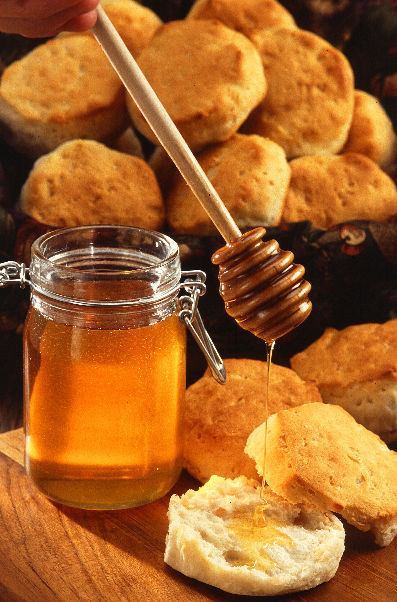

# Honey

Honey is the sweet substance bees make from nectar through their own enzymes and evaporation. Its sugars are mainly fructose and glucose, moisture is usually below 20%, and it carries small amounts of organic acids, enzymes, minerals and pollen. As the sole sugar source of [mead](ref:honey-wine), the difficulty is not sweetness but the sluggish fermentation caused by low nitrogen, high sugar and low pH together.

Figure: Honey. Image: Scott Bauer, USDA ARS, Public domain, via Wikimedia Commons ([source page](https://commons.wikimedia.org/wiki/File:Runny_hunny.jpg)).

## How bees make honey, and what it contains

A bee draws nectar into its honey stomach, mixes in invertase and partly hydrolyses sucrose to glucose and fructose. Back in the hive, repeated transfer and fanning evaporate water until the cells are capped. Ripe honey is about 70–80% sugar, with fructose and glucose together usually more than 85% of the soluble sugar. Moisture below 20% and water activity near 0.6 keep most microbes from growing.

Honey pH mostly falls between 3.4 and 6.1, averaging about 3.9, with gluconic, citric and malic acids. Hydrogen peroxide and glucose oxidase form a natural antimicrobial system that heat and light can weaken.

## High sugar, low nitrogen, low pH

Assimilable nitrogen in honey is very low. With only water and yeast, fermentation often stalls halfway and throws hydrogen sulphide and reductive notes. Producers add diammonium phosphate, amino acids and vitamins in stages, so the yeast does not settle out too early. Osmotic pressure also has to be managed by dilution; mead starting gravity is usually 1.090–1.120.

Low pH suppresses some yeast, but S. cerevisiae still works above pH 3.2. The real issue is weak buffering: as fermentation produces acid, pH falls quickly.

## Mead fermentation

The basic [mead](ref:honey-wine) process is honey diluted with water, yeast pitched and temperature controlled. Fermentation is usually held at 18–24°C; cool temperatures preserve floral notes, while warm ones speed the ferment at the cost of delicacy. The finished mead can keep residual sugar for a sweet style or ferment dry and receive a honey addition for aroma.

Honey aroma changes during fermentation. Acacia is light and becomes even thinner; dark buckwheat keeps caramel and grain notes; linden brings minty and woody tones. A second fermentation and ageing further change the result.

## Beer, liqueurs and spirits

In [beer](ref:beer), honey adds fermentable sugar, floral aroma and body, but too high a share dilutes malt character and lengthens fermentation. It is usually added late in the boil or before fermentation to keep aroma. [Liqueurs](ref:liqueur) use honey for sweetness and texture, often macerated with herbs and spices. Honey can also be fermented and distilled into a honey spirit, though raw-material and labelling rules differ by country.

## Nectar sources, regions and grades

China, Turkey, the United States, Argentina, Mexico and India are major producers. Nectar plants define the aroma and colour of monofloral honey: acacia, linden, vitex, lychee, buckwheat and manuka are common types. A monofloral label usually requires one source to dominate, with the proportion and test method varying by country.

EU Directive 2001/110/EC sets limits for moisture, sucrose and hydroxymethylfurfural and forbids adding sugar or any non-honey ingredient. Chinese honey standards also regulate moisture, fructose and glucose content, sucrose and antibiotic residues.

Honey crystallises in storage as glucose comes out first, and high-fructose honeys crystallise more slowly. Crystallisation is not spoilage; a warm water bath restores flow, but temperatures above 40°C damage enzymes and aroma, and above 60°C clearly raise hydroxymethylfurfural. Meaderies prefer honey that has not been heat-treated and pitch soon after dilution to limit wild yeast and osmotolerant microbes.

Fermentation speed also varies with nectar source. Dark honey carries more minerals and buffering compounds, so pH falls slowly; light honey has little buffering, acidity rises quickly, and yeast may settle early. Blending dark and light honey adjusts both aroma and the shape of the fermentation curve.

## Substitutes and recipe adjustment

Replacing honey with sucrose or glucose syrup gives a more stable, cheaper ferment but loses floral and mineral character. Maple syrup brings woody and caramel notes and a different fermentation speed. When honey is a large part of the recipe, nitrogen, pH and pitching rate must be adjusted accordingly; a simple one-for-one swap often stalls.

## Sensory impact

Honey aroma ranges from floral and citrus to mint, caramel, wood and herbs. After fermentation, light nectars lose perfume while dark ones keep more caramel and grain. Body depends on residual sugar and glycerol; low acidity tastes flat and is often corrected with a little citric or malic acid.

## Common misconceptions

First, honey never spoils, so hygiene does not matter. High sugar and low water activity suppress microbes, but osmotolerant yeast can still ferment it. Second, sweeter mead is more traditional. Dry mead has an equally long history. Third, honey can replace sugar one for one. The sugar is similar, but aroma, minerals and fermentation behaviour are not. Fourth, every honey suits the same fermentation temperature. Dark and light honeys differ in ideal temperature and nutrient plan.

Honey is a fermentable sugar, but it is also mostly water and contains natural acids and minerals that can affect yeast health. Honey wines ferment diluted honey, while beer and cocktail uses may add honey for flavour rather than as the main sugar source. Crystallisation is a normal sign of glucose and fructose balance. Heat can darken honey and drive off aroma, so it should not be treated as an inert sweetener.

## See also

- [Mead](ref:honey-wine): honey as the sole sugar source.
- [Liqueur](ref:liqueur): honey for sweetness and texture.
- [Beer](ref:beer): honey as a brewing adjunct.
- [Fermentation](ref:fermentation): nitrogen, pH and temperature.

**Short definition:** Honey is the sweet substance bees make from nectar, dominated by glucose and fructose; it is the sole sugar source of mead and can add aroma to beer, liqueurs and spirits, but low nitrogen, high sugar and low pH make fermentation hard to start. 

Start with the form and provenance. From there, consider the preparation, then how it behaves in the drink. That is how a practical judgment about Honey is built.

[Honey Wine](ref:honey-wine) and [Beer](ref:beer) are the nearest useful comparisons: one clarifies plant or material identity, the other tests origin.

**Key facts.**

| Item | Detail |
| --- | --- |
| In one line | Honey is the sweet substance bees make from nectar, dominated by glucose and fructose; it is the sole sugar source of mead and can add aroma to beer, liqueurs and spirits, but low nitrogen, high sugar and low pH make fer… |
| Material | Honey is the sweet substance bees make from nectar, dominated by glucose and fructose |
| Use | it is the sole sugar source of mead and can add aroma to beer, liqueurs and spirits, but low nitrogen, high sugar and low pH make fermentation hard to start. |

**Sources and limits.** The key claims about Honey are checked against the following sources: Oxford University Press (Used for entries on mead, honey fermentation and sweeteners), National Honey Board (Used to check the main sugars, moisture and monofloral classification of honey), European Union (Used to check moisture, sucrose and composition limits for honey) and 5 sources in total. Prices, batches and status change; the body is project-written and does not reproduce source text.
