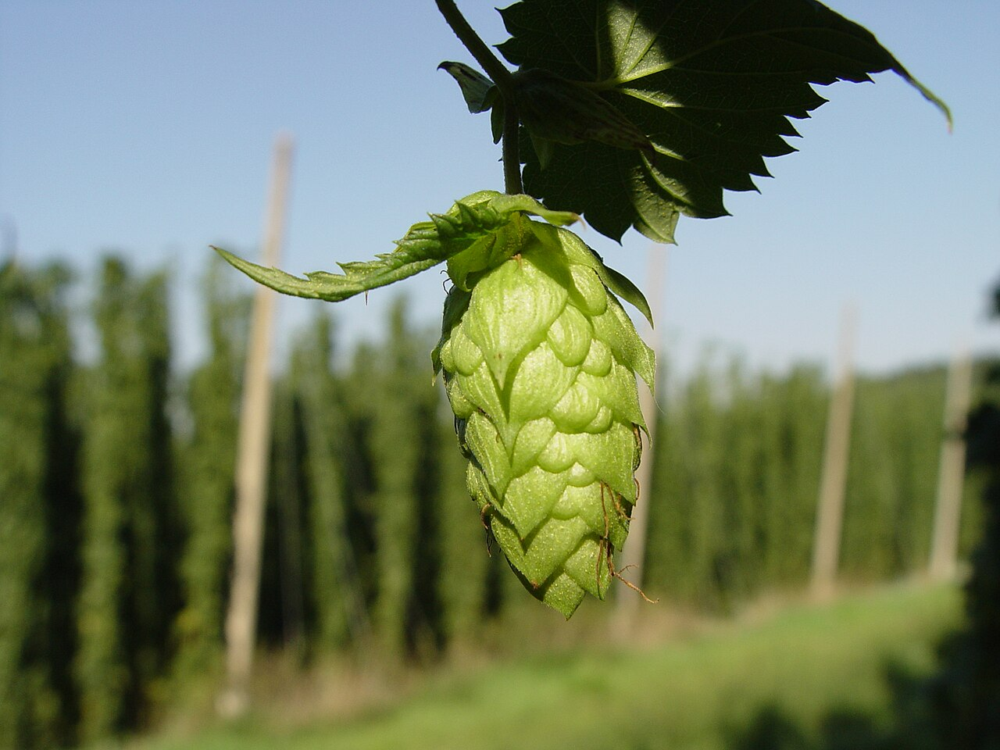

# Hops

Hops (Humulus lupulus) are a perennial climbing plant in the Cannabaceae family. Brewing uses the unpollinated female cones, which supply bitterness, aroma, antibacterial protection and foam stability. Bitterness does not come directly from alpha acids: it appears when alpha acids isomerise into iso-alpha acids during the boil. Aroma comes from essential oils, and the two want opposite timing.

Figure: Hops. Image: LuckyStarr, CC BY 2.5, via Wikimedia Commons ([source page](https://commons.wikimedia.org/wiki/File:Humulus_Lupulus_Hopfendolde-mit-hopfengarten.jpg)).

## The plant and its cones

The above-ground growth dies back each year while the rootstock persists, and the bines can climb more than 6 metres. A cone consists of bracts around a central strig, with lupulin glands at the base of the bracts secreting resin and essential oil. Ripe cones open their bracts and fill their glands; after harvest they are kiln-dried to about 8–10% moisture and then baled or pelletised.

Only unpollinated female flowers are suitable. Pollination produces seed, lowers resin content and adds fat, which harms foam and shelf life.

## Alpha acids, beta acids and essential oil

Resin alpha acids include humulone, cohumulone and adhumulone, ranging from 3% to 15% of cone weight depending on variety. Alpha acids are only weakly bitter themselves; a 100°C boil converts roughly 30–40% into iso-alpha acids, which carry most of the bitterness. Beta acids are weakly bitter, and their oxidation products can contribute flavour but are less stable.

The essential oil is dominated by myrcene, humulene, caryophyllene and farnesene. Myrcene leans resinous and citrusy, humulene spicy and woody, farnesene floral. Oils are volatile and boil off, so aroma additions go in late, at whirlpool or as dry hops after fermentation.

## Boil, whirlpool and dry hopping

Bittering additions go in early so alpha acids have time to isomerise; aroma additions go in late to limit oil loss. Whirlpool additions at 80–90°C balance sanitation with aroma retention. Dry hopping late in fermentation or during conditioning extracts citrus, tropical fruit and herbal notes along with some astringency and haze.

Iso-alpha acids have limited solubility, and bitterness tends to plateau near 100 IBU. More hops beyond that point do not raise bitterness linearly and instead add vegetal character and losses.

## Regions and varieties

Hops favour long-day regions between 35° and 55° latitude. Hallertau in Germany, Žatec in the Czech Republic, the Yakima Valley in Washington, Oregon, Idaho, Slovenia and Nelson in New Zealand are representative. Hallertau is one of the largest contiguous growing areas, and Saaz is known for soft spice.

Varieties divide into bittering, aroma and dual-purpose types. Saaz alpha acid is about 3–4.5%, Cascade about 4.5–7%, and Citra or Mosaic about 11–13%. Variety names are protected by breeders' rights, and a trade name is not a botanical classification.

Harvest and drying decide quality. Underripe cones are low in oil, while overripe cones shatter and oxidise quickly; cones should reach the kiln within 24 hours and dry slowly to 8–10% moisture, because excessive heat turns aroma to hay. Stems, leaves and debris must be removed before baling or they add green and astringent notes.

In the field, hops are propagated from rhizomes. First-year yield is low and the third to fifth years are the productive peak; downy mildew and powdery mildew can cut output sharply, which is why production clusters in latitudes with wide day-night temperature swings and long summer days. Dry hopping also exposes polyphenols to oxygen, and citrus aroma can turn to onion and cheese surprisingly fast.

## Substitutes and recipes

A high-alpha variety can replace a bittering hop at a lower dose, but the aroma profile changes; replacing an aroma hop requires comparing oil composition rather than alpha acid alone. Hop extracts, iso-alpha preparations and hop oil can replace part of the natural hop charge and are useful for stable bitterness or aroma, but they lack the polyphenols and mouthfeel of whole cones.

## Sensory impact

Hops affect bitterness, aroma and texture. Bitterness is set by iso-alpha acids and modified by wort gravity, pH and the bitterness unit; aroma runs from citrus, resin and tropical fruit to floral and spice; polyphenols add astringency and structure. Oxidised hops smell of cardboard, cheese and onion.

## Regulation and quality

GB/T 17204-2021 places beer within the Chinese classification of alcoholic drinks and defines it as brewed from malt and water, with hops permitted. The United States and the EU have their own rules on varieties, pesticide residues and labelling. Hops should be stored cold, dark and vacuum-sealed, because alpha acids decline with temperature and oxygen.

Product form also matters. Whole cones keep a complete aroma but take up space and oxidise easily; pellets are milled and compressed for better alpha-acid stability; extracts and isomerised pellets suit large-scale production but lack much of the cone's polyphenol. The choice balances aroma freshness, bitterness consistency and cost.

## Common misconceptions

First, hops are cannabis. They are in the same family but a different genus and contain no THC. Second, hops themselves are bitter. Bitterness comes mainly from isomerised alpha acids. Third, more hops always means more aroma. Excessive dry hopping brings astringency and green notes. Fourth, a higher IBU always tastes more bitter. IBU is an analytical value, and perception depends on malt balance.

## See also

- [Beer](ref:beer): the overall role of hops.
- [IPA](ref:ipa): heavy hopping and dry hopping.
- [IBU](ref:ibu): bitterness units and perception.
- [Lager](ref:lager): a style with restrained hopping.

Further reading: [Agave](ref:c-extra-1).

**In brief:** Hops are the female flower cones of a perennial climbing plant in the Cannabaceae family; alpha acids isomerise during the boil to give bitterness, essential oils give aroma, and polyphenols and antibacterial compounds affect foam, clarity and shelf life.

Begin with the form and provenance, move on to the preparation, and finish with how it behaves in the drink. That order keeps the reading of Hops practical.

Setting [Beer](ref:beer)'s plant or material identity beside [IBU (International Bitterness Units)](ref:ibu)'s origin makes the boundary between them visible.

A frequent error is to treat Hops as a finished drink. Establish what it is, then what the label claims. Neither answer settles the question alone.

Hops add bitterness, aroma and preservative power; their acids isomerise during the boil.

**Key facts.**

| Item | Detail |
| --- | --- |
| In one line | Hops are the female flower cones of a perennial climbing plant in the Cannabaceae family; alpha acids isomerise during the boil to give bitterness, essential oils give aroma, and polyphenols and antibacterial compounds a… |
| Material | Hops are the female flower cones of a perennial climbing plant in the Cannabaceae family |
| Use | alpha acids isomerise during the boil to give bitterness, essential oils give aroma, and polyphenols and antibacterial compounds affect foam, clarity and shelf life. |

**Sources and limits.** The key claims about Hops are checked against the following sources: Oxford University Press (Used for entries on hop morphology, alpha acids, varieties and hopping methods), Hop Growers of America (Used to check the broad picture of US hop regions and varieties), Industry body (Used to check the place of beer within the classification of alcoholic drinks) and 4 sources in total. Prices, batches and status change; the body is project-written and does not reproduce source text.
