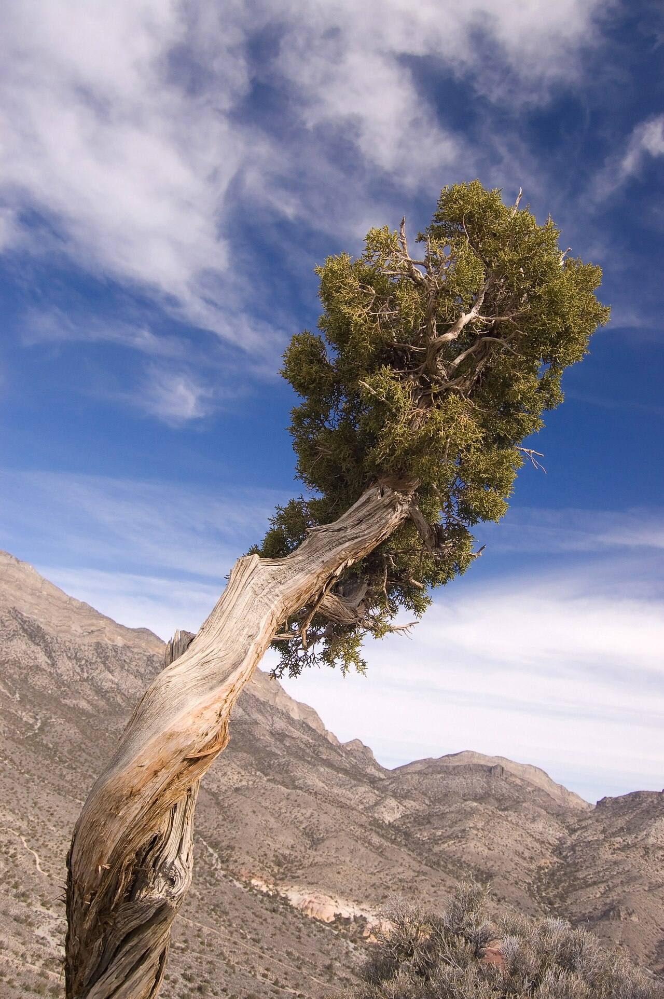

# Juniper

Juniper berries are the female cones of Juniperus communis. Botanically they are not berries but fleshy cones that take two to three years to ripen. They carry pine needle, resin, citrus and woody aromas into [gin](ref:gin), and they are not an optional decoration: both EU and US rules make juniper the defining flavour of the category.

Figure: Juniper. Image: Fcb981, CC BY-SA 3.0, via Wikimedia Commons ([source page](https://commons.wikimedia.org/wiki/File:Juniperus_osteosperma_1.jpg)).

## The juniper plant and its cones

Juniper is an evergreen coniferous shrub or small tree with separate male and female plants and needle-like leaves in whorls of three. After pollination the female cones turn from green to deep blue-purple and develop a waxy bloom. They are about 6–9 mm across and contain resin ducts and oil glands. Wild plants are scattered across the temperate and boreal Northern Hemisphere, grow slowly, and are usually picked by hand.

## Essential-oil composition and extraction

Juniper cones typically hold 0.5–2% essential oil. The main components are alpha-pinene, often 30–50%, together with myrcene, limonene, sabinene and smaller amounts of sesquiterpenes. Alpha-pinene supplies the pine and resin impression, limonene adds citrus brightness, and myrcene leans herbal and peppery. Crushing accelerates oil loss and oxidation, so distilleries either grind shortly before use or macerate whole cones.

## Legal status and distillation in gin

Regulation (EU) 2019/787 requires gin to be flavoured with juniper berries, and 27 CFR 5 in the United States likewise treats juniper as the required gin flavour. London dry gin goes further, demanding a juniper-led botanical character with very low sweetness, normally no more than 0.1 g/L of sugar in the finished spirit.

Two production routes dominate. Maceration distilling soaks juniper and other botanicals in neutral alcohol before heating; vapour infusion places botanicals in a basket above the still so that alcoholic vapour passes through them. Maceration extracts more completely and can bring heavier resin and bitterness, while vapour infusion gives a brighter, more citrus-forward aroma. Temperature and proof change how terpenes dissolve and hydrolyse.

## Regions, harvest and grades

Commercial collection takes place in Tuscany and other parts of Italy, North Macedonia, Bulgaria, Croatia, Spain and the Nordic countries. Mediterranean cones often show brighter citrus and resin, while cones from cold regions are tighter in aroma. Grades are usually set by origin, berry size, colour and foreign matter, but there is no single international classification; buyers rely on samples and oil analysis.

Commercial supply comes from both wild gathering and cultivation. Wild cones ripen unevenly, so a lot often contains unripe berries, twigs and leaf, and sorting is costly; cultivated plots can improve consistency through pruning and uniform harvest, but take years to establish. Pickers in Italy, the Balkans and Eastern Europe usually work hillsides by hand in autumn and winter, so output depends on weather and labour and prices swing widely.

Gin history explains the berry's status. Dutch and English distillers added juniper to grain spirit in the seventeenth century, and Britain's Gin Act of 1751 restricted retail and taxation without stopping gin from becoming an urban drink. Continuous distillation in the nineteenth century produced a cleaner spirit, and juniper shifted from a mask for rough alcohol to the core of a style. Premium gins now print origin and harvest year, but the law does not require it; such detail is largely marketing.

## Substitutes for juniper character

When cones are scarce or expensive, some recipes use juniper leaf, juniper wood or pine-needle oil to supply a resinous note. These materials lack the citrus and roundness of the cone, and leaf oil is more irritating. Coriander seed, angelica, orris root and citrus peel can support a gin's structure but cannot replace juniper's legal identity. Alcohol-free "gin" usually simulates the profile with juniper oil and botanical infusions, but the label may not call the product gin.

## Sensory impact

Juniper aroma separates into a front and a back: pine needle, citrus peel and pepper first, then resin, wood and a slight bitterness. Too little juniper leaves gin flat; too much brings turpentine and a long bitter tail. Blended with coriander's lemon note, orris powderiness and angelica's earthy sweetness, juniper can lead through clear direction rather than sheer force. Its aroma also shifts with strength: at high bottling proof the resin and pepper stand forward, while citrus and floral notes open after dilution, which is why tasting often starts neat and continues with a few drops of water. The same logic applies to the gin's final dilution before bottling.

## Common misconceptions

First, juniper berries are berries. They are fleshy cones. Second, every gin must taste strongly of pine. Juniper is mandatory, but a style can handle it gently. Third, the darker the berry the riper. Colour depends on species, maturity and drying and is not a quality index on its own. Fourth, all gins use the same botanical recipe. Recipe and distillation method are the core of a distillery's style.

Juniper “berries” are actually small cones from Juniperus communis. In gin they provide the resinous, pine-like core, but they are usually one botanical among many. Juniper can be used dried or fresh, and its oil content changes with origin and harvest. A gin that lacks juniper may still taste of citrus and spice, yet it does not meet the botanical logic of the category.

## See also

- [Gin](ref:gin): juniper as the defining flavour.
- [London dry gin](ref:london-dry-gin): low-sugar, juniper-led style.
- [Italy](ref:italy): collecting traditions such as Tuscany.
- [Distillation](ref:distillation): maceration versus vapour infusion.

**At a glance:** Juniper berries are the female cones of Juniperus communis and rich in terpenes such as alpha-pinene and myrcene; they are the legally required core flavour of gin, and distillation method and dose decide whether juniper leads or blends with other botanicals. 

Start with the form and provenance. From there, consider the preparation, then how it behaves in the drink. That is how a practical judgment about Juniper is built.

Juniper is the legally required botanical in gin, and its berries are distilled or macerated with other botanicals.

**Key facts.**

| Item | Detail |
| --- | --- |
| In one line | Juniper berries are the female cones of Juniperus communis and rich in terpenes such as alpha-pinene and myrcene; they are the legally required core flavour of gin, and distillation method and dose decide whether juniper… |
| Material | Juniper berries are the female cones of Juniperus communis and rich in terpenes such as alpha-pinene and myrcene |
| Use | they are the legally required core flavour of gin, and distillation method and dose decide whether juniper leads or blends with other botanicals. |

**Sources and limits.** The key claims about Juniper are checked against the following sources: European Union (Used to check the legal definition requiring gin to be flavoured with juniper berries), Oxford University Press (Used for entries on juniper, gin botanical recipes and distillation methods), Encyclopaedia Britannica (Used to check the botanical features of the genus Juniperus and of J. communis) and 5 sources in total. Prices, batches and status change; the body is project-written and does not reproduce source text.
