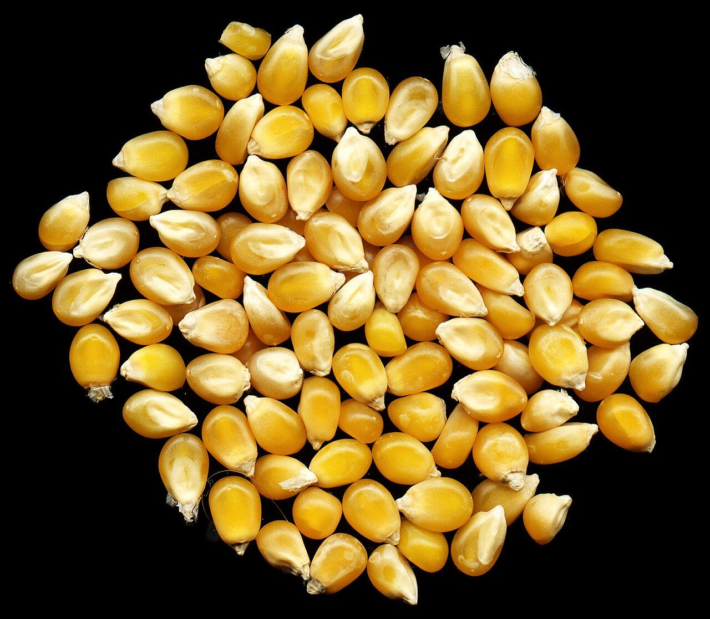

# Maize

Maize is an annual cereal of the genus Zea in the grass family, native to the Americas and now grown worldwide. Its starch content is high and its fat is concentrated in the germ; it is used as food and feed, and as a raw material for multi-grain baijiu, bourbon whisky and some beers. Its role in brewing depends on whether whole grain, degermed maize or maize starch products are used.

Figure: Dried maize kernels. Dent or flint maize is typical for brewing; sweet corn is not the main raw material. Image: Joel Penner, CC BY 2.0, via [source page](https://commons.wikimedia.org/wiki/File:Maize_Corn.jpg).

## Definition and forms

A maize kernel consists of endosperm, germ, bran and husk. The endosperm is mostly starch, while the germ contains more fat and protein. By kernel type there are dent, flint and sweet types; dent or flint maize is usually preferred for brewing because total starch is higher and processing adaptability is better. Sweet maize is high in sugar but low in starch and is not suitable as the main brewing starch source.

Maize fat is concentrated in the germ. If it is not removed, it can cause fatty-acid off-flavours during storage and fermentation and may reduce the cleanliness of the drink. Some baijiu and whisky producers use degermed maize or maize starch to limit oil-related off-notes. Whether to degerm is a trade-off between raw material handling and flavour goals.

## Main producing regions

Major maize producers include the United States, China, Brazil, Argentina and Ukraine. The US Midwest is a core maize region for bourbon, and northern and south-western China also grow large amounts. Climate, variety and drying method affect grain moisture, starch structure and impurity levels.

Maize must be dried promptly after harvest or high moisture leads to mould. Mouldy maize may carry mycotoxins, a food safety risk that must not enter brewing. Large-scale production usually tests incoming maize for moisture, impurities, starch and mouldy kernels.

## Role in baijiu

In [baijiu](ref:baijiu), maize is usually part of a multi-grain recipe. [Strong-aroma baijiu](ref:strong-aroma) commonly combines sorghum, rice, glutinous rice, wheat and maize; maize brings sweetness and some thickness. Its starch is high and gelatinises relatively easily after steaming, but poorly handled fat and protein can bring off-flavours.

In solid-state fermentation, maize must be paired with other materials to keep the grain bed loose and breathable. If the maize proportion is too high, the drink may taste sweet and lack structure; if too low, its contribution is limited. The goal of a multi-grain recipe is not to include every grain, but to combine complementary starch, protein and aroma precursors.

## Place in bourbon whisky

[Bourbon](ref:bourbon) is the most typical spirits use of maize. US rules require at least 51% maize in the grain recipe of bourbon, with malted barley, rye or wheat making up the rest. Maize brings sweetness, caramel and grain aroma, rye adds spice and pepper, and malted barley supplies saccharifying enzymes.

In whisky, maize is usually cooked and gelatinised, saccharified, [fermented](ref:fermentation) and distilled, then aged in new charred oak barrels. The maize proportion, grain recipe, distillation cuts and barrel ageing together determine the style. Within the wider category of [whisky](ref:whisky), corn whisky requires an even higher maize proportion and is not the same as bourbon.

## Adjunct role in beer

In [beer](ref:beer), maize often appears as flaked maize, maize starch or syrup. It supplies fermentable sugar, lowers the protein proportion, makes the body lighter and can replace part of the malt at lower cost. American light lagers commonly use maize adjuncts, but too high a proportion weakens malt aroma and body structure.

Maize adjuncts must be matched with the saccharification process. Maize starch gelatinises at a relatively high temperature, so it usually needs pre-gelatinisation or co-saccharification with malt; adding raw maize starch directly can lead to incomplete saccharification and filtration problems. Adjuncts are not simply a shortcut, and the key lies in recipe design and process control.

| Drink | Form of maize | Key processes |
| --- | --- | --- |
| Multi-grain baijiu | Whole or crushed maize | Steaming, saccharification, solid-state fermentation, distillation |
| Bourbon whisky | Maize grain | Cooking, saccharification, fermentation, pot or column distillation |
| Beer | Flakes, starch or syrup | Gelatinisation, saccharification, filtration, fermentation |

## Fat, starch and process fit

The germ fat is the main process concern with maize. Too much fat affects fermentation stability and the cleanliness of the drink, so degerming, extrusion or refined starch are common treatments. At the same time, a moderate grain flavour is part of maize's value; over-refining removes the raw material's character.

Maize starch needs enough water and temperature for gelatinisation and saccharification. Whole maize takes longer to cook, while crushed maize gelatinises more easily but tends to clump. Producers adjust cooking and saccharification parameters to their equipment, raw material form and target drink rather than applying one fixed flow.

## Buying and storage

When buying maize, look at kernel plumpness, colour, smell, impurities and mouldy kernels. Brewing maize should be fresh, free of musty odour and pests, with moisture not too high. For degermed maize and maize starch, check the processing date and storage conditions, and avoid moisture uptake and caking.

Store in a dry, ventilated, dark place away from pests and mould. Home brewers should choose material of clear origin and free of mould, and pay attention to equipment and water hygiene. Mouldy maize cannot be made fully safe by washing or steaming.

## Common misconceptions

First, that maize is only feed. It has real uses in baijiu, bourbon whisky and beer adjuncts.

Second, that maize liquor must be cloyingly sweet. Sweetness depends on recipe, fermentation and distillation, not on maize by itself.

Third, that more maize makes a more aromatic drink. Too high a proportion can weaken structure and complexity.

Fourth, that all maize suits brewing. Sweet maize is low in starch and high in sugar and is unsuitable as the main starch source.

Fifth, that mouldy maize is safe once cooked. The risk from mycotoxins is not fully removed by ordinary cooking.

**At a glance:** An annual cereal of the genus Zea with high starch content and fat concentrated in the germ; it is a common ingredient in multi-grain baijiu and a core raw material in American bourbon and some beer adjuncts.

**Key facts.**

| Item | Detail |
| --- | --- |
| In one line | An annual cereal of the genus Zea with high starch content and fat concentrated in the germ; it is a common ingredient in multi-grain baijiu and a core raw material in American bourbon and some beer adjuncts. |
| Material | An annual cereal of the genus Zea with high starch content and fat concentrated in the germ |
| Use | it is a common ingredient in multi-grain baijiu and a core raw material in American bourbon and some beer adjuncts. |

## Further reading

- [Baijiu](ref:baijiu): where maize sits in multi-grain baijiu.
- [Strong-aroma baijiu](ref:strong-aroma): multi-grain recipes matched with solid-state fermentation.
- [Bourbon](ref:bourbon): maize proportion and the core rules of the grain recipe.
- [Whisky](ref:whisky): the general framework of grain saccharification, distillation and barrel ageing.
- [Beer](ref:beer): the role of maize adjuncts in beer recipes.
