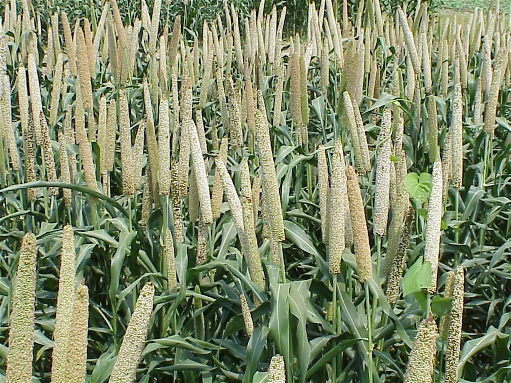

# Millet

Millet is the hulled grain of foxtail millet (Setaria italica), about 1–2 mm across and ranging from pale yellow to orange-red. Northern China has a long history of growing it, and it appears in huangjiu, millet wine and some regional baijiu. In Africa and South Asia, pearl millet, finger millet and related small grains underpin traditional cloudy cereal beers. Small, dense grains behave differently from rice and sorghum during cooking, saccharification and filtration.

Figure: Millet. Image: Wikimedia Commons contributor, Public domain, via Wikimedia Commons ([source page](https://commons.wikimedia.org/wiki/File:Grain_millet,_early_grain_fill,_Tifton,_7-3-02.jpg)).

## Foxtail, proso and pearl millet

Foxtail millet is an annual grass with a compact panicle; once hulled, it is the grain sold as millet. Proso millet (Panicum miliaceum) has slightly larger grains and many waxy varieties, and the proso grain is what Jimo laojiu uses, so it must not be confused with foxtail millet. Pearl millet (Pennisetum glaucum) is drought-tolerant with a large head and is grown across the Sahel and South Asia. Finger millet (Eleusine coracana) is rich in calcium and important in East Africa and India. In everyday Chinese, "millet" often covers all of these, but a brewing recipe must specify which one.

## Starch and protein

Millet starch is about 70–80% of the grain, with a high amylopectin share and gelatinisation around 70–80°C. Protein is roughly 10–13%, and fat and fibre are higher than in polished rice, concentrated in the aleurone and germ. Small grains have a large surface area per unit volume, so they absorb water quickly and clump during steaming; over-gelatinised starch makes the mash viscous and hard to press or filter.

Millet lacks the substantial husk of barley, so solid-state fermentations often add rice hulls or other chaff to improve porosity.

## Huangjiu and millet wine

The Chinese huangjiu standard classifies products by raw material and process, and proso-millet huangjiu is one category. Shandong's Jimo laojiu uses proso millet and goes through steeping, gelatinisation, saccharification, fermentation, pressing and boiling, giving a toasted, sweet profile. Millet huangjiu usually uses foxtail millet with wheat qu or small qu, and fermentation can last from days to months.

Millet wine is common in homes and small workshops and resembles sweet huangjiu: steamed grain is mixed with qu, saccharified, diluted and fermented, then pressed. Because millet carries more protein and fat, spoilage and bitterness are easy; hygiene and temperature control matter more than the recipe.

## Traditional grain drinks in Africa and Asia

In southern Africa, traditional cloudy beer such as umqombothi ferments sorghum and millet with both lactic acid bacteria and yeast. It is low in alcohol, usually only 2–4% ABV, unfiltered and rich in suspended yeast and grain particles. East African merissa and South Asian rice drinks follow a similar logic: saccharification and fermentation often happen in one vessel, with enzymes supplied by qu or germinated grain.

These drinks do not fit a hop-bitterness framework. Acidity, grain aroma, attenuation and hygiene are the relevant measures.

## Regions and landraces

Chinese millet comes mainly from the north, northeast and northwest, with Shanxi, Hebei, Inner Mongolia and Liaoning as important areas. Landraces differ in grain colour, waxiness and growing period; brewing millet is expected to be plump, clean and free of mould. India and Africa hold many more pearl and finger millet varieties, from white to dark brown, with wide differences in tannin and polyphenol content.

Millet has relatively active lipase, so poor storage leads to rancidity; once hulled, it loses the protection of the husk and should be kept sealed, dark and cool. Distilleries test intake lots for moisture, impurities, defective grains and aflatoxin, because millet is prone to mould in damp conditions. Compared with rice, the amylose share varies by variety, and waxy types can exceed 90% amylopectin, which explains the viscous, soft texture of local millet wine. In gluten-free beer, millet can replace part of the sorghum, but its higher protein and fat call for a longer protein rest and more thorough filtration.

## Replacing rice or sorghum

Rice starch is finer and its protein lower, giving a clean, soft spirit; sorghum contains tannin and coarser starch granules, suiting solid-state multi-round fermentation. Millet sits between them: more aromatic, but burdened by viscosity and fat. Replacing rice with millet calls for shorter steaming, more husk and vigilance against a sticky mash; replacing sorghum calls for added tannin structure and tolerance of repeated cooking.

## Sensory impact

Millet drinks usually show steamed-grain sweetness, nuts and light toast, with more acidity than rice drinks and a medium body. The toasted note of proso-millet huangjiu comes from Maillard reactions during gelatinisation and boiling, and differs from the fresh aroma of foxtail millet. Warm fermentation brings sharp higher alcohols and sourness; a cool, slow ferment keeps more grain sweetness.

## Common misconceptions

First, millet is the same as proso millet. They belong to different genera, and Jimo laojiu uses proso millet. Second, millet wine is always sweet. Greater attenuation can make it dry. Third, millet is gluten-free and therefore always safe. The grain is gluten-free, but shared equipment and qu ingredients can introduce gluten. Fourth, small grains are easy to saccharify. Their small size makes them clump, demanding finer control of steaming and stirring.

## See also

- [Huangjiu](ref:yellow-wine): the proso and foxtail millet traditions.
- [Baijiu](ref:baijiu): millet as a regional adjunct.
- [Beer](ref:beer): African millet beer and cereal fermentation.
- [Qu making](ref:qu-making): enzymes from moulds and rhizopus.
- [Saccharification](ref:saccharification): gelatinisation and enzyme breakdown.

For Millet, begin with the form and provenance. Then look at the preparation, and finally ask how it behaves in the drink. The answers point to different choices, not to a single score.

[Yellow wine](ref:yellow-wine) and [Beer](ref:beer) are the two useful reference points for Millet. [Yellow wine](ref:yellow-wine) sets out plant or material identity; [Beer](ref:beer) brings in origin. Read them together.

**Short definition:** Millet is the hulled grain of foxtail millet (Setaria italica) and a general name for small-seeded cereals such as proso and pearl millet; in China it is used in huangjiu and millet wine, and in Africa and Asia for traditional cloudy grain beers, with starch and protein shaping saccharification and flavour.

**Key facts.**

| Item | Detail |
| --- | --- |
| In one line | Millet is the hulled grain of foxtail millet (Setaria italica) and a general name for small-seeded cereals such as proso and pearl millet; in China it is used in huangjiu and millet wine, and in Africa and Asia for tradi… |
| Material | Millet is the hulled grain of foxtail millet (Setaria italica) and a general name for small-seeded cereals such as proso and pearl millet |
| Use | in China it is used in huangjiu and millet wine, and in Africa and Asia for traditional cloudy grain beers, with starch and protein shaping saccharification and flavour. |

**Sources and limits.** The key claims about Millet are checked against the following sources: Industry body (Used to check the raw-material and classification framework for huangjiu), Food and Agriculture Organization of the United Nations (FAO) (Used to check the broad picture of millet cultivation and use), Oxford University Press (Used for entries on millet beer and traditional African cereal fermentations) and 4 sources in total. Prices, batches and status change; the body is project-written and does not reproduce source text.
