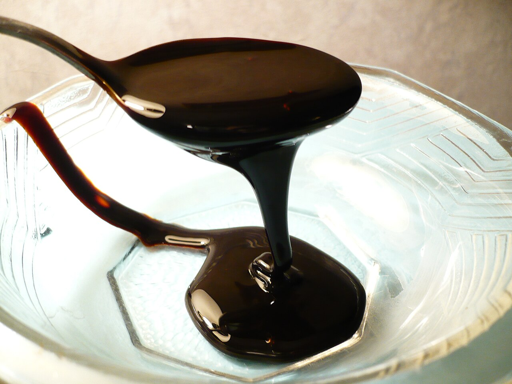

# Molasses

Molasses is the thick syrup left after sugar crystals are separated from cane or beet juice. It carries sucrose, invert sugar, minerals and nitrogenous matter into the fermenter, and it is the main sugar source for [rum](ref:rum). The old label of "waste molasses" is misleading: grade, ash content and microbial load directly change fermentation speed, distillation yield and body.

Figure: Molasses. Image: Badagnani, CC BY 3.0, via Wikimedia Commons ([source page](https://commons.wikimedia.org/wiki/File:Blackstrapmolasses.JPG)).

## From sugar-mill by-product to feedstock

Cane is pressed, clarified, evaporated, crystallised and centrifuged to remove sugar, leaving a mother liquor that becomes molasses. Molasses from the first crystallisation still holds much sucrose and can be boiled again; repeated boiling yields blackstrap, which is dark, high in ash and lower in sugar. High-test molasses is a partially inverted, incompletely crystallised syrup with a total sugar content of 75–85%, well suited to direct fermentation.

Beet molasses contains betaine and higher levels of sodium and potassium, which can give earthy and soapy notes after fermentation. Rum distilleries therefore generally prefer cane molasses.

## Sugars, ash and nitrogen

Cane molasses typically contains 50–70% total sugar, mostly sucrose with some glucose and fructose, 20–25% water and 4–10% ash; blackstrap sits at the upper end of the ash range. Yeast cannot absorb sucrose directly and must first hydrolyse it with invertase. Assimilable nitrogen is often low, especially in high-gravity diluted mashes, so distilleries add ammonium sulphate, urea or a mixed nutrient and manage phosphorus and magnesium.

High ash raises buffering capacity, so fermenter pH falls more slowly, but excessive salts inhibit yeast. Plants usually dilute molasses to 20–30°Brix before pitching to avoid osmotic stress and a sluggish start.

## Fermentation mechanics in rum

[Fermentation](ref:fermentation) is usually held at 28–33°C, with pitching rates chosen to suit house style. Distilleries chasing a light style use a single yeast strain and a short ferment; Jamaican producers seeking high ester levels retain wild microbes and add dunder from earlier runs, so bacteria and yeast together build esters, acids and heavy flavour compounds.

The wash then goes to [distillation](ref:distillation). Pot stills keep more congeners, while column stills produce a cleaner spirit. EU rules set a minimum for volatile substances in rum of 225 g/hL of pure alcohol, which is one analytical line between rum and neutral alcohol.

## Grades, origins and styles

Brazil, India, Thailand, China and the Caribbean are major suppliers of cane molasses. The rum traditions of Jamaica, Barbados, Guyana and Martinique rest on local sugar factories and molasses supply. [Jamaica](ref:jamaica) is known for heavy, high-ester spirits, while [Barbados](ref:barbados) emphasises cleaner pot and column styles. Batch variation is large, so distilleries blend by ash, total sugar and flavour.

## Substitutes: cane juice and syrups

Fermenting fresh [sugarcane](ref:sugarcane) juice produces the agricultural rum or Brazilian cachaça route, with greener aromas of cane peel and herbs. Molasses fermentation leans toward caramel, liquorice, spice and dark fruit. The two are not interchangeable: juice is dilute and perishable, demanding a fast processing chain, while molasses is viscous and needs dilution and warming.

## Sensory contribution

Molasses gives a base of caramel, liquorice, coffee, smoke and savoury salinity. High-ash molasses can add mineral and slightly bitter notes; warm ferments with active wild flora produce banana, pineapple and solvent aromas. Oak ageing folds these into vanilla, coconut and spice. Ester levels also depend on fermentation length and temperature: a fast, cool ferment keeps the profile narrow and clean, while a long, warm ferment with wild flora builds the pineapple and banana notes associated with heavy Caribbean styles. A longer rest in used casks softens the edges and lets the sweeter notes settle, so batch blending is as important as still choice in defining a house style.

In storage, molasses absorbs water, ferments or crystallises. Open tanks with wide temperature swings encourage yeast and mould at the surface. Distilleries often keep molasses above 25–30°C so it can be pumped, but prolonged heat accelerates Maillard reactions and deepens caramel and bitterness. Intake checks usually cover total sugar, ash, pH, total nitrogen and microbial load; colour alone is unreliable. Viscosity changes strongly with temperature and water content, so the material should be warmed before dilution and measurement or the sugar reading will drift. Jamaican distilleries also return stillage, or dunder, to the fermenter, which lifts acidity and ester formation, though too high a share suppresses yeast.

## Common misconceptions

First, molasses is waste. It is a sugar-making by-product with defined grades and uses. Second, all rum is made from molasses. Agricultural rum and cachaça start from cane juice. Third, the darker the molasses the better. Colour reflects ash and boiling history, and suitability depends on style. Fourth, molasses needs no nutrients. Diluted high-sugar washes are often short of nitrogen and trace elements and must be supplemented.

Molasses is a by-product of sugar refining, not a synonym for raw cane juice. It contains residual sugars, minerals and dark colour compounds, and its grade and ash level strongly influence fermentation. Rum made from molasses tends to show deeper, cooked-sugar notes than cane-juice rum. “Blackstrap” is a commercial grade, not a guarantee of quality or a required rum ingredient.

## See also

- [Rum](ref:rum): the molasses and cane-juice routes.
- [Jamaica](ref:jamaica): high-ester, heavy styles.
- [Barbados](ref:barbados): pot and column traditions.
- [Fermentation](ref:fermentation): dilution, pitching and nutrition.
- [Distillation](ref:distillation): how still type shapes flavour.
- [Sugarcane](ref:sugarcane): the fresh-juice alternative.

**At a glance:** Molasses is the syrup left after sugar crystallisation, containing sucrose, glucose, fructose and minerals; it is the main sugar source for rum and a common industrial yeast medium, and its grade and composition shape fermentation speed and flavour. 

Begin with the form and provenance, move on to the preparation, and finish with how it behaves in the drink. That order keeps the reading of Molasses practical.

The comparison with [Rum](ref:rum) and [Barbados](ref:barbados) runs through plant or material identity and origin. Each answers a different question.

It is tempting to treat Molasses as a finished drink. Its identity and use are separate questions.

Molasses is the main sugar source for rum and a common yeast medium; its grade affects fermentation speed and flavour.

**Key facts.**

| Item | Detail |
| --- | --- |
| In one line | Molasses is the syrup left after sugar crystallisation, containing sucrose, glucose, fructose and minerals; it is the main sugar source for rum and a common industrial yeast medium, and its grade and composition shape fe… |
| Material | Molasses is the syrup left after sugar crystallisation, containing sucrose, glucose, fructose and minerals |
| Use | it is the main sugar source for rum and a common industrial yeast medium, and its grade and composition shape fermentation speed and flavour. |

**Sources and limits.** The key claims about Molasses are checked against the following sources: Oxford University Press (Used for entries on molasses, molasses rum and high-ester fermentation), Food and Agriculture Organization of the United Nations (FAO) (Used to check the sugar-making process and the place of molasses as a by-product), U.S. Department of Agriculture (Used to check the sugar, moisture and mineral profile of molasses) and 5 sources in total. Prices, batches and status change; the body is project-written and does not reproduce source text.

For Molasses, this page was last checked in 2026; prices, batches and availability change, so confirm them against the sources below.
