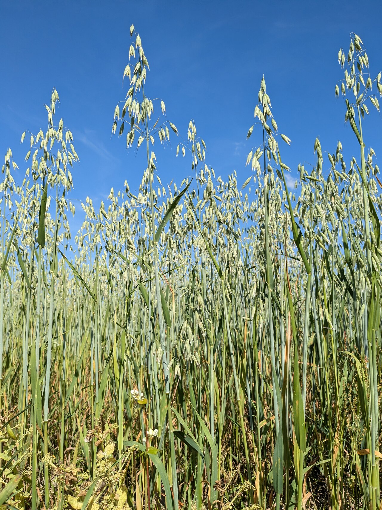

# Oats

Oats (Avena sativa) are an annual cereal of the genus Avena that prefers cool, moist climates. Their fat and beta-glucan levels are clearly higher than barley. In [beer](ref:beer) they mostly supply [body](ref:body), creaminess and haze rather than sugar; in oatmeal [stout](ref:stout) that silky texture has become a style marker. High fat and viscosity, however, make [saccharification](ref:saccharification), lautering and distillation harder than with barley.

Figure: Oats. Image: Christian Fischer, CC BY-SA 4.0, via Wikimedia Commons ([source page](https://commons.wikimedia.org/wiki/File:AvenaSativa3.jpg)).

## Botany and grain structure

Oats are an annual grass with a panicle inflorescence, and each grain is enclosed by husks. Cultivated types split into winter and spring oats, and by use into feed, food and malting oats. The grain consists of endosperm, aleurone, embryo and husk. The husk is a high proportion of the grain and has an open structure, so it can act as a natural filter bed, but it also brings astringency and absorption losses.

USDA FoodData Central lists about 66.3 g carbohydrate, 16.9 g protein, 6.9 g fat and 10.6 g dietary fibre per 100 g of raw oats. Unsaturated fatty acids dominate the fat, and poor storage leads to oxidation and cardboard or rancid notes.

## Beta-glucan, fat and saccharification

Beta-glucan is a soluble fibre in the oat endosperm cell wall, present at roughly 4–6%. It absorbs water and forms a highly viscous solution, which improves roundness on the palate but slows wort separation and can stall the mash. Brewers schedule a beta-glucan rest at 40–45°C or use an enzyme preparation containing beta-glucanase.

Oat amylase activity is limited. Flaked oats, which are not malted, work almost entirely as an adjunct. Oat shares in a recipe usually run from 5–20%, with barley malt supplying the rest of the sugar. Fat reduces foam persistence, and excessive oats give coarse, quickly collapsing foam.

## Use in brewing

Oats enter the mash as oat malt, flaked oats, rolled oats or raw oats. Oat malt has been partly germinated and dried, so it has more enzyme activity than raw oats, though still not enough to convert a mash alone. Hazy IPA often uses 10–20% flaked oats for smoothness and haze; oatmeal stout pairs oat malt with roasted barley and dark malts for a velvet texture.

[Fermentation](ref:fermentation) itself is not unusual with oats; viscosity, oxygen and nutrients are the real issues. Wort from high-oat grists is cloudy, yeast settles slowly, and longer cold conditioning or filtration is needed before packaging.

## Regions and varieties

Oats suit cool, moist regions. Russia, Canada, Poland, Finland, the United States and Australia are major producers. Northern and high-altitude parts of China also grow oats, mostly for food and feed. Varieties differ widely in fat, beta-glucan and protein; malting oats are selected for high kernel weight, thin husk and even germination.

Fat oxidation is the main storage and brewing risk with oats. Moisture above 12%, warm storage or prolonged exposure after crushing activates lipase and lipoxygenase, producing hexanal and other compounds that smell of old cardboard. Brewers therefore prefer fresh flaked oats and open the bag only before mashing; malted oats need controlled kilning so that creamy notes do not turn burnt. A few grain-whisky recipes use 5–10% oats to add an oily texture, though little aroma survives distillation.

Oat husk also adsorbs some hop bitterness, a loss that recipe design should account for. In hazy IPA, oats and wheat are often used together: wheat supplies protein haze, oats supply slip, and an imbalance between them can collapse the foam. For home brewing, flaked oats must be gelatinised with the base malt or their starch is not fully released; crushing them before use improves water uptake.

## Replacing barley or wheat

Against barley, oats lack both a strong husk filter bed and sufficient enzymes, so they cannot serve as a base malt. Against wheat, oat protein does not form gluten, so it gives softness rather than a chewy, bread-like structure. Oats are a common choice when more body is wanted without wheat's haze-forming protein; replacing part of the base malt, however, requires an added enzyme source.

## Sensory effect and body

Oats work through texture more than aroma. The entry is rounder and fuller, the finish softer, and the usual descriptors are creamy, silky or velvety. They also make the beer hazy, slightly darker and a little less sharply bitter. At high rates, raw grain notes, astringency and foam problems appear. Serving temperature matters too: at cellar temperature the creamy texture reads clearly, while very cold serving hides both the body and the grain sweetness that oats contribute.

## Common misconceptions

First, oats are only for stout. They are equally common in hazy IPA, wheat beer and pale ale. Second, more oats always means more smoothness. Beyond a certain share, viscosity and lautering problems cancel the gain. Third, oats are gluten-free. Oat protein is not gluten, but shared equipment with wheat means pure oat products still need certification. Fourth, oats can replace base malt. Their enzyme activity is too low, so barley malt must accompany them.

## See also

- [Beer](ref:beer): oats as an adjunct and body modifier.
- [Stout](ref:stout): the oatmeal stout tradition.
- [Saccharification](ref:saccharification): beta-glucan rests and enzymes.
- [Body](ref:body): the textural change oats bring.
- [Whisky](ref:whisky): experimental use of oats in grain distillation.

For Oats, begin with the form and provenance. Then look at the preparation, and finally ask how it behaves in the drink. The answers point to different choices, not to a single score.

The comparison with [Beer](ref:beer) and [Saccharification](ref:saccharification) runs through plant or material identity and origin. Each answers a different question.

**Short definition:** Oats are an annual cereal of the genus Avena with high fat and beta-glucan content; they bring silky body and haze to beer and are traditional in oatmeal stout, but fat and viscosity make saccharification, lautering and distillation harder than with barley.

Treating Oats as a finished drink mixes two different questions: identity and use. Separate them before comparing.

Oats add body and a creamy texture to beer and whiskey; their high fat and beta-glucan need careful milling and mash temperatures.

**Key facts.**

| Item | Detail |
| --- | --- |
| In one line | Oats are an annual cereal of the genus Avena with high fat and beta-glucan content; they bring silky body and haze to beer and are traditional in oatmeal stout, but fat and viscosity make saccharification, lautering and … |
| Material | Oats are an annual cereal of the genus Avena with high fat and beta-glucan content |
| Use | they bring silky body and haze to beer and are traditional in oatmeal stout, but fat and viscosity make saccharification, lautering and distillation harder than with barley. |

**Sources and limits.** The key claims about Oats are checked against the following sources: Oxford University Press (Used for entries on oat malt, oatmeal stout, beta-glucans and lautering), Whole Grains Council (Used to check the broad picture of oat fat, beta-glucan and nutrition), U.S. Department of Agriculture (Used to check carbohydrate, protein, fat and fibre values for raw oats) and 5 sources in total. Prices, batches and status change; the body is project-written and does not reproduce source text.
