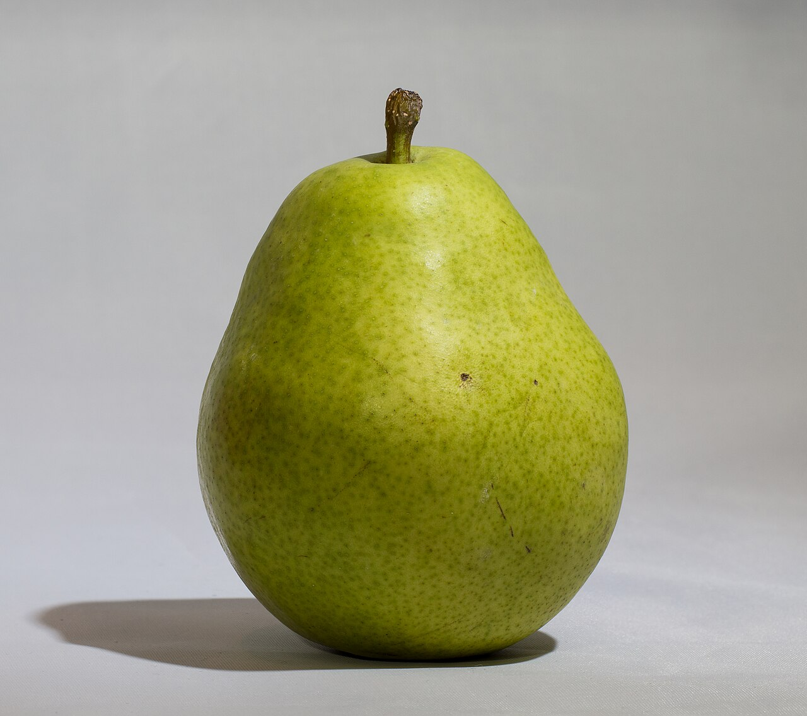

# Pear

Pear is the fruit of the genus Pyrus, eaten fresh and also fermented; specialist perry pears have high tannin, acidity and aroma, and are made into perry in England and Normandy, lighter than apple cider but related in style.

Figure: Pear: D'anjou pear (Wikimedia Commons). Image: Rhododendrites, CC BY-SA 4.0, via Wikimedia Commons ([source page](https://commons.wikimedia.org/wiki/File:D%27anjou_pear.jpg)).

## Definition and naming

Pear is a pome in the genus Pyrus. Cultivated types are mainly European pear (Pyrus communis) and Asian pears (Pyrus pyrifolia and relatives). European pears are soft and finely aromatic; Asian pears are crisp and juicy. Both can be eaten fresh, fermented or distilled.

Perry pears are specialist fruit for perry: small, high in tannin and acid, too harsh to eat fresh. They are not “sweeter pears” but raw material selected for fermentation and structure. When a label says perry, pear cider or pear wine, separate fermented pear drinks from juice drinks and liqueurs.

## Origin and spread

Pear cultivation traces to parts of Europe, western Asia and China; European and Asian pears were selected separately for fruit shape, texture and aroma. Pears spread through trade, migration and horticulture to temperate zones in North America, South America, Australia and New Zealand.

Perry has a long tradition in Herefordshire and Gloucestershire in England and in Normandy, France; these areas retain old orchards and dedicated perry varieties. Hebei, Shandong and Shaanxi in China focus more on fresh pears and juice, with pear wine and pear spirit remaining niche products.

## Botany and cultivation

A pear is a pome: the flesh develops from the receptacle and the seeds sit in the centre. Most pear cultivars are self-incompatible and need a pollinator; growers manage chilling requirement, spring frost, soil drainage and rootstock. Pear rust, fire blight and fruit spot diseases are common concerns.

Perry orchards often use standard or half-standard trees with small fruit and low yields but high tannin and acid. Dessert pears emphasise thinning, bagging, harvest maturity and cold chain; overripe fruit turns mealy and loses aroma, while underripe fruit stays astringent.

## Style and palate

Perry is usually dry, with pear, white flower, citrus and tannin notes; traditional bottle fermentation can add bubbles, from light to full styles. Like apple cider, perry ferments the fruit’s sugar and uses no grapes; sweetness depends on retained sugar or later sweetening.

Pears also make pear liqueur, Poire Williams pear spirit and juice. Poire Williams usually ferments and distills Williams pears; a whole pear inside a bottle is a presentation and infusion technique, not the fermentation itself. Pear aroma is volatile, so low-temperature distillation and timely cuts matter.

## Main regions and representative products

The West Midlands, Herefordshire and Gloucestershire in England are core perry areas; Normandy and Anjou in France also have pear-drink traditions. Hebei, Shandong, Shaanxi and Xinjiang in China are better known for fresh pears, juice and canned fruit, while pear wine remains a small category.

Perry has no single official hierarchy like wine. Its identity depends on orchard, variety and maker. Check whether the label names perry pears, bottle fermentation, sweetness and origin, rather than only the words “pear wine”.

## How to drink and pair

Perry is served cool but not ice-cold; too cold mutes aroma. Use a tulip or high-shouldered glass and sip in modest amounts. Dry perry suits pork, chicken, cheese and fried food; sweet perry suits fruit tarts, blue cheese and spicy dishes. Poire Williams is served at room temperature in a small glass, neat or with ice, and also works in cocktails.

Pear sweetness pairs with nuts, blue cheese, pork, duck and root vegetables; tannin and acidity cut fat. Drinkers sensitive to alcohol should note the strength difference between perry and pear spirit, and sweet pear drinks can encourage fast drinking.

## Buying and common misreadings

First, confusing perry with pear juice drinks: perry is fermented, not flavoured juice. Second, assuming all pear drinks are dry; check the label and residual sugar. Third, treating the whole pear in a Poire Williams bottle as the fermenting material; it is mainly infusion and display. Fourth, assuming sweeter pears make better perry; perry needs acid, tannin and aroma.

Pear is not a grape, so clone, rootstock, old-vine and grape-skin maceration language do not apply. Its variables are European versus Asian pear, perry-specific varieties, ripeness, fermentation and whether the product is distilled.

Perry orchards are not dessert-pear orchards. Specialist varieties are small, high in tannin and vigorous, often managed as standard trees; dessert pears emphasise fruit shape, bagging and cold chain. Harvest maturity also differs: perry pears need acid and tannin, and overripe fruit loses structure, while dessert pears wait for sugar-acid balance but turn mealy when overripe. The difference between perry and pear juice is fermentation: the first turns fruit sugar into alcohol, the second is adjusted, flavoured or diluted. A “pear cider” may be fermented or compounded, so read the label. A whole pear in a Poire Williams bottle is infusion and display, not the fermenting material.

## Further reading and see also

- Related: [cider](ref:cider), [liqueur](ref:liqueur), [fermentation](ref:fermentation), [terroir](ref:terroir), [france](ref:france).
- This page offers no plant identification, prices or shopping channels; a label name is not a botanical identification.

**In brief:** Pear is the fruit of the genus Pyrus, eaten fresh and also fermented; specialist perry pears have high tannin, acidity and aroma, and are made into perry in England and Normandy, lighter than apple cider but related in style. 

Read Pear through the form and provenance, then the preparation, and finally how it behaves in the drink. The sequence matters.

The comparison with [Cider](ref:cider) and [Fermentation](ref:fermentation) runs through plant or material identity and origin. Each answers a different question.

Sources for Pear include FAO, USDA, CGIAR, Royal Botanic Gardens, Kew.

Perry pears are high in tannin and acidity, and perry is made in England and Normandy; it is lighter than cider but related in style.

Perry is often compared with cider, but its best examples are drier and more aromatic, with a pear-skin bitterness.

**Key facts.**

| Item | Detail |
| --- | --- |
| In one line | Pear is the fruit of the genus Pyrus, eaten fresh and also fermented; specialist perry pears have high tannin, acidity and aroma, and are made into perry in England and Normandy, lighter than apple cider but related in s… |
| Material | Pear is the fruit of the genus Pyrus, eaten fresh and also fermented |
| Use | specialist perry pears have high tannin, acidity and aroma, and are made into perry in England and Normandy, lighter than apple cider but related in style. |

**Sources and limits.** The key claims about Pear are checked against the following sources: FAO (crop, production-region and processing background), USDA (agricultural, botanical and nutritional material), CGIAR (crop germplasm and agricultural research frameworks) and 4 sources in total. Prices, batches and status change; the body is project-written and does not reproduce source text.

For Pear, this page was last checked in 2026; prices, batches and availability change, so confirm them against the sources below.
