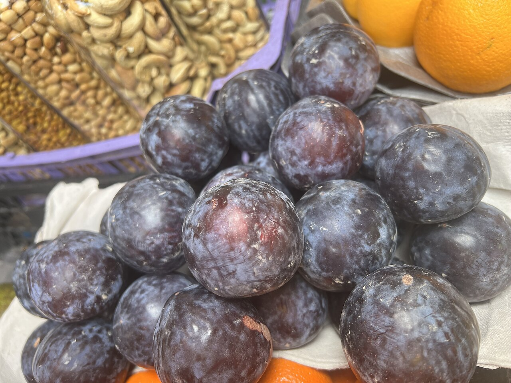

# Plum

Plum is a Prunus fruit; East Asian “ume” (Prunus mume) differs from Western plums, with high acidity and clean aroma, used for pickles, umeshu and plum vinegar, a shared food tradition in Japan, China and Korea.

Figure: Plum: Plum Fruit on Display (Wikimedia Commons). Image: Iwai-Dialax, CC BY 4.0, via Wikimedia Commons ([source page](https://commons.wikimedia.org/wiki/File:Plum_Fruit_on_Display.jpg)).

## Definition and naming

Ume (Prunus mume) originated in China and later reached Japan and the Korean Peninsula. Unripe fruit is green and extremely acidic; as it ripens it turns yellow and gains aroma. Western plums (Prunus domestica, Prunus salicina and relatives) are a different group, sweeter and less acidic, yet both are often translated as “plum”, which causes confusion.

Umeshu is made by steeping green ume with sugar and shochu or brandy for months to a year; it is an infused liqueur, not a fermented wine. Plum vinegar, salted plums and plum paste are preserved products. When a label says plum wine, identify whether it is umeshu, fermented plum wine or distilled plum spirit.

## Origin and spread

Ume originated in the Yangtze basin and southwestern mountains of China, with a long history of cultivation and food use, later spreading to Japan, the Korean Peninsula and Southeast Asia. Wakayama in Japan, Fujian and Yunnan in China and Korea are important ume and umeshu regions; Western plums developed separate variety groups around the Mediterranean, Europe and North America.

Ume spread with pickling, medicinal and seasoning traditions, not only as fresh fruit. Japanese umeshu is common in homes and commercial production; Korean plum drinks and vinegar have their own recipes; Chinese green-plum wine has revived in recent years, from infused to compounded products.

## Botany and cultivation

Ume is a drupe with flesh around a stone and a seed inside. Green ume acidity comes mainly from citric and malic acids, with low sugar, so eating it fresh is harsh; ripe fruit gains aroma but stays acidic. Growers manage frost risk, chilling requirement, pollination and drainage.

Pruning and thinning affect fruit size and acidity. Green ume is picked at the hard-ripe stage; overripe fruit gains aroma but loses acid and can cloud an infusion. Salting and sugar preservation extend shelf life but change how the fruit tastes in a drink.

## Style and palate

Umeshu is usually sweet-tart, with alcohol from low to moderate; sugar, base spirit and steeping time define the style. Green ume releases acid and aroma into the sugar solution, and the base may be shochu, brandy or another neutral spirit. Umeshu is not fermented plum juice or grape wine.

Western plums can be fermented into plum wine or distilled into plum brandy such as slivovitz. Plum brandy often ferments or distills with pits, giving a marked almond note; umeshu is more about sweet-tart fruit and infusion. Both are called plum in English, but the processes and flavours differ.

## Main regions and representative products

Wakayama in Japan is known for ume and umeshu, with brands such as Choya and Umenoyado; Fujian, Yunnan and Guangdong in China produce green-plum drinks and preserves; Korean plum wine, vinegar and pickles are also common. The Balkans are known for slivovitz plum brandy.

“Plum wine” may be a true infusion, a compounded drink or a flavoured product. Check the share of fruit, sugar, base spirit and alcohol rather than relying on the word plum.

## How to drink and pair

Umeshu is served chilled or over ice, and can be topped with soda, green tea or tonic; sweet versions need portion control. It suits sushi, grilled meat, fried food and cheese, where acidity cuts fat. Plum brandy is served at room temperature in a small glass with grilled meat and hard cheese.

Plum’s acid and sugar are flexible at the table, but very sweet umeshu can overwhelm light dishes. Drinkers sensitive to alcohol should separate the sugar in an infusion from the strength of its base spirit, rather than treating umeshu as a low-alcohol drink.

## Buying and common misreadings

First, treating ume (Prunus mume) and Western plum as the same fruit. Second, treating umeshu as a fermented wine; it is usually an infusion. Third, treating plum brandy as umeshu; raw material and process differ. Fourth, ignoring sugar and base spirit, since sweet products can hide alcohol.

Plum is not a grape, so clone, rootstock, old-vine and grape-tannin language do not apply. Judge a plum product by ume ripeness, salt or sugar preservation, base spirit, steeping time and whether it is distilled.

The boundary between umeshu and plum spirit lies in raw material and process. Umeshu usually steeps green ume, with sugar and base spirit setting sweetness and strength; plum wine may be fermented, and plum brandy such as slivovitz is often fermented or distilled with pits, giving a stronger almond note. Plum vinegar and salted plums are preserves, not drinks. Read the ingredient order—fruit, sugar, base spirit, acidity regulators and flavourings—before the front label. Ume harvest is short: too early is sour and lean, too late loses acid and softens.

## Further reading and see also

- Related: [liqueur](ref:liqueur), [soju](ref:soju), [fermentation](ref:fermentation), [terroir](ref:terroir), [japan](ref:japan).
- This ingredient offers no plant identification, prices or shopping channels; a label name is not a botanical identification.

The comparison with [Liqueur](ref:liqueur) and [Fermentation](ref:fermentation) runs through plant or material identity and origin. Each answers a different question.

**Short definition:** Plum is a Prunus fruit; East Asian “ume” (Prunus mume) differs from Western plums, with high acidity and clean aroma, used for pickles, umeshu and plum vinegar, a shared food tradition in Japan, China and Korea. 

For Plum, begin with the form and provenance. Then look at the preparation, and finally ask how it behaves in the drink. The answers point to different choices, not to a single score.

A frequent error is to treat Plum as a finished drink. Establish what it is, then what the label claims. Neither answer settles the question alone.

**Key facts.**

| Item | Detail |
| --- | --- |
| In one line | Plum is a Prunus fruit; East Asian “ume” (Prunus mume) differs from Western plums, with high acidity and clean aroma, used for pickles, umeshu and plum vinegar, a shared food tradition in Japan, China and Korea. |
| Material | Plum is a Prunus fruit |
| Use | East Asian “ume” (Prunus mume) differs from Western plums, with high acidity and clean aroma, used for pickles, umeshu and plum vinegar, a shared food tradition in Japan, China and Korea. |

**Sources and limits.** The key claims about Plum are checked against the following sources: FAO (crop, production-region and processing background), USDA (agricultural, botanical and nutritional material), CGIAR (crop germplasm and agricultural research frameworks) and 4 sources in total. Prices, batches and status change; the body is project-written and does not reproduce source text.

For Plum, this ingredient was last checked in 2026; prices, batches and availability change, so confirm them against the sources below.
