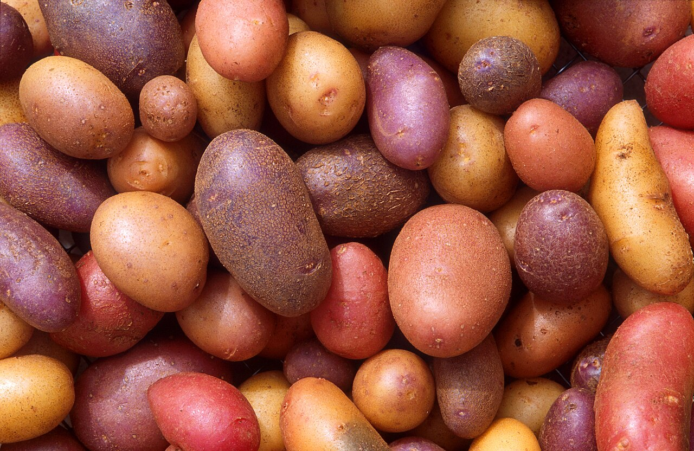

# Potato

Potato is a tuber of the nightshade family, rich in starch and water, and the core material for potato vodka in Poland, Germany, Sweden and Eastern Europe; it is usually rounder and slightly sweeter than grain vodka and naturally gluten-free.

Figure: Potato: Patates (Wikimedia Commons). Image: Scott Bauer, USDA ARS, Public domain, via Wikimedia Commons ([source page](https://commons.wikimedia.org/wiki/File:Patates.jpg)).

## Definition and naming

Potato is the tuber of Solanum tuberosum in the nightshade family. The edible part is a swollen underground stem, not a root or a fruit; buds (“eyes”) sit on the tuber, and sprouted or greened tubers accumulate solanine and should not be eaten.

“Potato”, “spud” and regional names refer to the same crop; as a distilling material, the term usually means a high-starch potato, not a small waxy salad potato. Read labels for potato vodka, potato spirit and potato-flavoured compounded drinks as separate categories.

## Origin and spread

Potato originated in the Andes of South America and reached Europe after the sixteenth century, becoming an important food and distilling material in Poland, Germany, Sweden and Eastern Europe. Cool climates suit high-starch potatoes, and tubers store well, providing fermentable sugar through winter.

Potato vodka has a long tradition in Poland and Germany; Chopin and Luksusowa in Poland are common examples. Potatoes also go into industrial alcohol, chips and starch, but drink production cares about starch content, maturity and storage.

## Botany and cultivation

Potato tubers are rich in starch and water, with large starch granules. Before fermentation the starch must be cooked and gelatinised, then converted to fermentable sugar by enzymes or malt. Compared with grain, potatoes carry more water, so transport and storage costs are higher.

Growers manage seed-tuber health, loose soil, drainage and late blight. Tubers are stored cool, dark and ventilated; light turns them green and raises solanine, and sprouted tubers must stay out of food and distilling.

## Style and palate

Potato vodka is usually rounder than wheat or rye vodka, with a faint sweetness and earthy note and a heavier body; the texture survives dilution. It works neat, over ice or in cocktails, but the “sweetness” is mouthfeel rather than added sugar.

Potatoes can also be fermented into potato wine or distilled into potato spirit, though commercial products are mostly vodka. Potato is not a grape, so skin, tannin and maceration language do not apply; flavour comes from tuber variety, cooking, saccharification, fermentation and distillation.

## Main regions and representative products

Poland, Germany, Sweden and Eastern Europe are the main potato-vodka regions; Chopin and Luksusowa in Poland use potato, and Germany and Sweden have their own brands. Some distilleries in the United States and Canada make small-batch potato vodka.

“Potato vodka” does not mean potato spirit plus flavouring. Check whether potato is the main material, whether grain is added, and whether sugar or flavouring is present; pure potato vodka has a different texture from grain vodka, but not every label states the proportion.

## How to drink and pair

Vodka is usually served chilled and neat, or at room temperature in a small glass; potato vodka’s round texture is clearest when cold. Ice dilutes but lowers alcohol burn; in cocktails it pairs with citrus, vanilla, cream and spice.

Potato vodka suits grilled meat, smoked fish, caviar, pickles and potato dishes; its body carries fat while alcohol cuts richness. Drinkers sensitive to alcohol should remember that vodka is usually strong, even when the texture feels soft.

## Buying and common misreadings

First, treating “gluten-free” as a quality grade; it is a raw-material property. Second, confusing potato starch or potato flavouring with the raw material. Third, assuming every potato vodka is sweet; sweetness may come from glycerol or additives. Fourth, ignoring the proportion of potato and the producer.

Potato is not a grape and has no clone, rootstock or old-vine framework. Judge potato spirits by tuber variety, starch content, saccharification and distillation, and by the raw materials and alcohol on the label.

Raw-material handling shapes potato vodka more than the word “potato”. High-starch tubers are cooked and gelatinised, then converted by enzymes or malt; fermentation temperature and yeast decide higher alcohols and esters, and distillation cuts decide cleanliness. Pure potato vodka usually adds no sugar or flavouring, but a “potato-flavoured” product may contain only a small extract. Read the ingredient list, alcohol and producer rather than “gluten-free” or “small batch”. Potato and grain vodka differ more in texture than aroma: potato is rounder and heavier, grain cleaner and more direct. Chilling for neat service shows texture; ice or mixing shows cleanliness and pairing. Store tubers dark, cool and ventilated; greening and sprouting raise solanine, so the raw material must be sound before it reaches the still. Potato vodka’s sweetness is mostly mouthfeel and glycerol, not added sugar; the share of potato and the number of distillations say more about style than an origin story. Check the first ingredient and the stated potato share.

## Further reading and see also

- Related: [vodka](ref:vodka), [distillation](ref:distillation), [barley](ref:barley), [terroir](ref:terroir), [fermentation](ref:fermentation).
- This page offers no plant identification, prices or shopping channels; a label name is not a botanical identification.

**Short definition:** Potato is a tuber of the nightshade family, rich in starch and water, and the core material for potato vodka in Poland, Germany, Sweden and Eastern Europe; it is usually rounder and slightly sweeter than grain vodka and naturally gluten-free. 

For Potato, begin with the form and provenance. Then look at the preparation, and finally ask how it behaves in the drink. The answers point to different choices, not to a single score.

[Vodka](ref:vodka) and [Barley](ref:barley) answer different questions about Potato: plant or material identity and origin. Read them as a pair, not as alternatives.

The entry on Potato draws on FAO, USDA, CGIAR, International Potato Center. 

A common misreading treats Potato as a finished drink. The correction is to ask what it is, then where it belongs, and keep the answers apart.

Potato vodka is typically rounder and slightly sweeter than grain vodka, and it is naturally gluten-free.

**Key facts.**

| Item | Detail |
| --- | --- |
| In one line | Potato is a tuber of the nightshade family, rich in starch and water, and the core material for potato vodka in Poland, Germany, Sweden and Eastern Europe; it is usually rounder and slightly sweeter than grain vodka and … |
| Material | Potato is a tuber of the nightshade family, rich in starch and water, and the core material for potato vodka in Poland, Germany, Sweden and Eastern Europe |
| Use | it is usually rounder and slightly sweeter than grain vodka and naturally gluten-free. |

**Sources and limits.** The key claims about Potato are checked against the following sources: FAO (crop, production-region and processing background), USDA (agricultural, botanical and nutritional material), CGIAR (crop germplasm and agricultural research frameworks) and 4 sources in total. Prices, batches and status change; the body is project-written and does not reproduce source text.

For Potato, this page was last checked in 2026; prices, batches and availability change, so confirm them against the sources below.
