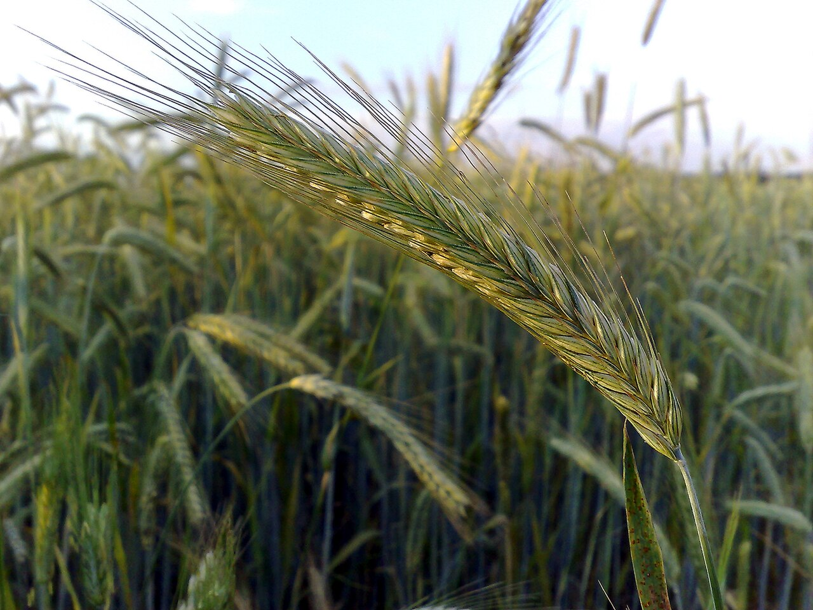

# Rye

Rye (Secale cereale) is an annual or biennial cereal of the genus Secale, hardy and tolerant of poor soil, able to grow at latitudes where wheat struggles to overwinter. It is the required base of American rye whiskey, the flour behind German and Nordic rye bread, and in beer a spicy, dry grain backbone. Its beta-glucans and proteins make [saccharification](ref:saccharification) and lautering harder, which explains why it is less widespread than barley.

Figure: Rye. Image: LSDSL, CC BY-SA 3.0, via Wikimedia Commons ([source page](https://commons.wikimedia.org/wiki/File:Ear_of_rye.jpg)).

## Botany and cold hardiness

Rye has a spike inflorescence and long, slender grains ranging from yellow-brown to blue-grey. Cross-pollination gives populations wide genetic variation and broad adaptation. A deep root system allows it to grow on sandy and poor soils; winter rye survives cold through low-temperature acclimation and osmotic adjustment. Rye is prone to ergot (Claviceps purpurea), whose sclerotia contain ergot alkaloids, so cleaning and testing of raw material are essential.

## Grain composition and saccharification problems

Rye starch is about 60–68% of the grain, protein about 10–14%, and beta-glucan about 2–4%, higher than wheat. Beta-glucan creates high viscosity in the mash, slowing or blocking lautering; the prolamin-to-glutelin ratio also differs from wheat, giving a sticky rather than elastic dough.

Brewers typically schedule a beta-glucan rest at 40–45°C and extend the saccharification rest at 62–65°C. Rye malt has good enzyme activity and can carry part of the base malt load, but a high share still produces cloudy wort and lower yield.

## The legal framework for rye whiskey

US 27 CFR 5 requires rye whiskey to be mashed from at least 51% rye, distilled at no more than 62.5% ABV, aged for at least 2 years in new charred oak and bottled at no less than 40% ABV. Kentucky, Indiana, Maryland and Pennsylvania are important production states. The [American](ref:usa) rye tradition shares a process framework with [bourbon](ref:bourbon) but uses a different grain bill.

Canadian whisky may use rye as a flavouring grain; the rules allow other spirits or wine as flavouring, and the 9.09% figure is an age-claim and export-certificate threshold rather than a compositional cap. So “Canadian rye” is not necessarily rye-dominant, a point widely misunderstood.

## Beer and other drinks

In [beer](ref:beer), rye usually makes up 10–60% of the grain bill, adding pepper, clove and bread-crust notes plus body and foam texture. Rye IPA, rye stout and German rye beer are established types. Above about 40%, rice hulls or another filter aid are needed, or lautering time rises sharply.

Rye also appears in vodka, gin and some Nordic aquavit; [Germany](ref:germany) and Poland have long traditions of rye bread and rye spirits. Chinese baijiu rarely uses rye, though it occasionally appears in multi-grain recipes.

## Regions and varieties

Rye is grown mainly in Russia, Poland, Germany, Belarus, Ukraine, Canada and the northern United States. Winter and spring types serve different purposes, the former for yield and the latter for consistency. Varieties differ in pentosan and beta-glucan content; brewing rye is expected to have high kernel weight, little mould and no ergot sclerotia.

Rye pentosans also absorb water and raise viscosity, and together with beta-glucans they can turn the mash into porridge. Mash-tun design, grist ratio and heating rate all affect lautering; some distilleries prefer a 20–30% rye share with a longer rest rather than risk pushing above 60%. Rye above 14% moisture heats and moulds easily, and ergot sclerotia survive if cleaning is incomplete. Intake checks usually cover test weight, moisture, defective grains and ergot, followed by magnets and destoners before milling.

## Substitutes and recipe differences

Wheat gives a softer flavour and lower viscosity but lacks rye's spice and dryness; barley offers better enzymes and lautering but loses the grain character. In whiskey, rye is often paired with maize and wheat: maize adds sweetness and yield, wheat adds softness, and rye adds spice and structure.

## Sensory impact

Rye brings pepper, clove, bread crust, liquorice and a faint sourness. In whiskey, a high rye share usually shows as spice, a dry finish and a long tail; in beer it adds body and fine foam, while excess gives astringency and a thick mouthfeel. Aged rye whiskey develops vanilla, caramel and citrus peel. In a high-rye mash the spice can dominate the nose while the palate stays dry, so distillers often keep a little maize or malted barley to round the middle and protect mouthfeel.

## Common misconceptions

First, rye whiskey must be 100% rye. The rule requires at least 51%. Second, all Canadian whisky is rye whisky. Rye may be only a flavouring grain. Third, darker rye beer is better. Colour comes from roasted malt, not from the rye share. Fourth, rye is cheap because it is easy to grow. Price depends on region, year and demand.

Rye is a cereal grain with a robust, peppery character and a relatively high pentosan content, which can make milling and lautering more difficult. In whisky it contributes spice, grain and sometimes a dry, earthy edge; in beer it adds body and a slight viscosity. Rye bread and rye malt are not interchangeable, and the grain’s flavour depends on how much of the mash bill it occupies.

## See also

- [Whisky](ref:whisky): rye whiskey in the wider spirits system.
- [Beer](ref:beer): rye as a brewing adjunct.
- [United States](ref:usa): Kentucky, Indiana and other states.
- [Germany](ref:germany): rye bread and spirit traditions.
- [Distillation](ref:distillation): rye whiskey distillation and ageing.
- [Saccharification](ref:saccharification): beta-glucan rests and lautering.
- [Bourbon](ref:bourbon): the shared American process framework.

Start with the form and provenance. From there, consider the preparation, then how it behaves in the drink. That is how a practical judgment about Rye is built.

**In brief:** Rye is an annual cereal of the genus Secale, hardy and tolerant of poor soil; it is the required base of American rye whiskey and brings a spicy, dry grain character to beer, while beta-glucans and proteins make saccharification and lautering harder.

Rye gives pepper, spice and a dry finish to whiskey and vodka; its high pentosan content can make mash viscous.

**Key facts.**

| Item | Detail |
| --- | --- |
| In one line | Rye is an annual cereal of the genus Secale, hardy and tolerant of poor soil; it is the required base of American rye whiskey and brings a spicy, dry grain character to beer, while beta-glucans and proteins make sacchari… |
| Material | Rye is an annual cereal of the genus Secale, hardy and tolerant of poor soil |
| Use | it is the required base of American rye whiskey and brings a spicy, dry grain character to beer, while beta-glucans and proteins make saccharification and lautering harder. |

**Sources and limits.** The key claims about Rye are checked against the following sources: U.S. Government Publishing Office (Used to check the grain share and ageing requirements for American rye whiskey), Oxford University Press (Used for entries on rye whiskey, Canadian whisky and rye beer; Used for entries on rye malt, beta-glucans and lautering difficulty), U.S. Department of Agriculture (Used to check the carbohydrate, protein and fibre profile of rye grain) and 8 sources in total. Prices, batches and status change; the body is project-written and does not reproduce source text.
