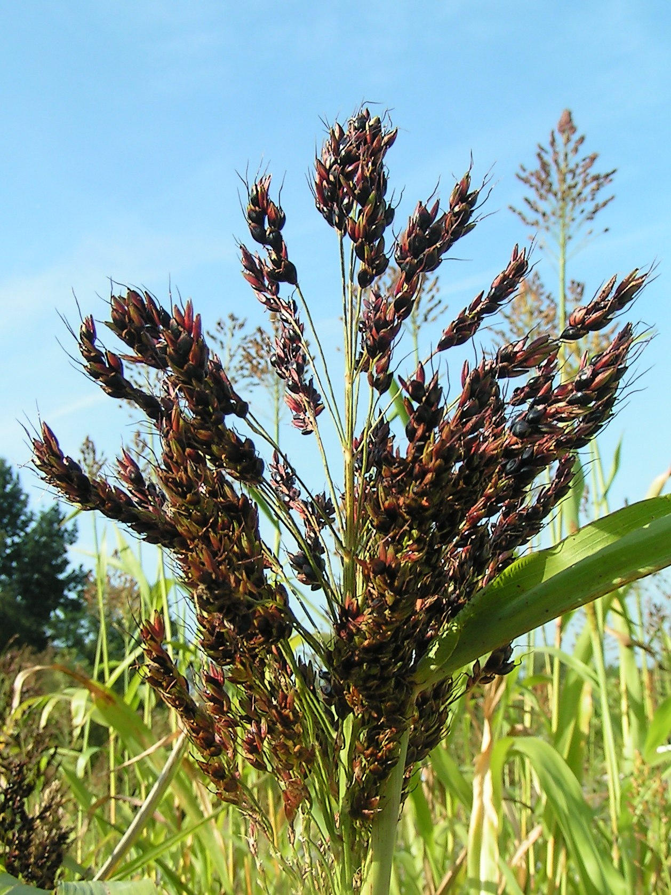

# Sorghum

Sorghum is an annual herb of the genus Sorghum in the grass family, with the cultivated species usually written Sorghum bicolor. FAO material lists it as an important cereal in the dry and semi-arid regions of Africa and Asia, with names including great millet and kaoliang; in China it is also often called shushu or hongliang. It tolerates drought and heat and is highly adaptable, serving as food and feed as well as an important raw material for baijiu, yellow wine and vinegar.

Figure: Sorghum. Image: No machine-readable author provided. Pethan assumed (based on copyright claims)., CC BY-SA 3.0, via Wikimedia Commons ([source page](https://commons.wikimedia.org/wiki/File:Sorghum_bicolor03.jpg)).

## Botany and main types

Sorghum grain can be red, white or yellow, and by starch structure it can be waxy or non-waxy. Waxy sorghum has a higher proportion of amylopectin and becomes sticky and easy to gelatinise after cooking; non-waxy sorghum has more amylose and a firmer structure. Sorghum for brewing usually needs to be plump, with intact husks and few impurities.

Sorghum husks and the outer grain layers contain tannin. A moderate amount can be converted into aroma compounds during fermentation, while too much brings astringency and inhibits microbes. The degree of husking and the tannin content are therefore practical variables in evaluating raw material, not something where "cleaner is always better". Protein and fat proportions in different varieties also affect how loose the grain is after cooking and how microbes grow.

## Why baijiu often uses sorghum

[Baijiu](ref:baijiu) chooses sorghum not because it is "superior", but because its composition suits solid-state fermentation. Sorghum has relatively high starch, moderate protein and fat, and becomes loose and air-permeable after cooking, which helps the microbes in qu grow; a moderate amount of tannin also gives the body structure.

Differences between Chinese baijiu aroma styles come largely from combinations of sorghum variety, qu type, fermentation pit and distillation method, not from a single raw material. Multi-grain recipes using rice, glutinous rice, wheat and maize can also make quality baijiu; sorghum's prevalence comes from process fit and regional tradition, not from being the only correct answer.

## Position in brewing

In baijiu, sorghum is usually the main grain raw material. Light-aroma and sauce-aroma baijiu mostly use sorghum as the main grain; [strong-aroma baijiu](ref:strong-aroma) often uses multi-grain recipes, for example sorghum, rice, glutinous rice, wheat and maize together.

Sauce-aroma baijiu around Maotai town often uses local waxy sorghum, known locally as "hongyingzi", whose small grains and thick husks tolerate repeated steaming and suit the multi-round spirit extraction of sauce-aroma production; [Maotai](ref:moutai) is one representative of this raw-material route. These statements describe the match between raw material and process, not an endorsement of any brand's quality.

Sorghum also has a place in other drinks. Yellow wine traditionally uses rice as its main raw material, but some regional yellow wines add sorghum; beyond baijiu, sorghum is also used for vinegar and some distilled spirits. As food, sorghum grain can be cooked into porridge or eaten as a staple, but brewing sorghum and eating sorghum are not entirely the same in variety and purpose.

## Rice versus sorghum

Comparing sorghum with rice helps explain raw-material differences. Rice starch is fine and protein low, becoming sticky after cooking, which suits small-qu (xiaoqu) processes and some yellow wines; sorghum starch granules are coarser and the husk contains tannin, making the grain looser after cooking and suited to large-qu (daqu) solid-state fermentation and repeated steaming. Both can make alcohol, but the qu types, equipment and fermentation cycles differ.

The comparison also shows that raw materials have no absolute ranking, only a match with process. [Yellow wine](ref:yellow-wine) forms one system around rice, while baijiu forms another around sorghum, and each has a complete technical tradition. Applying one material's standard to another drink easily leads to wrong conclusions.

## Sorghum and aroma styles

Sorghum is not the only factor determining aroma style, but it influences the direction of expression. Light-aroma baijiu pursues clarity and cleanliness, often using even-grained sorghum with moderate husk, controlled through low-temperature qu and clean steaming and burning; sauce-aroma baijiu needs waxy sorghum that tolerates repeated steaming, combined with high-temperature qu and high-temperature stacking to form a mix of sauce, roast and floral notes; strong-aroma baijiu often uses multi-grain recipes, with sorghum providing the frame, rice and glutinous rice adding softness, and wheat and maize bringing different aromas and sweetness.

Understanding these combinations is more meaningful than debating "which sorghum is best" in isolation. Aroma style is the result of raw material, qu type, fermentation vessel, distillation and ageing together; changing any one link changes the final style.

## Regions, climate and raw-material quality

Sorghum is grown across tropical and temperate zones, and its drought tolerance allows production in regions with limited rainfall. Several provinces in northern and southwestern China grow sorghum, with local waxy and non-waxy, red and white varieties coexisting. Regional climate affects grain ripeness, moisture content and tannin accumulation, and therefore cooking and fermentation behaviour.

Raw-material quality also depends on the harvest year, drying and storage. Rain at harvest easily causes mould, and mouldy grain produces off-flavours and food-safety risks. Commercial distilleries usually test incoming sorghum for moisture, impurities, starch and mouldy grains; these indicators reflect actual quality better than "good-looking colour".

## Buying, storage and identification

To understand sorghum as a raw material, three points matter: whether the grain is plump, whether the colour is even, and whether the proportion of impurities and broken grains is reasonable. Brewing sorghum is usually not judged by "the whiter the better" but by total starch, husk proportion and freshness.

Store it away from moisture, insects and mould, because mould produces off-flavours and may bring food-safety risks. Small household quantities should be kept dry, ventilated and dark, away from strongly scented items. When buying sorghum grain, the variety, origin, production date and storage conditions on the package are more reliable than appearance.

## Common misconceptions

First, "sorghum liquor" means all baijiu. Sorghum liquor is a category named by its main raw material, but baijiu can also use rice, glutinous rice, wheat, maize and other grains.

Second, red sorghum is always better for brewing than white. Colour relates to tannin and starch structure; suitability depends on the target process and aroma style, not colour itself.

Third, the more expensive the sorghum, the better. Raw-material quality depends on variety, origin, year and storage, while price also reflects supply, demand and branding.

Fourth, sorghum can only be used for alcohol. It is also an important food and feed crop and is used in vinegar and other fermented products.

Fifth, "hongyingzi" is the only raw material for all sauce-aroma baijiu. Local varieties relate to process routes, and other regions also use raw materials suited to local conditions.

**Short definition:** An annual cereal of the genus Sorghum and one of the main grain ingredients in Chinese baijiu; the balance of starch, protein, fat and tannin in the grain shapes fermentation and flavour. 

## Further reading

- [Baijiu](ref:baijiu): an overview of baijiu raw materials, qu and aroma styles.
- [Strong-aroma baijiu](ref:strong-aroma): multi-grain recipes and solid-state fermentation in mud pits.
- [Maotai](ref:moutai): the sauce-aroma process and its local waxy sorghum route.
- [Yellow wine](ref:yellow-wine): another grain-wine tradition based mainly on rice.
