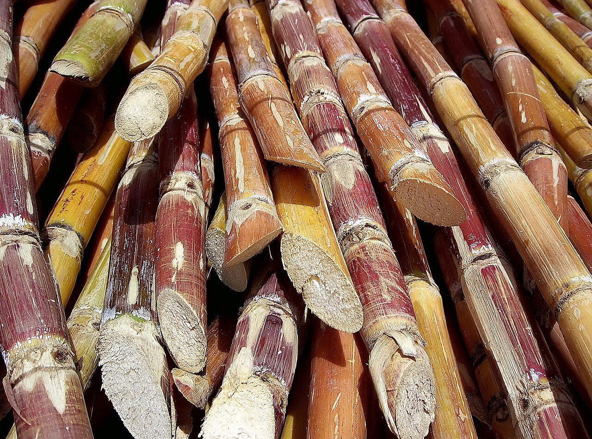

# Sugarcane

Sugarcane is a perennial C4 grass of the genus Saccharum whose stem works like a sugar pipeline, storing photosynthate as sucrose at 12–16%. It underpins the global sugar industry and is the starting point for rum, cachaça and agricultural rum. Pressing and fermenting the juice, or crystallising sugar first and fermenting the molasses, sets the aromatic direction and the regional tradition.

Figure: Harvested sugarcane stalks cut into sections, showing nodes and internodes. Image: ruurmo, CC BY-SA 2.0, via [source page](https://commons.wikimedia.org/wiki/File:Cut_sugarcane.jpg).

## The Saccharum genus and stem structure

Cultivated cane is mostly hybrid, with S. officinarum, S. spontaneum and other species in its parentage. The stem is divided into nodes and internodes, with buds and root bands at the nodes; sucrose is stored mainly in parenchyma cells. As a C4 plant, cane has high photosynthetic efficiency and a large water demand, with a growing cycle of 10–18 months. After harvest, invertase rapidly degrades sucrose, so the gap between cutting and milling should be as short as possible, typically 24–48 hours.

## Sucrose storage and juice handling

Pressed juice contains about 75–85% water, 12–16% sucrose and has a pH near 5.0–5.5, along with wild yeast, lactic acid bacteria and acetic acid bacteria. Once it leaves the mill, it begins to ferment or spoil, so distilleries use rapid chilling, sulphur dioxide or direct pitching to secure a microbial advantage. Yeast cannot use sucrose directly and must first hydrolyse it to glucose and fructose, which is why cane juice ferments start quickly but are also easier to derail.

## Direct fermentation: agricultural rum and cachaça

In Martinique, [agricultural rum](ref:martinique) must use fresh cane juice, ferment it, distil it and age it in oak for a defined minimum; the AOC rules also cover cane varieties, pressing and distillation. Brazilian cachaça likewise starts from juice, ferments for 12–24 hours, usually distils in a column and is legally bottled at 38–48% ABV.

Directly fermented spirit shows green cane, herb, citrus peel and mineral notes, with fermentation usually held at 28–32°C. The more wild flora involved, the more complex the acidity and esters, but the harder the process is to stabilise.

## The sugar route and molasses

Making sugar first and fermenting the molasses is the other main route to [rum](ref:rum). Juice is clarified, evaporated, crystallised and centrifuged, leaving molasses as the mother liquor. Molasses spirit leans toward caramel, liquorice and dark fruit, in contrast to the green character of juice. Both routes coexist in the Caribbean, and distilleries in [Barbados](ref:barbados) and [Jamaica](ref:jamaica) choose according to raw-material supply and tradition.

## Regions and varieties

Cane grows across the tropics and subtropics. Brazil, India, China, Thailand and Pakistan are the main producers; in China, Guangxi, Yunnan and Guangdong lead. Caribbean islands, Réunion, Mauritius, the Philippines and Australia all have their own traditions. Varieties are selected for sugar, disease resistance, ratoon performance and maturity, and distilleries prefer high sugar, moderate fibre and fresh juice.

Traditional regions often burn cane leaves before harvest to reduce bulk and the risk of snakes and insects, but burning pollutes air and loses soil organic matter. Brazil has increasingly restricted burning in favour of green-cane harvesting, which keeps a leaf blanket that conserves moisture and suppresses weeds but adds impurities, so the cane needs more thorough washing before milling. Maturity is judged by Brix and sucrose content: immature juice is acidic and low in sugar, while overripe cane has more invert sugar and ferments less predictably.

Juice concentration is common in tropical distilleries. Heating juice to 60–70°C evaporates some water, raises sugar, suppresses wild microbes and develops a light cooked-cane note, but it also loses freshness and darkens colour. Some distilleries cool and pitch the concentrate, landing between fresh juice and molasses in flavour.

## Substitutes and process differences

Molasses costs less and is more reliable than juice, but brings heavier aroma and higher ash. Refined sugar or high-test molasses ferments more cleanly but lacks the vegetal character of cane. Juice demands a fast processing chain and strict hygiene, while molasses needs dilution, nutrient supplementation and tighter temperature control. "Same raw material" does not make the two interchangeable.

## Sensory impact

Cane-juice rum typically shows grass, cane peel, citrus and white pepper; molasses rum shows caramel, vanilla, coffee, smoke and savoury notes. Pot stills retain more esters and acids, while columns give a cleaner, lighter spirit. Oak ageing adds vanilla, coconut and spice, but the raw-material difference remains the base layer.

## Common misconceptions

First, all rum is made from molasses. Agricultural rum and cachaça use juice. Second, cane spirit is simply rum. Cachaça, agricultural rum and rum each have legal definitions. Third, sweeter juice makes better spirit. Fermentation management matters more than sugar level. Fourth, older is always better. Ageing depends on cask type, climate and spirit structure, not on time alone.

Sugarcane is the raw material behind both cane juice and molasses spirits, but the two routes produce different results. Cane juice is crushed and fermented fresh, giving grassy, floral and sometimes vegetal notes; molasses is boiled, clarified and fermented, giving deeper sugar and caramel notes. Rhum agricole and molasses rum are therefore related but not interchangeable categories.

## See also

- [Rum](ref:rum): the juice and molasses routes.
- [Barbados](ref:barbados): a molasses-rum heartland.
- [Martinique](ref:martinique): the agricultural-rum AOC.
- [Jamaica](ref:jamaica): high-ester rum and wild fermentation.
- [Fermentation](ref:fermentation): juice handling and pitching.
- [Distillation](ref:distillation): pot versus column style.

**Short definition:** Sugarcane is a tall grass of the genus Saccharum whose stems store sucrose; pressing the juice and fermenting it directly yields cane-juice rum and Brazilian cane spirit, while refining sugar first and fermenting the molasses gives the other major rum route.

Sugarcane is best read by starting with the form and provenance, moving to the preparation, and ending with how it behaves in the drink.

[Rum](ref:rum) and [Martinique](ref:martinique) are the two useful reference points for Sugarcane. [Rum](ref:rum) sets out plant or material identity; [Martinique](ref:martinique) brings in origin. Read them together.

Treating Sugarcane as a finished drink mixes two different questions: identity and use. Separate them before comparing.

Sugarcane is crushed for juice, boiled into sugar and molasses, and fermented for rum or distilled for cane spirit.

**Key facts.**

| Item | Detail |
| --- | --- |
| In one line | Sugarcane is a tall grass of the genus Saccharum whose stems store sucrose; pressing the juice and fermenting it directly yields cane-juice rum and Brazilian cane spirit, while refining sugar first and fermenting the mol… |
| Material | Sugarcane is a tall grass of the genus Saccharum whose stems store sucrose |
| Use | pressing the juice and fermenting it directly yields cane-juice rum and Brazilian cane spirit, while refining sugar first and fermenting the molasses gives the other major rum route. |

**Sources and limits.** The key claims about Sugarcane are checked against the following sources: Oxford University Press (Used for entries on sugarcane, cane-juice rum, molasses rum and regions), Food and Agriculture Organization of the United Nations (FAO) (Used to check the public overview of cane cultivation, milling and sugar processing; Used to check global cane output and the ranking of major producers), U.S. Government Publishing Office (Used to check US class requirements for rum raw material and strength) and 5 sources in total. Prices, batches and status change; the body is project-written and does not reproduce source text.
