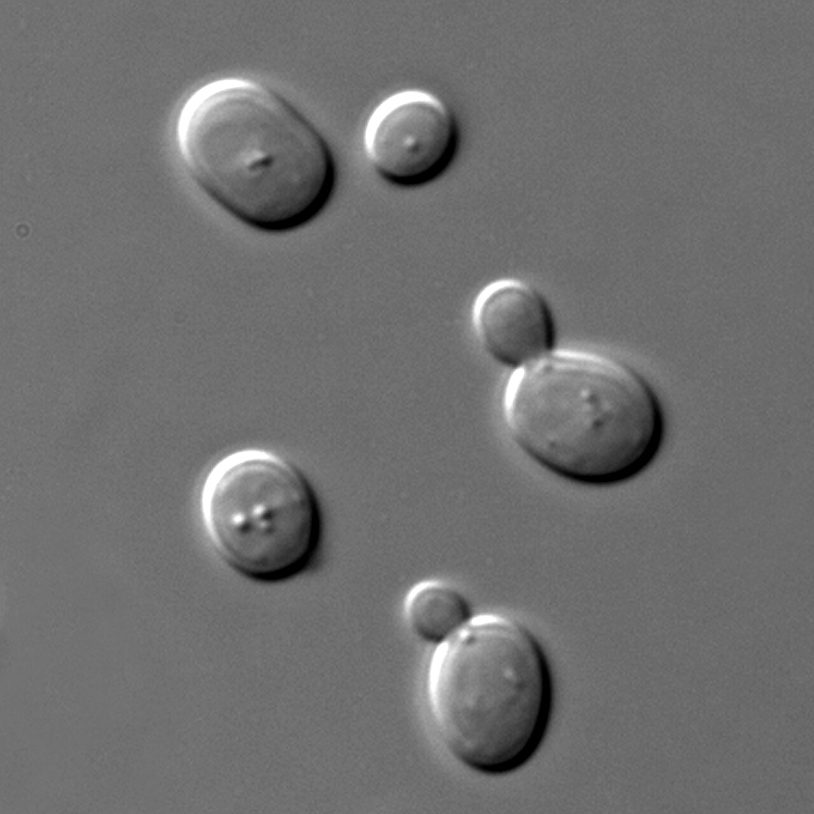

# Yeast

Yeast is a single-celled fungus that turns sugar into ethanol and carbon dioxide during fermentation, and it shapes flavour through esters, higher alcohols, glycerol and organic acids. It both executes fermentation and creates style. Change the strain or the temperature on the same wort or juice and the result can be entirely different, which is why yeast is often called the most overlooked ingredient.

Figure: Yeast. Image: Masur, Public domain, via Wikimedia Commons ([source page](https://commons.wikimedia.org/wiki/File:S_cerevisiae_under_DIC_microscopy.jpg)).

## Single-celled fungus and classification

Saccharomyces cerevisiae belongs to the Ascomycota. Cells are spherical to oval, about 5–10 micrometres across, and reproduce by budding; with ample nutrients at 30°C the doubling time is roughly 90–120 minutes. Brewing yeasts divide into ale and lager types. Ale yeast is mostly S. cerevisiae, ferments at 16–22°C and often forms a foam head; lager yeast is S. pastorianus, a hybrid of S. cerevisiae and S. eubayanus, ferments at 8–13°C and settles to the bottom.

Wine, sake, huangjiu and baijiu use different yeasts or mould systems, but the core ethanol pathway is the same.

## Sugar metabolism and flavour formation

Under anaerobic conditions yeast converts glucose into two molecules of ethanol and two of carbon dioxide. The theoretical ethanol yield is about 51.1% by mass, and practical yields are usually 90–95% of that. Early in fermentation yeast consumes glucose and fructose; sucrose must first be hydrolysed by invertase, while maltose and maltotriose are used later in beer fermentation.

Flavour compounds arise mainly from two routes. Esterification produces ethyl acetate, isoamyl acetate (banana) and phenylethyl acetate (rose); amino acid metabolism produces higher alcohols, aldehydes and acids. Warmer fermentation speeds ester formation but also raises higher alcohols and solvent notes.

## Strains and pitching

Breweries choose ale, lager, wheat or champagne yeast by style; wineries distinguish commercial from indigenous yeast; baijiu producers rely on a community of moulds, yeasts and bacteria in starter and qu. Pitching rate affects both start-up and flavour: too little invites contamination, too much gives a violent ferment and coarse aroma.

Commercial dry yeast usually contains billions of viable cells per gram, and rehydration temperature and liquid composition affect survival. Spontaneous fermentation depends on yeast from fruit skins or the environment; it carries more risk but can express site and vintage.

Water that is too hot kills yeast during rehydration, while water that is too cold leaves the cell membrane poorly restored. Most dry yeasts are rehydrated at 35–40°C in sterile water and then cooled gradually to fermentation temperature to avoid cold shock. The first 24 hours are the critical window for yeast to establish dominance, and oxygen, free nitrogen and temperature must all be in place or wild microbes and bacteria may take the lead.

## Temperature, nitrogen and fermentation management

Temperature is the most direct control. Ale fermentation runs at 16–22°C, lager at 8–13°C, wine at 15–30°C and mead at 18–24°C. Too warm accelerates the ferment but increases higher alcohols and sulphur compounds; too cool risks a stuck ferment.

Yeast-assimilable nitrogen (YAN) is the other key variable. Wine fermentation usually targets 150–250 mg/L YAN, and the risk of stalling rises sharply below 100 mg/L. Beer wort must also supply enough free amino nitrogen; a shortfall calls for supplementation, while an excess can push unwanted ester formation.

Oxygen at the start of fermentation matters as well. Yeast needs oxygen to synthesise ergosterol and unsaturated fatty acids so that its membrane can withstand alcohol toxicity. Wort is usually aerated to 8–10 mg/L at pitching; more encourages oxidation notes, less leaves yeast under-built. Once fermentation turns anaerobic, further aeration only invites acetic acid bacteria and aroma loss. Yeast activity falls sharply above about 15% ABV, which is why many spontaneous ferments stop at 14–16%.

## Regional and beverage differences

Regional yeast populations and practices create local styles: phenolic Belgian ales, fruity English ales, clean German lagers, spontaneous French wines, association sake yeasts in Japan and the qu-based systems of Chinese baijiu. Region is not the only variable, but long selection and habit give local strains recognisable character.

## Substitutes and wild fermentation

Replacing indigenous yeast with a commercial strain makes fermentation more controllable and consistent but can lose site complexity; replacing commercial yeast with wild flora gives more complexity along with stalls, volatile acidity and spoilage risk. Mixed fermentation, sequential inoculation and a pied de cuve starter are common middle paths.

## Sensory impact

Yeast contributes bread, biscuit, banana, pear, rose, honey and spice. Ale yeast often brings fruit and esters, while lager yeast stays cleaner and lets malt speak. Lees ageing releases mannoproteins that add roundness and texture. Excessive autolysis gives meaty, sulphurous and bitter notes.

## Common misconceptions

First, yeast is just a fermentation powder. Strain and process decide a large part of the flavour. Second, more yeast means faster and better fermentation. Over-pitching brings coarse aroma and nutrient competition. Third, wild yeast is always better. Risk and consistency must be weighed. Fourth, yeast flavour means bread. Different strains and temperatures generate very different esters and phenols.

## See also

- [Beer](ref:beer): ale and lager fermentation differences.
- [Wine](ref:wine): commercial versus indigenous yeast.
- [Baijiu](ref:baijiu): starter, qu and multi-species fermentation.
- [Huangjiu](ref:yellow-wine): wheat qu, rice starter and yeast.
- [Fermentation](ref:fermentation): temperature, nitrogen and metabolism.
- [Lees](ref:lees): autolysis and mannoproteins.

Read Yeast through the form and provenance, then the preparation, and finally how it behaves in the drink. The sequence matters.

[Beer](ref:beer)'s plant or material identity and [Baijiu](ref:baijiu)'s origin form a useful pair: the contrast shows where one ends and the other begins.

**At a glance:** Yeast is a single-celled fungus that turns sugar into ethanol and carbon dioxide and produces esters, higher alcohols and other flavour compounds; strain, pitching method and temperature steer fermentation, making yeast the most important and most overlooked variable in brewing. 

Do not reduce Yeast to a finished drink. 

The State Administration for Market Regulation and the Standardization Administration of China, Oxford University Press, the National Center for Biotechnology Information and the International Organisation of Vine and Wine are the main sources behind this entry on Yeast. Each is cited where it bears on a specific claim; none is asked to carry the conclusion alone.

Yeast converts sugar to alcohol and carbon dioxide, and its strain shapes aroma, speed and tolerance.

**Key facts.**

| Item | Detail |
| --- | --- |
| In one line | Yeast is a single-celled fungus that turns sugar into ethanol and carbon dioxide and produces esters, higher alcohols and other flavour compounds; strain, pitching method and temperature steer fermentation, making yeast … |
| Material | Yeast is a single-celled fungus that turns sugar into ethanol and carbon dioxide and produces esters, higher alcohols and other flavour compounds |
| Use | strain, pitching method and temperature steer fermentation, making yeast the most important and most overlooked variable in brewing. |

**Sources and limits.** The key claims about Yeast are checked against the following sources: Industry body (Used to check the terminology framework for yeast, starter culture and fermentation in the baijiu industry), Oxford University Press (Used for entries on yeast, inoculation, spontaneous fermentation and lees; Used for entries on brewing yeast and lager and ale fermentation temperatures), National Center for Biotechnology Information (Used to check the taxonomic position and scientific name of brewer's yeast) and 7 sources in total. Prices, batches and status change; the body is project-written and does not reproduce source text.
