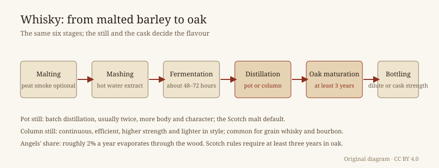

# Distillation

Distillation separates ethanol from water and other volatile components by exploiting differences in boiling points. Fermented liquid or mash usually contains only a low concentration of ethanol; heating, vaporisation and condensation produce a distillate with higher alcohol strength. Distillation is essential to brandy, whisky, rum, vodka and baijiu, but different drinks choose equipment and cut points very differently.

Figure: the six stages of whisky production and where pot and column distillation diverge. Original diagram, CC BY 4.0.

## Principle

Ethanol boils at about 78 °C and water at about 100 °C. When a liquid containing ethanol is heated, the vapour has a higher ethanol proportion than the liquid, so the condensed distillate has higher alcohol strength. Ordinary distillation cannot purify ethanol completely: ethanol and water form an azeotrope, with an azeotropic point of about 95.6% ABV at normal pressure, and simple distillation once or several times can hardly exceed that concentration. Higher purity requires special dehydration methods such as molecular sieves or azeotropic distillation.

Distillation is also a process of selective concentration. Different volatile substances have different boiling points, solubilities and vapour pressures, and heating rate and reflux conditions change their proportions in the distillate. That is why the same fermented liquid, with different equipment and cut points, can yield spirits of very different character.

## Main equipment

Common equipment includes pot stills, column stills and the Chinese steam basket (zengtong). A pot still consists of a heated pot, a swan neck and a condenser, distilling in batches and preserving raw-material flavour; a column still contains multiple plates and distils continuously with higher efficiency, usually giving a more neutral body; the zengtong is used for solid-state distillation in Chinese baijiu, with fermented mash loaded directly into the basket so that steam passes through it and carries ethanol and aroma.

Equipment choice is not a neutral technical matter but part of style design. Batch pot distillation with lower reflux retains more raw-material and fermentation aromas; column distillation improves purity through multiple equilibria and suits cleaner, lighter products. The zengtong combines distillation with the handling of solid mash and creates the distinctive aroma layers of Chinese baijiu.

## Distillation and drink types

Different drinks prefer different methods. [Baijiu](ref:baijiu) mostly uses solid-state distillation, emphasising grain, qu and pit aromas; [whisky](ref:whisky) often uses pot stills, with Scotch malt whisky usually distilled twice and some distilleries three times; [brandy](ref:brandy) mainly uses pot stills to pursue fruit aroma and ageing potential; rum and vodka often use column stills for efficiency and purity.

These choices relate to raw material, regulation and drinking tradition. Grape-based brandy needs to preserve fruit aroma and ageing potential, so it relies more on pot stills; molasses- or grain-based vodka pursues neutrality, where column stills suit better. Drink names often imply a set of process expectations, but specific practice still varies by producer.

## Cuts and flavour

During distillation the outflow is divided in sequence into heads, hearts and tails. Heads contain more low-boiling substances such as aldehydes and some esters, giving pungent aroma but a harsh palate; the heart is the main body, with alcohol strength and flavour in better balance; tails contain more high-boiling substances such as higher alcohols and fatty acids, giving a heavy palate. Producers keep the heart by "cutting heads and tails", with exact cut points depending on drink type, equipment and target style.

Cut points directly determine the composition of the finished spirit. Cutting too early loses aroma and body; cutting too late brings pungent, oily or bitter substances. Producers often judge the switch using [alcohol strength](ref:abv), aroma and palate together rather than a single number. After cutting, strength still changes with storage and water addition, so cutting is a flavour decision, not merely a concentration decision.

## Key parameters

Heating rate, reflux ratio, number of plates, vacuum and condensation temperature all affect the composition of the distillate. Slow heating and a higher reflux ratio usually give a cleaner, more focused body; fast distillation retains more volatile flavour but may also carry impurities.

Vacuum distillation lowers the boiling point and reduces losses of heat-sensitive substances, and is often used for aromatic spirits. Condensation temperature affects vapour condensation and reflux, and insulation and cooling-water temperature change the actual result. Producers must trade off purity, flavour retention and energy, and no parameter is "optimal" apart from a drink type.

## Double and triple distillation

The number of distillations is part of style design. Scotch malt whisky is usually distilled twice, and some distilleries use three distillations to pursue a lighter, cleaner palate; Irish whisky is also often triple distilled. More distillations raise strength and purity but also reduce flavour compounds. A single distillation retains more raw-material character but gives lower strength and more impurities.

Producers choose the number according to the target style rather than chasing "the more the better". The same distillery may use different numbers for different product lines to create product differentiation. Judgement should consider distillation count together with raw material, equipment, cut points and ageing; looking at the count alone easily leads to one-sided conclusions.

## History and evolution

Distillation developed independently in different regions and spread through trade, colonisation and industrialisation. Early distillation was mostly used to preserve perishable agricultural produce or to make medicinal alcohol, and later developed into drinking spirits. The column still raised efficiency and output, while the pot still survived in drinks that pursue flavour.

Chinese baijiu's solid-state distillation and zengtong craft form another independent technical tradition. These traditions share the use of boiling-point differences to concentrate ethanol and differ in raw-material state, equipment structure and flavour goals. Understanding this history helps explain why spirits are so diverse today.

## Common misconceptions

First, the more distillations the better. Multiple distillations raise purity but also strip flavour, and suitability depends on the drink type.

Second, the higher the alcohol strength, the better the quality. Strength is only a concentration parameter; flavour, balance and raw-material expression matter just as much.

Third, all spirits use the same still. Pot, column and zengtong each have their own applications, and equipment choice is part of style design.

Fourth, "cutting heads and tails" only removes impurities. It also affects aroma, body and palate, and is a key step in flavour design.

Fifth, distillation equals purification. Distillation raises alcohol strength while selectively retaining or excluding volatile compounds.

**In brief:** A process that separates and concentrates ethanol from a fermented liquid or mash by exploiting differences in boiling points; equipment, reflux and cut points shape the spirit's flavour. 

## Further reading

- [Baijiu](ref:baijiu): the solid-state distillation and zengtong system.
- [Whisky](ref:whisky): pot distillation, distillation counts and the ageing framework.
- [Brandy](ref:brandy): distillation and ageing routes based on grapes.
- [Alcohol by volume](ref:abv): understanding distillate strength, cut points and water reduction.
