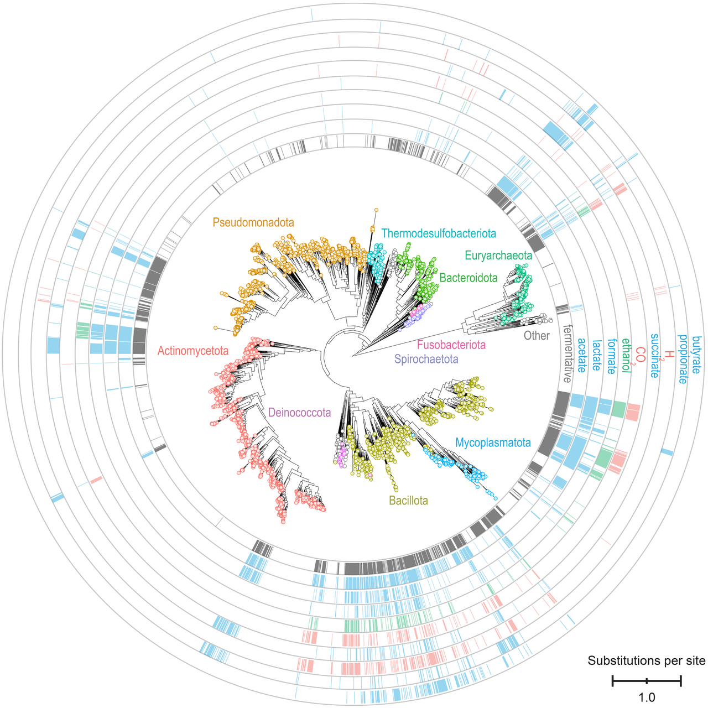

# Fermentation

Fermentation is the metabolic process in which yeast or bacteria break down sugar under low-oxygen conditions and produce ethanol, carbon dioxide and flavour compounds. It converts the chemical energy of sugar into cellular energy and releases ethanol as a waste product. Every fermented drink depends on this step: wine, beer, sake, cider and honey wine gain their alcohol from it, while baijiu, whisky and brandy ferment first and then concentrate the alcohol by [distillation](ref:distillation).

Figure: Fermentation. Image: Tjhackmann, CC BY-SA 4.0, via Wikimedia Commons ([source page](https://commons.wikimedia.org/wiki/File:Phylogenetic_tree_of_bacteria_and_archaea,_highlighting_those_that_carry_out_fermentation.png)).

## Place in the process

Fermentation sits between sugar supply and post-treatment. Upstream are pressing, [saccharification](ref:saccharification) or qu making; downstream are racking, filtration, ageing, distillation or bottling. It has a clear start, whether by inoculation or spontaneous onset, and a clear end, whether sugar runs out, alcohol reaches tolerance or the process is stopped deliberately. Treating fermentation, ageing and distillation as one block hides where alcohol and flavour are actually formed.

## Steps and parameters

Fermentation normally passes through a lag phase, exponential growth, a stationary phase and decline. Ale ferments at 18–22 °C for 3–7 days and lager at 8–12 °C for 7–14 days; red wine usually ferments on skins at 20–30 °C for 5–15 days and white wine at 12–20 °C; sake mash often ferments slowly at 10–18 °C for about 20–35 days. These ranges follow the common descriptions in the OIV, national-standard and industry material listed on this process. About 17 g of sugar per litre yields 1% alcohol by volume, and the tolerance of wine yeast usually sits at 15–16%, with adapted strains going higher. Wine pH is mostly 3.2–3.8, while fermenting beer is mostly 4.0–4.6.

## Mechanism: glycolysis and by-products

Wine yeast runs glycolysis, converting glucose into pyruvate, which pyruvate decarboxylase turns into acetaldehyde and alcohol dehydrogenase then reduces to ethanol while regenerating NAD⁺. Without oxygen, this route still lets the cell make ATP. Glycerol is a by-product of osmotic and redox balance; higher alcohols come from amino acids through the Ehrlich pathway; esters form when acetyl-CoA and alcohols are joined enzymatically; hydrogen sulfide comes from sulfur-amino-acid metabolism. Bacterial routes differ: lactic acid bacteria use homo- or heterofermentative lactate fermentation, while acetic acid bacteria oxidise ethanol to acetic acid, which is why fermented drinks turn sour.

## Equipment and variants

Vessels include stainless-steel tanks, oak barrels, concrete tanks, open fermenters, clay jars and fermentation pits. Stainless steel is easy to cool and clean, oak adds micro-oxygenation and wood aroma, concrete holds heat steadily, and open vessels help yeast recovery but raise oxidation risk. Variants include spontaneous versus inoculated fermentation, skin-contact versus clear-juice fermentation, whole-cluster fermentation, carbonic maceration, continuous and batch fermentation. Baijiu uses pits or earthen jars for solid-state fermentation, sake uses open or closed tanks, and equipment follows drink type and scale rather than a universal best design.

## Failure modes and diagnosis

A stuck fermentation shows as gravity or sugar that will not fall, often caused by poor nutrition, a sudden temperature drop, alcohol toxicity or pesticide residue. Reductive off-flavours come from hydrogen sulfide and mercaptans, smelling of rotten eggs or drains; rising volatile acidity points to acetic acid bacteria or heterofermentative lactobacilli; excess acetaldehyde gives green apple and solvent notes. Diagnosis should combine the gravity curve, temperature log, viable yeast count and volatile acidity rather than aroma alone. Refermentation in bottle brings haze, pushed corks and even bursting, so residual sugar and microbial status must be confirmed before filling.

## Effect on flavour

Fermentation sets the frame of alcohol, acidity and aroma. Slow cool fermentation retains more fruit and esters, warm fast fermentation produces more higher alcohols and solvent heat; skin contact extracts colour and tannin, lees contact adds roundness; yeast strain sets the ester profile and sulfide output. In [wine](ref:wine), temperature and maceration time decide fruit and structure; in [beer](ref:beer), yeast and temperature decide ester character and cleanliness; in [baijiu](ref:baijiu), solid-state multi-species fermentation builds complex aroma precursors that distillation later carries into the spirit.

## Effect on stability

Residual sugar, pH, alcohol and leftover nutrients at the end of fermentation decide what happens next. High residual sugar with too little alcohol allows refermentation in bottle; a higher pH lets lactic and acetic acid bacteria act more easily; residual oxygen encourages acetic acid bacteria and oxidation. Only complete fermentation, sufficient alcohol and appropriate sulfur dioxide or filtration support long ageing. Runaway temperature can also increase precursors of ethyl carbamate, a safety marker that needs monitoring.

## Common misconceptions

First, that fermentation only "makes alcohol", ignoring how glycerol, esters and acids shape texture. Second, treating temperature as the only variable and ignoring nutrition and dissolved oxygen. Third, assuming spontaneous fermentation is always better and ignoring the risk of loss of control and batch variation. Fourth, using "secondary fermentation" as a catch-all, when in-bottle sparkling fermentation and malolactic fermentation are different processes. Fifth, reading any residual sugar as a failed fermentation, when sweet styles may be intentional.

## See also

- [Saccharification](ref:saccharification): the upstream step that turns starch into fermentable sugar.
- [Distillation](ref:distillation): the downstream step that concentrates alcohol from a fermented liquid.
- [Wine](ref:wine), [beer](ref:beer) and [baijiu](ref:baijiu): three ways of organising fermentation around different raw materials and microbes.

Fermentation is best read by starting with the inputs, moving to the sequence of steps, and ending with what changes at the end.

Setting [Saccharification](ref:saccharification)'s purpose beside [Wine](ref:wine)'s control point makes the boundary between them visible.

**Short definition:** The metabolic process in which yeast or bacteria convert sugar into ethanol, carbon dioxide and flavour compounds under low oxygen; strain, temperature, sugar concentration, pH and oxygen set speed, strength and aroma.

Fermentation temperature and yeast strain decide whether a wine or beer stays clean and fruity or develops esters and higher alcohols; nutrition and oxygen also matter. A slow, cool fermentation preserves aroma, while a warm one can add complexity but risks off-flavours. The vessel and the time on the lees shape texture after the sugar is gone.

**Key facts.**

| Item | Detail |
| --- | --- |
| In one line | The metabolic process in which yeast or bacteria convert sugar into ethanol, carbon dioxide and flavour compounds under low oxygen; strain, temperature, sugar concentration, pH and oxygen set speed, strength and aroma. |
| Applies to | Wine、Beer、Baijiu |

**Sources and limits.** The key claims about Fermentation are checked against the following sources: International Organisation of Vine and Wine (OIV) (Used to check the framework for wine fermentation, yeast and alcohol content), State Administration for Market Regulation, Standardisation Administration of China (Used to check fermented drink categories and process terminology), Encyclopaedia Britannica (Used for reference on fermentation metabolism, yeast and anaerobic processes) and 4 sources in total. Prices, batches and status change; the body is project-written and does not reproduce source text.

For Fermentation, this process was last checked in 2026; prices, batches and availability change, so confirm them against the sources below.
