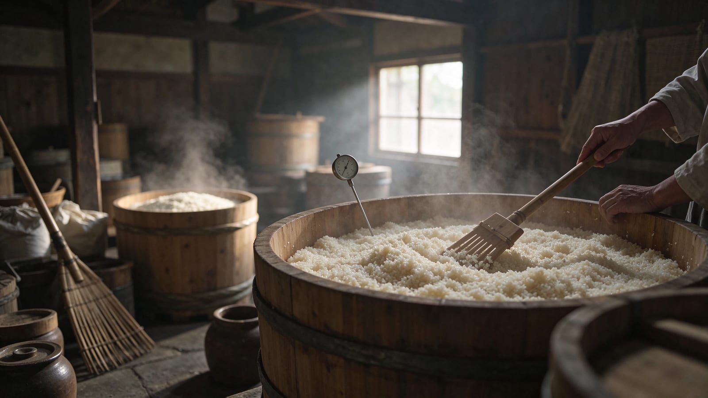

# Kimoto and yamahai

Kimoto and yamahai are two traditional sake-mother methods for [sake](ref:sake), both relying on natural lactic acid bacteria to acidify the mother instead of adding lactic acid. Kimoto keeps the yamafuri step, in which the mixture is mashed into a paste, while yamahai omits it. The two are often treated as synonyms, yet they differ in how microbes act, in labour demand and in the finished style, and neither should be confused with steps outside the mother.

Figure: Editorial illustration of kimoto and yamahai starter mash: rice koji and steam in a wooden vat, turned with a bamboo rake; AI-assisted, not a photograph. Image: Hejiu editorial team, project-owned.

## Place in the process

The sake mother is the intermediate stage where yeast is cultivated, sitting between [koji making](ref:qu-making) and mash fermentation. Once rice, rice koji and water are combined, yeast must multiply while unwanted microbes are suppressed. Sake solves this with acidification, which gives three routes: sokujo with added lactic acid, kimoto led by natural lactic acid bacteria, and yamahai, which omits yamafuri. The mother route is not a grade: the same named category can be made with different mothers, so a mother term on the label describes process only.

## Steps and parameters

In kimoto, steamed rice, rice koji and water go into the vessel, the batch is started cool, yamafuri mashes the mixture into a paste, and a warming phase then lets lactic acid bacteria and yeast follow one another. The whole cycle usually takes 2–4 weeks, starting at about 5–10 °C and rising to 10–15 °C later. Yamahai skips the mashing and achieves acidification through long stirring and temperature control, also over about 2–4 weeks. Sokujo adds lactic acid directly and takes about 2 weeks. These ranges follow the common descriptions in the association, National Tax Agency and brewing-research material listed on this process.

## Mechanism: the lactic acid relay

The mother starts near neutral pH, and rice and koji bring sugar, amino acids and minerals along with lactic acid bacteria, wild yeast and unwanted microbes. Kimoto uses yamafuri to break up the rice, release starch and enzymes, introduce oxygen and even out temperature so that lactic acid bacteria multiply first. Leuconostoc-type cocci bring pH down to about 4, then more acid-tolerant lactobacilli continue until pH reaches 3.3–3.5. That acidity suppresses most spoilage organisms while allowing sake yeast to dominate after the yeast addition. Yamahai relies more on the oxygen and temperature curve created by stirring, which is why its flavour profile differs slightly.

## Equipment and variants

Tradition used wooden mother tanks, long-handled paddles for yamafuri and manual stirring; modern breweries mostly use stainless or enamel-lined tanks with mechanical agitation and jacketed temperature control. Variants include fully manual kimoto, mechanically assisted kimoto, yamahai, and label terms such as kimoto-brewed or yamahai-brewed. Some breweries use a high-temperature saccharification method to shorten the mother stage, but that is no longer kimoto or yamahai. Tank material affects heat retention and cleaning, while stirring intensity affects oxygen and the microbial community.

## Failure modes and diagnosis

First, insufficient acidification: pH will not fall and spoilage organisms gain room, giving off-flavours or a viscous mother. Second, acidification too fast or too warm: lactic acid bacteria and wild yeast run away and produce acetic acid, butyric acid or a stale smell. Third, inadequate yamafuri: rice is not broken up enough, enzyme action is uneven and fermentation starts slowly. Fourth, poor timing of yeast addition: pitching before acidity is established lets contaminants compete. Diagnosis should combine pH, acidity, temperature records, smell and microscopy, not calendar days alone.

## Effect on flavour

The natural lactic route usually gives higher acidity and stronger umami, with lactic, nutty, grainy and matured aromas rather than the fruitiness of ginjo styles. Kimoto, with the oxygen and microbial diversity introduced by yamafuri, is often described as having more layers; yamahai leans towards acidity and richness. Warming the sake amplifies acidity and umami and makes alcohol more obvious. These sake suit stews, soy-flavoured dishes and oilier fish and shellfish, while delicate sashimi is easily overwhelmed.

## Effect on stability

The acidity of the mother is the first defence of the later mash. A mother with low pH and enough lactic acid suppresses most spoilage organisms and lets sake yeast work slowly in the 10–18 °C mash. If mother acidity is insufficient, the mash may sour early or develop off-aromas. Kimoto and yamahai usually carry higher live yeast counts and start fermentation more reliably, but the cycle is long and temperature management is demanding, with greater risk in hot weather. If the finished sake is not pasteurised or filtered, residual enzymes and microbes can still change it.

## Labels and identification

Labels often show kimoto-brewed, yamahai-brewed or kimoto-made expressions that describe the mother route, not a named-category grade. Yamahai sake can be [junmai](ref:junmai) or [honjozo](ref:honjozo), so yamahai is not a synonym for junmai. Buyers should read the category word, mother term, polishing ratio and alcohol level together; inferring flavour or quality from the word yamahai alone easily misleads.

## Common misconceptions

First, treating kimoto and yamahai as the same thing and ignoring whether yamafuri was done. Second, equating yamahai with junmai and ignoring that it can combine with honjozo. Third, calling sokujo a cheap process, when it is stable, clean and the modern mainstream. Fourth, assuming natural lactic acid always tastes better, when complexity is not to every drinker's taste. Fifth, treating yamahai as a legal grade, when it is only a mother method and a labelling term.

## See also

- [Sake](ref:sake): the category system and brewing framework.
- [Junmai](ref:junmai) and [honjozo](ref:honjozo): categories often paired with kimoto and yamahai.
- [Koji making](ref:qu-making) and [fermentation](ref:fermentation): rice koji and the upstream principles of mash fermentation.
- [Japan](ref:japan): the national and regional background of sake.

Read Kimoto and yamahai through the inputs, then the sequence of steps, and finally what changes at the end. The sequence matters.

[Sake](ref:sake) explains purpose; [Honjozo sake](ref:honjozo) adds control point. Put Kimoto and yamahai between them before deciding what it is.

**In brief:** Two traditional sake-mother routes that rely on natural lactic acid bacteria; kimoto keeps the yamafuri mashing step while yamahai omits it, and both differ from the sokujo route that adds lactic acid, shaping acidity, umami and production time.

**Key facts.**

| Item | Detail |
| --- | --- |
| In one line | Two traditional sake-mother routes that rely on natural lactic acid bacteria; kimoto keeps the yamafuri mashing step while yamahai omits it, and both differ from the sokujo route that adds lactic acid, shaping acidity, u… |
| Applies to | Sake、Junmai sake、Honjozo sake |

**Sources and limits.** The key claims about Kimoto and yamahai are checked against the following sources: Japan Sake and Shochu Makers Association (the differences between kimoto, yamahai and sokujo sake mothers), National Tax Agency of Japan (the use of kimoto-brewed and yamahai-brewed labelling terms), Oxford University Press (Consulted for entries on sake mother, kimoto and yamahai; Migrated from the former reference list at the end of the article; access date not re-verified) and 5 sources in total. Prices, batches and status change; the body is project-written and does not reproduce source text.

For Kimoto and yamahai, this process was last checked in 2026; prices, batches and availability change, so confirm them against the sources below.
