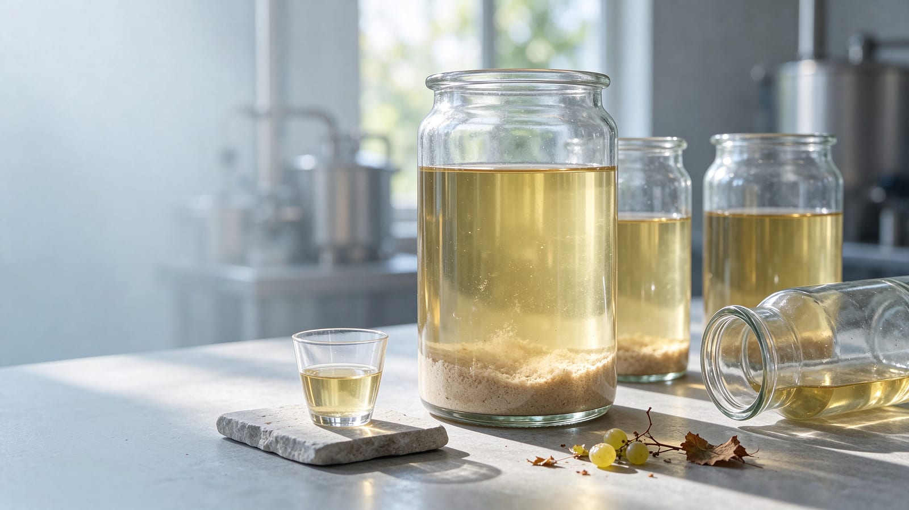

# Lees ageing

Lees ageing (French sur lie) keeps wine in contact with the [lees](ref:lees) that settle after fermentation. The bulk of the lees is spent yeast, mixed with a little grape debris and tartrate. Gross lees are coarse and prone to spoilage and are usually separated quickly; fine lees are small, slow to settle and may deliberately be retained. The key to the process is not leaving the wine alone but controlling contact time, temperature, sulfur dioxide and whether the lees are stirred.

Figure: Editorial illustration of lees ageing: wine layered above fine lees, with a racking tube and sample glass; AI-assisted illustration, not a photograph. Image: Hejiu editorial team, project-owned.

## Place in the process

Lees ageing sits after alcoholic [fermentation](ref:fermentation) and before clarification and bottling. It is a maturation tool but not maturation itself: ageing is the time dimension, while lees ageing is one way of maturing with a contact medium. It can be combined with [oak ageing](ref:oak-ageing) or carried out entirely in stainless steel. Bottle ageing on lees in sparkling wine applies the same principle inside a closed vessel, with the addition of pressure and disgorging.

## Steps and parameters

Still white wine often keeps fine lees after fermentation and rests at 10–15 °C for 4–12 months; bâtonnage is done once or twice a week, or adjusted to tasting results. Free sulfur dioxide is commonly held at 20–35 mg/L, enough to limit oxidation and unwanted microbes without suppressing autolysis. These ranges follow the common descriptions in the OIV material and wine reference work listed on this page. The traditional-method rule in Champagne is that non-vintage Champagne must age at least 15 months before release, including at least 12 months on lees, while vintage Champagne must age at least 36 months in total.

## Mechanism: autolysis and reductive protection

Yeast cells in the lees gradually autolyse, and cell-wall and intracellular material is broken down by hydrolytic enzymes, releasing mannoproteins, polysaccharides, amino acids, fatty acids and nucleotides. Mannoproteins adsorb tannin and pigment, improving colloidal stability and making the texture rounder; polysaccharides raise the sense of viscosity and soften the sharp edge of acidity. Fine lees also consume dissolved oxygen and create a low-redox zone below the surface that limits oxidation. The cost is that sulfur metabolism continues in the absence of oxygen, so hydrogen sulfide and mercaptans can accumulate as reductive notes.

## Equipment and variants

Common vessels are temperature-controlled stainless tanks, oak barrels and concrete tanks, with a stirring rod or built-in agitation. Variants include static contact without stirring, regular bâtonnage, combined micro-oxygenation, separation and later return of lees, and in-bottle contact for sparkling wine. Champagne also needs riddling and disgorging equipment, and some producers use inert gas to limit oxygen pickup. The more airtight the vessel and the more stable its temperature, the more controllable the reductive risk, though a completely oxygen-free tank also makes sulfides harder to disperse.

## Failure modes and diagnosis

First, reductive notes: cabbage, drains or burnt rubber, from hydrogen sulfide and methanethiol, often caused by a thick lees layer, low oxygen or poor nutrition. Second, bitterness and spoilage from gross lees left too long, bringing bitter, earthy and rancid-fatty notes. Third, haze and protein instability when the lees are too fine or stirring is too vigorous and solids will not settle. Fourth, sulfur dioxide imbalance: too much suppresses autolysis, too little allows oxidation or lactic acid bacteria. Diagnosis should combine sensory checks, turbidity, redox potential and sulfide analysis rather than assuming that long contact is enough.

## Effect on flavour

The clearest change is textural: a fuller body, a softer acid edge, and creamy, bready, nutty and yeasty notes in white wine. In [sparkling wine](ref:sparkling-wine), time on lees directly sets the intensity of toasted and biscuit flavours, and the layers of vintage Champagne often come from longer autolysis. In [wine](ref:wine), lees and oak are often used together: the barrel gives micro-oxygenation and wood, the lees give texture and reductive protection. Handled badly, lees let sulfides mask the fruit and produce a dull, reductive style.

## Effect on stability

Mannoproteins and polysaccharides released by the lees inhibit potassium bitartrate crystallisation, improve protein stability and reduce chill haze and protein haze after bottling. Autolysis also releases a little nitrogen, which can become microbial nutrient if not handled later. Oxygen is continuously consumed during lees ageing, lowering oxidation risk, but if the wine is aerated during racking, the reductive notes already formed can oxidise into more persistent mercaptans. Longer bottle contact in sparkling wine gives finer bubbles, but after disgorging the dosage and closure must still be handled to avoid a second oxidation.

## Common misconceptions

First, equating lees ageing with ageing in general and forgetting that it is only one contact-based method. Second, assuming more lees is better while ignoring the bitterness and spoilage that gross lees bring. Third, calling reductive notes complexity when excess sulfide is a fault. Fourth, believing stirring is compulsory, when static contact also works. Fifth, treating lees ageing and yeast autolysis as synonyms, when autolysis is only one reason the method creates flavour.

## See also

- [Lees](ref:lees): classification, composition and separation of lees.
- [Wine](ref:wine) and [sparkling wine](ref:sparkling-wine): still-wine and in-bottle applications.
- [Fermentation](ref:fermentation) and [oak ageing](ref:oak-ageing): upstream metabolism and a parallel maturation tool.

Start with the inputs. From there, consider the sequence of steps, then what changes at the end. That is how a practical judgment about Lees ageing is built.

[Lees](ref:lees)'s purpose and [Sparkling wine](ref:sparkling-wine)'s control point form a useful pair: the contrast shows where one ends and the other begins.

**At a glance:** An ageing method that keeps wine in contact with the fine lees left after fermentation; stirring frequency, temperature and time bring roundness, creamy and bready notes and a reductive barrier, but poor handling produces sulfides and bitterness. 

It is tempting to treat Lees as ageing a brand. Its identity and use are separate questions.

**Key facts.**

| Item | Detail |
| --- | --- |
| In one line | An ageing method that keeps wine in contact with the fine lees left after fermentation; stirring frequency, temperature and time bring roundness, creamy and bready notes and a reductive barrier, but poor handling produce… |
| Applies to | Wine、Sparkling wine |

**Sources and limits.** The key claims about Lees ageing are checked against the following sources: International Organisation of Vine and Wine (OIV) (Used to check lees, sur lie and bâtonnage terminology), Oxford University Press (Used for reference on fine lees, bâtonnage and yeast autolysis), Comité Interprofessionnel du vin de Champagne (Used to check minimum ageing on lees and disgorging in Champagne) and 4 sources in total. Prices, batches and status change; the body is project-written and does not reproduce source text.

For Lees ageing, this page was last checked in 2026; prices, batches and availability change, so confirm them against the sources below.
