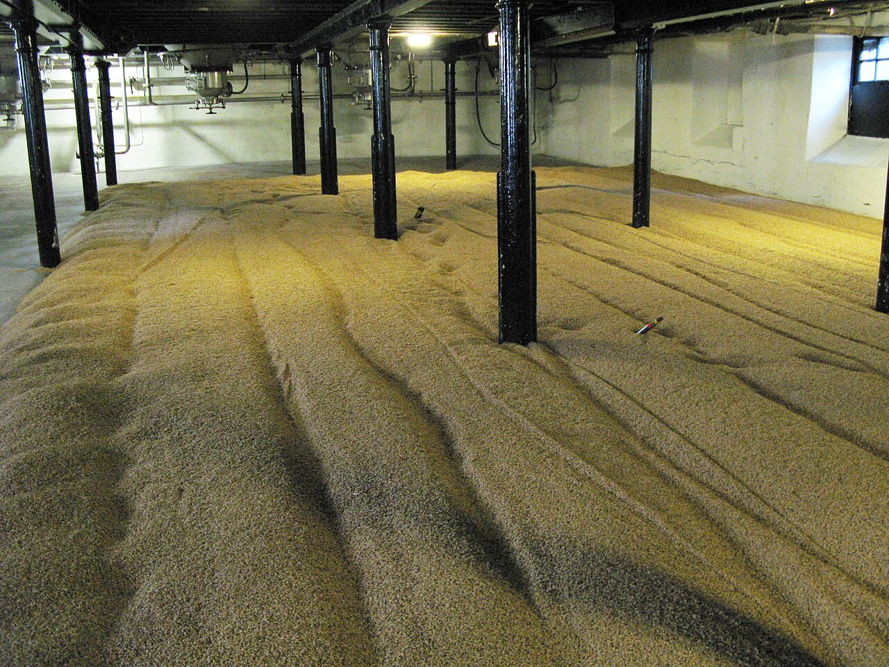

# Malting

Malting turns [barley](ref:barley) and other grains into malt. Its core is not simply letting grain sprout: germination wakes the grain's own enzyme system, and kilning then fixes those enzymes and drives moisture down. Beer and whisky both depend on malting, because without the amylases supplied by malt, [saccharification](ref:saccharification) cannot convert endosperm starch into fermentable sugar.

Figure: Malting. Image: Lakeworther, CC BY-SA 3.0, via Wikimedia Commons ([source page](https://commons.wikimedia.org/wiki/File:Highland_park_malting_floor.jpg)).

## Place in the process

Malting sits between agricultural raw material and brewhouse, and is a separate pre-treatment industry. Upstream are variety choice, cleaning and grading; downstream are milling, mashing and fermentation. It turns dormant grain, which stores badly and has very low enzyme activity, into a semi-finished material with stable moisture, controllable enzyme power and designable flavour. Calling malting "cleaning the raw material" underrates it: malt modification and colour are already fixed at this stage.

## Steps and parameters

Malting is divided into steeping, germination, kilning and de-rooting. Steeping usually lasts 40–48 hours, alternating wet and air rests to bring moisture to 42–46%; germination runs at 12–16 °C for 4–6 days, with turning and ventilation controlling bed temperature and moisture; kilning first dries at 50–65 °C and then cures base malt at 80–85 °C, while speciality malt may reach 100–220 °C; de-rooting removes rootlets, which are about 3–5% of finished malt mass. These ranges follow the common descriptions in the brewing reference works, encyclopaedia and association material listed on this page. The final steep is often treated with lime water or alkali to reduce surface mould, and the germination bed is turned every 4–6 hours to prevent local hot spots and uneven growth.

## Mechanism: enzyme formation and starch modification

Dormant barley contains almost no active amylase. After water uptake, gibberellin is activated, the aleurone layer synthesises alpha-amylase, proteases and beta-glucanase, and beta-amylase is released from its bound form. Alpha-amylase cuts alpha-1,4 bonds at random, beta-amylase removes maltose from non-reducing ends, proteases break down storage protein, and beta-glucanase degrades endosperm cell walls so starch is exposed. This is called modification. Kilning heat progressively deactivates the enzymes while sugars and amino acids undergo Maillard reactions that create colour and toasted aroma.

## Equipment and variants

Traditional maltings used steeping tanks, germination floors, shovels and direct-fired kilns; modern plants use Saladin boxes, drums, tower germination and indirect hot-air kilns. Variants include floor malt, box malt and tower malt; by product there are base malt, caramel malt, chocolate malt, smoked malt and Vienna malt. Whisky distilleries often kiln with peat so that phenols adhere to the malt; breweries choose the bill by colour and enzyme power. Small craft breweries mostly buy finished malt, since in-house malting needs stable temperature and humidity plus a large footprint.

## Failure modes and diagnosis

First, uneven germination: a bed that is too deep, turning that is too infrequent or uneven moisture gives rootlets of different lengths and inconsistent modification. Second, mould: poor ventilation or excessive temperature after steeping brings musty smells and caking. Third, over-modification: protein breakdown goes too far, the malt mashes easily but foam and body suffer and yield falls. Fourth, low enzyme power: too hot or too long a kiln leaves an iodine test that stays dark for a long time during mashing. Fifth, excess rootlet residue, which brings bitterness and absorbs moisture. Diagnosis should combine rootlet length, friability, mealiness, enzyme assay and a mash trial. Malt stored above 5% moisture also loses enzyme power faster and is prone to mould, so stock should be rotated first-in-first-out.

## Effect on flavour

Base malt supplies most fermentable sugar and grain sweetness, while speciality malts supply colour and caramel, nutty, coffee and smoky notes. In a given bill, a higher share of base malt means more enzyme power, while a higher share of speciality malt means more colour and toasted aroma. The hotter the kiln, the less enzyme survives and the stronger the flavour contribution. In [beer](ref:beer), the malt bill determines colour, sweetness, foam and malt aroma and is the main variable in style; in [whisky](ref:whisky), malt supplies enzymes and sugar, and peat kilning adds smoky phenols; in the wort before [fermentation](ref:fermentation), how the malt was handled affects saccharification efficiency and the nutrients available to yeast.

## Effect on stability

Malt moisture, enzyme power and microbial load affect finished stability. Moisture above 5% invites mould and enzyme loss; poorly modified malt needs a longer mash and raises oxidation risk; over-modified malt weakens protein buffering and beer foam stability. Microbes on the malt surface enter the wort after milling and can bring off-flavours if the boil is inadequate. Storage should be dark, dry and cool, with first-in-first-out rotation to limit enzyme decline over time.

## Common misconceptions

First, equating malting with germination and ignoring steeping, kilning and de-rooting. Second, assuming paler malt is "purer" and ignoring the functional differences between colour levels. Third, reading colour without reading modification, which leads to a mismatched mash schedule. Fourth, thinking smoky flavour comes from the grain itself, when it usually comes from phenols in the kilning fuel. Fifth, confusing malting with saccharification, which makes it impossible to explain why malt quality limits yield.

## See also

- [Barley](ref:barley): the main raw material and the effect of variety.
- [Beer](ref:beer) and [whisky](ref:whisky): the two main downstream products.
- [Saccharification](ref:saccharification) and [fermentation](ref:fermentation): how malt enzymes and sugar profile enter later stages.

Start with the inputs. From there, consider the sequence of steps, then what changes at the end. That is how a practical judgment about Malting is built.

Put [Barley](ref:barley)'s purpose next to [Whisky](ref:whisky)'s control point; the difference marks the boundary.

**Short definition:** The pre-treatment that steeps, germinates, kilns and de-roots barley and other grains; the degree of germination and the kilning curve set amylase power, modification and colour, and therefore saccharification efficiency and finished flavour.

Treating Malting as a brand mixes two different questions: identity and use. Separate them before comparing.

**Key facts.**

| Item | Detail |
| --- | --- |
| In one line | The pre-treatment that steeps, germinates, kilns and de-roots barley and other grains; the degree of germination and the kilning curve set amylase power, modification and colour, and therefore saccharification efficiency… |
| Applies to | Beer、Whisky |

**Sources and limits.** The key claims about Malting are checked against the following sources: Oxford University Press (Used for reference on steeping, germination, kilning and malt types), Encyclopaedia Britannica (Used for reference on malt preparation and germination), Brewers Association (Used to check industry descriptions of steeping moisture, germination temperature and kilning curves) and 4 sources in total. Prices, batches and status change; the body is project-written and does not reproduce source text.

**Read alongside.** Put Malting next to Barley, Beer, Whisky: the first fixes identity and boundary, the others provide a region, process or peer comparison. Read this page first, then return to those entries; the links become coordinates, not decoration.

For Malting, this page was last checked in 2026; prices, batches and availability change, so confirm them against the sources below.
