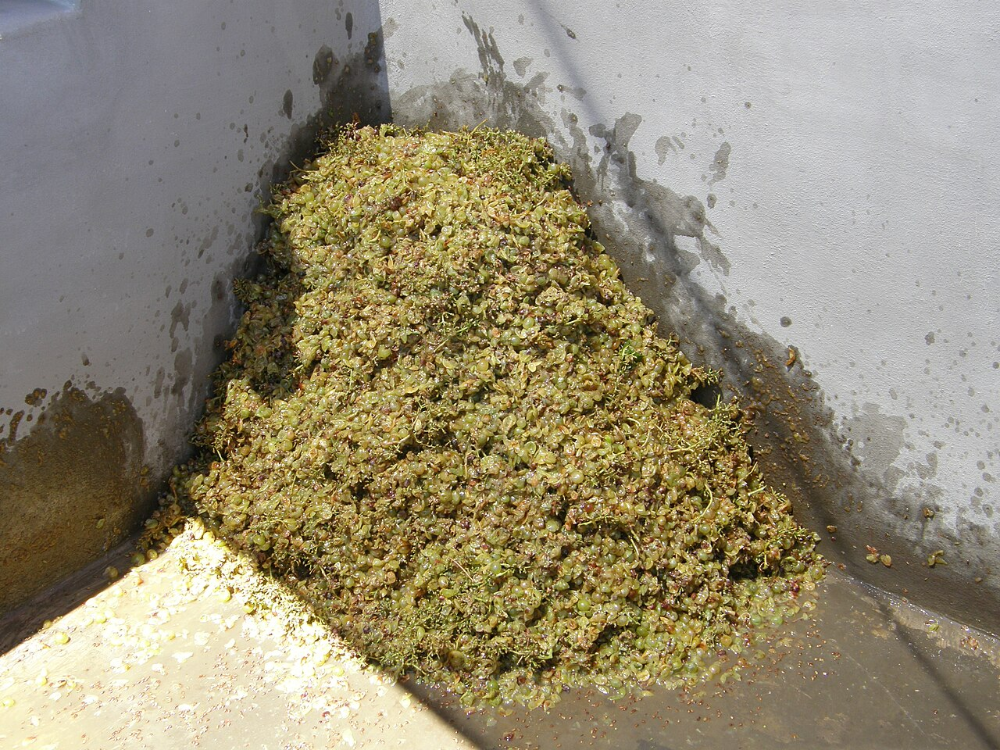

# Pressing

Pressing separates juice or wine from skins, seeds and stems. It looks like simple squeezing, but it is a trade-off over pressure, time and fraction cuts: more pressure raises yield but also pulls in tannin, colour and bitterness; less pressure gives cleaner liquid but lower volume. The winemaker draws a line between quantity and quality.

Timing changes with the wine. White wines are usually pressed before fermentation, so clear juice can be separated from solids and fermented cool. Red wines are pressed after maceration or fermentation, with free-run wine and press wine kept apart. Sparkling base wines are pressed earlier and more gently to keep colour and tannin out. The same press, used at a different moment, makes a completely different wine.

Figure: White grapes being pressed in Santorini, separating juice from skins and solids. Image: Klearchos Kapoutsis, CC BY 2.0, via Wikimedia Commons ([source page](https://commons.wikimedia.org/wiki/File:White_wine_grape_pressing_in_Santorini.jpg)).

## White wine: press first, ferment later

The aim in white pressing is to separate juice from solids quickly and limit oxidation and phenolic extraction. Whole-bunch pressing is common: grapes go into the press without destemming, the stems create drainage channels, pressure is more even and the juice is cleaner. Destemmed pressing suits ripe fruit with little stem character.

Presses usually cut the juice into fractions. The first fraction is the clearest and most acidic; later fractions carry more solids and phenolics. In Champagne, the fractions are called cuvée and taille: the first is purer, the second fuller, and the house decides whether to blend it. White juice is then settled to remove suspended solids before fermentation.

The key words in white pressing are gentle and fast. Too much pressure pulls colour, tannin and bitterness from the skins and strips the wine of freshness; too much time raises oxidation risk. Modern presses use airbags or membranes with programmable pressure and inert gas protection, which reduces human error.

## Red wine: press after fermentation

Red pressing happens after maceration or fermentation. When fermentation ends, wine is drained from the tank as free-run wine; the remaining pomace goes into the press, and the wine released is press wine. Free-run is usually softer and fruitier; press wine is darker, more tannic, higher in pH and more structural, with a bitter edge.

Winemakers separate press wine by pressure fraction. Light fractions may be folded back into the free-run to add colour and backbone; heavy fractions, with coarse tannin, may be kept apart or sent to distillation. Press wine is usually a small share of the blend, but for reds built to age it can be part of the recipe. Throw all of it away and the wine may taste thin; blend all of it and the wine may taste coarse.

Maceration time is another variable. Longer maceration softens the pomace and makes pressing easier; shorter maceration leaves harder pomace, demands higher pressure and pulls more tannin. Pressing is not an isolated step; it works together with maceration, fermentation temperature and pump-overs to shape the final style.

## Press equipment and pressure control

The traditional press is the basket press: pomace goes into a basket and is pressed by hydraulic or manual force, with juice running out through the basket wall. Basket presses are gentle and intuitive, well suited to small estates and fine wines; the drawbacks are low batch throughput and long cleaning. Screw presses feed continuously and are efficient, but pressure is higher and coarse tannin is easier to extract, so modern fine-wine producers use them less.

Bladder presses and membrane presses are the modern mainstream. An airbag inflates inside the drum and pushes pomace against the wall, giving even, programmable pressure; a membrane press uses a flexible membrane to separate the air chamber from the fruit. Both can run low-pressure, multi-step curves that are gentler on the pomace. Some machines can work under inert gas to reduce oxidation.

The core of pressure control is gradual application. One push to maximum pressure can crack the pomace and release bitterness; stepped pressure with a longer low-pressure phase lets juice flow at lower force. The winemaker sets the curve from variety, ripeness, pomace condition and target style, not from the equipment manual.

## Pressing in other drinks

Cider and perry are pressed too. Apples are milled and pressed for juice, which is fermented into cider; the pomace becomes feed or compost. Unlike wine, cider pressing puts more weight on yield and fruit freshness, and pressure control is coarser, though modern producers also use bladder presses and inert gas.

Grape pomace can be pressed again or distilled. The pressed skins, called marc, can be rehydrated, fermented and distilled into pomace brandy such as marc, grappa or orujo; they can also go straight to compost. The "remainder" of pressing still has value in spirits and in the circular economy.

Beer's separation of mash and wort is called lautering, not pressing. The principle is solid-liquid separation, but the spent grain is a filter bed, not pomace under pressure. Calling brewery lautering "pressing" confuses the process. Accurate terms decide whether a reader can see the real differences between drinks.

## Common misunderstandings and how to judge

The first misunderstanding is that harder pressing gives more wine and therefore more value. Yield does rise, but so do tannin, colour and bitterness, and finesse falls. The second is that press wine is always inferior. Press wine can add colour, structure and ageing potential; the question is fraction and proportion. The third is that first press is always best. First juice is clear and acidic, but some styles need the weight and complexity of later fractions.

To judge pressing, winemakers look at turbidity, colour, pH, tannin and taste. White juice needs rapid settling and cooling to limit oxidation; red press wine is tasted separately to decide whether to blend it and how much. Pressing is not a single action but a series of decisions to record and review.

For consumers, pressing rarely appears on a label, yet it explains why wines from the same appellation and variety can differ so much. The visible label gives region and vintage; the invisible pressure curve is part of the code beneath body and structure.

## See also and references

- Fermentation: see [fermentation](ref:fermentation).
- Malolactic fermentation: see [malolactic fermentation](ref:malolactic-fermentation).
- Wine: see [wine](ref:wine).
- Red wine: see [red wine](ref:red-wine).
- White wine: see [white wine](ref:white-wine).
- Terroir: see [terroir](ref:terroir).

**At a glance:** Pressing separates juice or wine from skins, seeds and stems. White wines are usually pressed before fermentation, red wines after maceration or fermentation, and the pressure curve and fraction cuts decide yield, tannin and body. 

For Pressing, begin with the inputs, then the sequence of steps, and finish with what changes at the end; that order keeps the account grounded.
