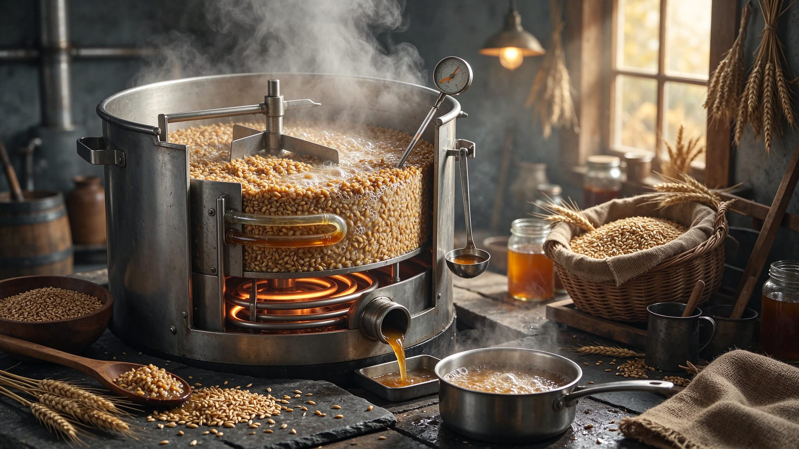

# Saccharification

Saccharification breaks grain starch into sugars that yeast can use. Starch is a polymer of glucose, and its granules are wrapped in protein and lipid, so pitching yeast directly onto grain ferments almost nothing. Only after gelatinisation and enzymatic hydrolysis into glucose, maltose and maltotriose can the sugar enter [fermentation](ref:fermentation). Beer, whisky, baijiu and sake all depend on this step; what differs is where the enzymes come from and in what medium they work.

Figure: Editorial illustration of grain saccharification: a cooking vessel, steam, heating structure and sampling; AI-assisted illustration, not a photograph. Image: Hejiu editorial team, project-owned.

## Place in the process

Saccharification sits between raw-material preparation and fermentation. Upstream are malt production or grain steaming and [qu making](ref:qu-making); downstream are separation, cooling and inoculation. It includes both the physical gelatinisation of starch and its enzymatic hydrolysis, so it is more than "heating until the starch dissolves". In a brewery, mashing and wort separation are often treated as one brewhouse stage; in a baijiu plant, steaming, cooling, qu addition and pit loading follow a different rhythm, and saccharification often runs alongside fermentation in the same pit.

## Steps and parameters

Typical brewery values are a water-to-grain ratio of 2.5–4 L/kg and a mash pH of 5.2–5.5; a rest at 62–65 °C for 30–60 minutes lets beta-amylase cut starch into maltose; a rest at 70–72 °C for 20–40 minutes lets alpha-amylase continue dextrinisation; 75–78 °C is used to end conversion. These ranges follow the common descriptions in the brewing reference works and association material listed on this process, and breweries adjust them to malt modification and target body. Baijiu steams grain at about 100 °C under atmospheric steam, sake steams rice for about 40–60 minutes, and rice-koji cultivation is usually held at 30–38 °C.

## Mechanism: gelatinisation and enzymolysis

Gelatinisation is the uptake of water by starch granules, the collapse of their crystalline regions and the opening of amylose and amylopectin to enzymes. Barley starch begins to gelatinise at roughly 60–65 °C, so a mash rest must sit above that point. Alpha-amylase cuts alpha-1,4 bonds at random, chopping long chains into dextrins and lowering viscosity; beta-amylase removes maltose units from the non-reducing end and sets the share of fermentable sugar; limit dextrinase handles branch points. Glucoamylase from Aspergillus and Rhizopus can release glucose from chain ends, which is the enzymatic basis for simultaneous saccharification and fermentation in baijiu and sake.

## Equipment and variants

Breweries use roller mills, mash vessels, lautering tanks or mash filters, kettles and plate coolers. Infusion mashing relies on single or stepped temperature rises, while decoction mashing boils part of the mash and returns it, which suits poorly modified malt. Whisky distilleries often use a semi-lauter mash tun and aim for clear, fermentable wort. Baijiu uses steamers, cooling beds and pits; sake uses continuous rice steamers and koji rooms. Equipment differences affect heating rate, oxidation and separation efficiency, and a brewery mash line cannot simply be transferred to solid-state baijiu.

## Failure modes and diagnosis

The usual end-point check is the iodine test: a blue-black colour means starch remains, while red-brown or yellow means dextrinisation is largely complete. Under-conversion shows up as low extract, wort gravity below target and abnormal residual sugar after fermentation; over-conversion gives a thin body and weak foam. Slow lautering often comes from poorly modified malt, over-fine milling or a rest that was too warm. Above pH 5.8, more polyphenols and silicates dissolve, bringing astringency and haze. These signs must be read against the raw-material batch and the mash curve rather than blamed on a single number.

## Effect on flavour

The sugar profile sets the ratio of alcohol to residual sugar and therefore the weight of the drink. More fermentable sugar gives a drier, more alcoholic result; more dextrin gives a fuller body and longer-lasting foam, though residual sweetness can turn cloying. A warmer rest favours dextrin, a cooler rest favours maltose. Kilning level adds bread, biscuit, caramel and nutty notes. In [beer](ref:beer), mash temperature is the main body adjustment; in [whisky](ref:whisky), it shapes fermentation efficiency and the aroma base before distillation; in [baijiu](ref:baijiu), the degree of grain steaming and the enzyme activity of the qu decide grain aroma and yield.

## Effect on stability

The balance of fermentable sugar and dextrin carries through to microbial stability. High residual sugar without stabilisation before bottling can restart fermentation in the bottle; too much dextrin adds nutrients for microbes and can contribute to chill haze. A high mash pH dissolves more polyphenols and raises the later risk of protein-polyphenol haze; too low a pH suppresses enzymes and lengthens the mash. In the low-moisture solid mash of sake and baijiu, saccharification and fermentation run together, so spoilage risk comes more from temperature loss and wild microbes than from the conversion end point itself.

## Common misconceptions

First, that saccharification is "cooking starch until it dissolves", ignoring the temperature window enzymes need. Second, that hotter always extracts more sugar, when enzymes deactivate quickly above 80 °C. Third, judging completion from iodine colour alone while ignoring differences in gelatinisation temperature between grains. Fourth, replacing much of the malt with unmalted grain without adding enzymes, which leaves conversion weak. Fifth, confusing saccharification with fermentation, which makes it impossible to explain simultaneous conversion and fermentation in solid-state baijiu.

## See also

- [Fermentation](ref:fermentation): how sugar enters yeast metabolism and becomes ethanol and flavour.
- [Qu making](ref:qu-making): the Chinese route in which moulds supply saccharifying enzymes.
- [Beer](ref:beer), [whisky](ref:whisky) and [baijiu](ref:baijiu): three ways of organising saccharification in different media.

**In brief:** The process that breaks starch in grains and other raw materials into fermentable sugars; malt enzymes, mould enzymes from qu, temperature, pH and the water-to-grain ratio set the sugar profile and shape body, yield and fermentation.

Saccharification is best read by starting with the inputs, moving to the sequence of steps, and ending with what changes at the end.

[Fermentation](ref:fermentation) and [Beer](ref:beer) answer different questions about Saccharification: purpose and control point. Read them as a pair, not as alternatives.

**Key facts.**

| Item | Detail |
| --- | --- |
| In one line | The process that breaks starch in grains and other raw materials into fermentable sugars; malt enzymes, mould enzymes from qu, temperature, pH and the water-to-grain ratio set the sugar profile and shape body, yield and … |
| Applies to | Beer、Whisky、Baijiu |

**Sources and limits.** The key claims about Saccharification are checked against the following sources: State Administration for Market Regulation, Standardisation Administration of China (Used to check baijiu saccharification, qu-making and fermentation terminology), Oxford University Press (Used for reference on mashing, enzymes and gelatinisation parameters), Encyclopaedia Britannica (Used for reference on milling, mashing and lautering) and 5 sources in total. Prices, batches and status change; the body is project-written and does not reproduce source text.
