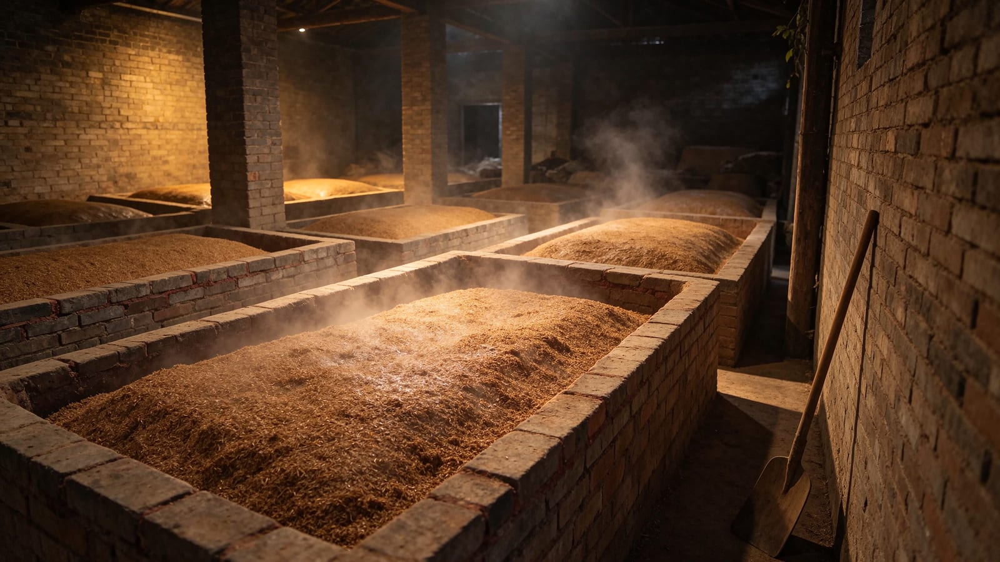

# Stacked fermentation

Stacked fermentation is an open process step in baijiu production in which qu-inoculated material is piled for a period before pit loading. GB/T 15109-2021, Terminology of baijiu industry, defines it as the process of piling material for a certain time before it enters the pit for fermentation. It is most closely associated with sauce-aroma baijiu, though similar arrangements appear in mixed-aroma and sesame-aroma routes.

Figure: Editorial illustration of stacked fermentation: grain mounds and steam in a brick fermentation room; AI-assisted illustration, not a photograph. Image: Hejiu editorial team, project-owned.

## Position in the process

In a typical sauce-aroma sequence the order is roughly cooking, cooling, qu addition, stacking, pit loading, sealing, in-pit fermentation and distillation. Stacking sits between qu addition and pit loading, acting as the transition from a hot, open environment to a closed, anaerobic one.

That position gives it two tasks. It lets microbes multiply in the mash, and it uses warming and chemical change to prepare a more suitable substrate for in-pit fermentation. Calling it preparation before fermentation or part of fermentation is not wrong, but its environment is completely different from the inside of a pit.

## Purpose and principle

The purpose of stacking is usually summarised in four points. First, multiplication: qu-inoculated mash in an open environment captures microbes from the air and the site, and moulds, yeasts and bacteria keep growing. Second, warming: microbial metabolism produces heat, the pile warms up and heat-tolerant groups gain an advantage. Third, conversion: starch breaks down to some degree, and sugars, amino acids and flavour precursors change under warm conditions. Fourth, adjustment: moisture, acidity and oxygen settle into a state suitable for pit loading.

These goals do not always move together. If the temperature rises too fast, some microbes may lose activity; if warming is insufficient, the aromatic base the process wants is missing. Stacking is therefore not simply piling material and waiting, but an empirical step that depends on watching the temperature curve and the condition of the mash.

## Operation

Basic operations include even qu mixing, controlled water addition, piling in a certain shape, watching the temperature rise, turning the pile at the right time and loading the pit once the process target is reached. Shape, tightness, height and site conditions all affect heat loss and air supply, and therefore the temperature distribution.

Turning the pile is a key action. Temperature and moisture differ across the pile, and turning remixes the material, releases heat and exchanges air, preventing local overheating or long cold patches. Timing is usually judged from temperature and appearance rather than a fixed clock time.

## Key parameters

GB/T 10781.4-2024, Quality requirements for baijiu — Part 4: Jiang-flavour baijiu, gives a checkable description of sauce-aroma production. The peak temperature in high-temperature qu making is above 60 °C. The peak temperature of high-temperature stacking can reach 50 °C or above, and one production cycle includes no fewer than six rounds of stacked fermentation. Fermentation after loading is sealed, the pit is preferably a stone pit with a mud bottom, the traditional process uses eight rounds of in-pit fermentation, and in-pit fermentation lasts no fewer than 30 days.

These numbers describe a process framework, not uniform parameters for every company. In practice, season, site, mash moisture and the amount of qu all shift the temperature curve. Treating the description in the standard as the only correct temperature misreads the process.

## Difference from pit fermentation

Stacked fermentation is open and in contact with air, aiming mainly at warming, microbial multiplication and conversion. In-pit fermentation is sealed and mainly anaerobic alcohol production and esterification. They differ in oxygen, temperature, vessel and duration.

In sauce-aroma baijiu, stacking usually lasts several days while in-pit fermentation runs for months. After stacking the mash is loaded and sealed with pit mud or a dedicated material to create an anaerobic environment. Confusing the two makes it impossible to explain why one round contains two fermentation steps.

## Influence on flavour

The microbial community and metabolites formed during stacking become the starting point for later in-pit fermentation. High temperatures are often used to explain the baked, nutty and toasted notes in sauce-aroma baijiu, but flavour results from qu making, stacking, in-pit fermentation, distillation, storage and blending together. No single aroma can be credited to stacking alone.

Good stacking control gives richer mash aroma and steadier fermentation. Poor control can bring runaway heating, locally burnt mash, abnormal acidity or contamination. Flavour differences usually come from these details rather than from a single label.

## Common misconceptions

First, higher piles are better. An excessively high pile hinders heat loss and air supply and raises the risk of local overheating.
Second, a higher peak temperature is better. Temperatures outside the process range damage microbial activity.
Third, all baijiu is stacked. Stacking belongs to particular styles and process routes, not to baijiu in general.
Fourth, the end of stacking means fermentation is complete. The mash still has to enter the pit, where the main alcohol formation happens.
Fifth, watching only temperature and ignoring mash condition. Moisture, acidity, the amount of qu and site conditions matter just as much.

Start with the inputs. From there, consider the sequence of steps, then what changes at the end. That is how a practical judgment about Stacked fermentation is built.

Start with [Baijiu](ref:baijiu) for purpose, then read [Fermentation pit](ref:fermentation-pit) for control point. Seeing both keeps Stacked fermentation from being confused with a neighbouring idea.

**At a glance:** An open process step in baijiu production in which qu-inoculated mash is piled for a period before pit loading, allowing natural warming and microbial multiplication. Common in sauce-aroma baijiu.

**Key facts.**

| Item | Detail |
| --- | --- |
| In one line | An open process step in baijiu production in which qu-inoculated mash is piled for a period before pit loading, allowing natural warming and microbial multiplication. Common in sauce-aroma baijiu. |
| Applies to | Baijiu、Sauce-aroma baijiu |

**Sources and limits.** The key claims about Stacked fermentation are checked against the following sources: State Administration for Market Regulation; Standardization Administration of China (the terms for stacking, rounds and first grain addition; no standard text is reproduced; the descriptions of high-temperature qu, stacking and in-pit fermentation; no standard text is reproduced), Guizhou Provincial Administration for Market Regulation (publication and implementation dates and process points), China Kweichow Moutai Distillery (Group) Co., Ltd. (the description of stacking and rounds in the traditional process) and 5 sources in total. Prices, batches and status change; the body is project-written and does not reproduce source text.

## Further reading

- [Sauce-aroma baijiu](ref:sauce-aroma): the style defined by high-temperature stacking and multi-round fermentation.
- [Baijiu](ref:baijiu): the definition, raw materials and main process outline.
- [Fermentation pit](ref:fermentation-pit): the vessel that receives the mash after stacking.
- [Qu making](ref:qu-making): the microbial and enzyme basis of the qu used in stacking.
- [Fermentation](ref:fermentation): the general principles and process framework.
- [Moutai](ref:moutai): a representative product of the traditional sauce-aroma process.
- [GB/T 15109-2021 Terminology of baijiu industry](ref:gbt-15109): the source for the terms for stacking and rounds.
