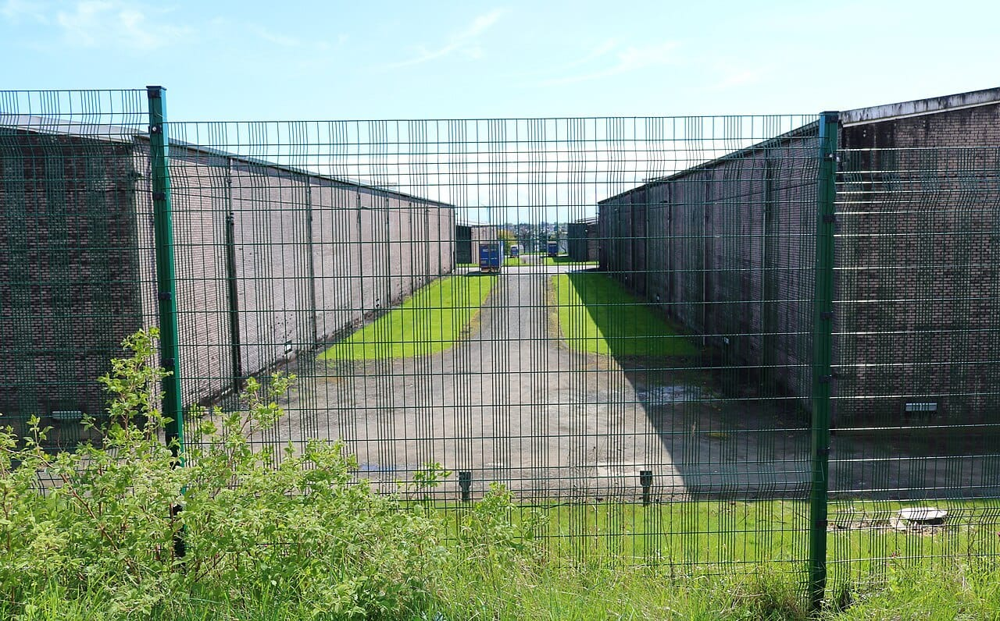

# Diageo

Diageo is a multinational drinks group formed in 1997 by the merger of Guinness and Grand Metropolitan, headquartered in London. It owns brands such as Johnnie Walker, Smirnoff, Baileys, Tanqueray and Guinness, covering whisky, vodka, gin, beer and liqueurs.

Figure: Diageo. Photograph: Diageo distillery, Leven - geograph.org.uk - 6463659. Credit: Bill Kasman, CC BY-SA 2.0, via Wikimedia Commons ([source](https://commons.wikimedia.org/w/index.php?curid=150169452)).

## Company identity

This producer records the producer level: company name, location, historical starting point and organisational form. The group is the entity for production, distribution and brand management; when discussing "Diageo", first separate the group, its subsidiaries and an individual brand.

The group is listed on the London Stock Exchange and the New York Stock Exchange, covering owned distilleries, agency brands and a global distribution network. The merged structure means the production and sale of one brand may sit with subsidiaries in different countries.

## Region and production network

The group is headquartered in the United Kingdom, with production across Scotland, Ireland, North America and Africa. Scotch whisky, Irish whiskey, gin and beer each rely on different regional conditions for raw materials, distillation and maturation.

For Diageo, regional conditions reach the finished product as raw materials, distillation method, maturation environment and legal requirements. For a given product, state which category it belongs to and where the key steps take place, rather than generalising from the group's headquarters.

## Brands and products

The portfolio spans a wide range: Johnnie Walker is a Scotch blended whisky, Smirnoff is vodka, Tanqueray is London dry gin, Baileys is a cream liqueur, and Guinness is an Irish beer.

For Diageo, brand level and group level differ: the brand answers "what is it called and who is it for", while the group answers "who owns the trademark and who organises production and distribution". Brands under one group differ greatly and cannot be summarised by one standard.

The group also holds an equity stake in Chinese baijiu, and public material shows a controlling relationship with [Sichuan Swellfun Co., Ltd.](ref:swellfun), a direct link between a multinational group and a Chinese baijiu producer.

## Craft and production

Each category follows a different path: whisky relies on [distillation](ref:distillation) and oak maturation, gin on distilling or macerating a base spirit with botanicals, beer on mashing, fermentation and maturation, and cream liqueurs on blending a base spirit with dairy.

Blending is one of the group's core capabilities across multiple brands and distilleries; [blending](ref:blending) combines new make from different sites and ages into a consistent style. The exact formula is company information, and labels usually disclose only part of it.

## History

In 1997, Guinness and Grand Metropolitan merged to form Diageo. Later acquisitions and integration extended the portfolio into whisky, vodka, gin, liqueurs and beer.

Public material shows the group operates Diageo China for imports, distribution and brand management, and participates in Swellfun's operations through an equity relationship.

## Timeline

- 1997: Guinness and Grand Metropolitan merge to form the group.
- Late 20th to early 21st century: acquisitions expand the portfolio.
- 2010s: an equity relationship brings a Chinese baijiu producer into the group's orbit.

## Industry and market

The strength of a multinational drinks group lies in its portfolio and distribution network; the challenge lies in differing category cycles and channel structures. Whisky, beer and liqueurs serve different occasions, and one group must run them with different price tiers and channels.

Diageo is best approached through the range it makes, then the site and the owner, and then the bottler named on the label. One check alone will not settle it.

## Common misconceptions

First, treating Diageo as one Scotch style. Its Scotch range spans smoky Islay malts such as Lagavulin, the maritime and peppery Talisker, lighter Lowland and Speyside whiskies, and the Johnnie Walker blends; peat, still shape and cask policy differ by site.

Second, assuming every Guinness is brewed in Dublin. St. James's Gate is the brand's historic brewery, but Guinness is also brewed under licence in other markets, where strength, water and adjuncts can differ; the label records the brewing country and version.

Third, reading group turnover as a bottle guarantee. Diageo's scale is a portfolio and distribution fact; each product still depends on its own malt or grain, yeast, distillation cut, cask and batch.

Fourth, treating blended whisky as inferior. Blending is a production route, not a grade.

Fifth, equating an equity stake with the same product name. Ownership is not the same as recipe or brand ownership.

Diageo is a multinational drinks group built from the merger of Guinness and Grand Metropolitan. Its identity lies in a portfolio of brands and a production and distribution network, not in one distillery. Whisky, vodka, liqueur and beer brands sit under the same group but come from different sites and traditions. Group ownership does not make their ingredients or production methods the same. Group scale comes from a portfolio and a global distribution network, but each product still has its own raw materials, distillation and ageing regime. Financial statements describe business segments, not the flavour of a bottle. Ownership is not a process guarantee. A portfolio is not a recipe, and a parent company is not a tasting note.

**In brief:** A multinational drinks group formed in 1997 by the merger of Guinness and Grand Metropolitan, headquartered in London and owning brands such as Johnnie Walker, Smirnoff, Baileys, Tanqueray and Guinness.

[United Kingdom](ref:united-kingdom) and [Beer](ref:beer) are the nearest useful comparisons: one clarifies company history, the other tests production assets.

Diageo's Scotch operations include distilleries such as Blair Athol, Cardhu and Cameronbridge, while Guinness brewing remains centred in Dublin. The group's scale comes from distribution and brand ownership, not from one recipe; a bottle of Johnnie Walker and a bottle of Tanqueray share a parent but not a production method. Its China business imports and distributes international brands and holds an equity stake in Swellfun, linking a global portfolio to a domestic baijiu producer. The group reports in segments, and segment revenue is not a guide to a single bottle's quality.

Its portfolio also includes ready-to-drink products and local joint ventures, which are separate from the flagship brands.

**Key facts.**

| Item | Detail |
| --- | --- |
| In one line | A multinational drinks group formed in 1997 by the merger of Guinness and Grand Metropolitan, headquartered in London and owning brands such as Johnnie Walker, Smirnoff, Baileys, Tanqueray and Guinness. |
| Founded | 1997 |
| Type | Multinational drinks group |
| Official site | diageo.com |

**Sources and limits.** The key claims about Diageo are checked against the following sources: Diageo plc (Used to check the 1997 merger, headquarters and brand portfolio; Used to check the group's investor and annual report information channels), Diageo China (Used to check the China market footprint and the joint-venture relationship), Encyclopaedia Britannica (the entry's background, terminology and regulatory context). For current products, addresses or opening status, use diageo.com. Prices, batches and status change; the body is project-written and does not reproduce source text.

For Diageo, this producer was last checked in 2026; prices, batches and availability change, so confirm them against the sources below.

## Further reading

- [United Kingdom](ref:united-kingdom): the group's headquarters and the regional background of whisky and beer.
- [Whisky](ref:whisky): the category of Johnnie Walker.
- [Beer](ref:beer): the category of Guinness.
- [Gin](ref:gin): the category of Tanqueray.
- [Distillation](ref:distillation): the core step of whisky and gin.
- [Blending](ref:blending): the craft basis of blended whisky.
- [Swellfun](ref:swellfun): the Chinese baijiu producer in which the group holds a stake.
- [Alcohol by volume](ref:abv): understanding strength across categories and products.
