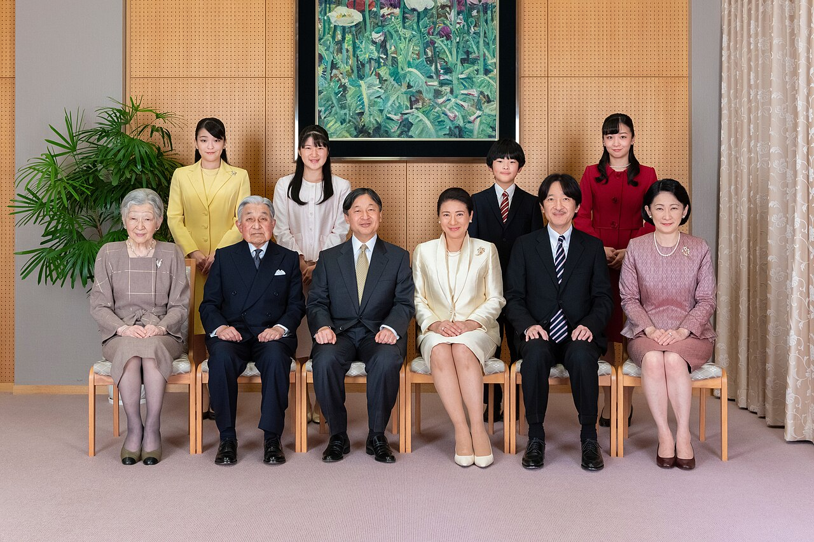

# Dynasty

Dynasty (Dynasty Fine Wines Group, stock code 828) is the continuation of a Sino-French joint-venture winery founded in Tianjin in 1980. It is first a listed company with named shareholders, a plant and periodic disclosure duties, and only second the "Dynasty" wine on a shelf. Reading the company means separating the shareholder layer, the listed entity, the production site and the individual product; otherwise one phrase, "an old joint venture", conceals more than forty years of structural change.

Figure: Dynasty. Image: 日本国政府, CC BY 4.0, via Wikimedia Commons ([source page](https://commons.wikimedia.org/wiki/File:The_Imperial_Family_of_Japan,_2021.jpg)).

## Company identity and listing

The listed entity is Dynasty Fine Wines Group Limited, on the Main Board of the Hong Kong Stock Exchange under stock code 828. Its registered place and main production base are in Tianjin, and its business covers grape growing, winemaking, bottling and sales, with products sold in the mainland market and some overseas markets under the "Dynasty" brand.

The company layer and the product layer are not the same. Questions about equity, the board and periodic reports refer to the listed entity; questions about an estate, a bottling line or a series refer to an operating subsidiary. The producer name and address on the label are the first piece of evidence for the responsible entity.

## Ownership: Tianjin Food and Rémy Cointreau

The 2025 interim report discloses that, as of 30 June 2025, Tianjin Food Group Co., Ltd. held 42.80% and Rémy Cointreau Asia Pacific Limited held 23.90%, with the remainder in public hands. Together the two form the core shareholder structure.

The percentages say two things. First, control sits within the Tianjin local state-owned system, so operating decisions are closely tied to local industrial policy. Second, the French Rémy Cointreau side still holds a substantial minority stake, so the joint-venture origin has not disappeared. Percentages change with placements, buy-backs and shareholder dealings, so any citation must state the reporting date and cannot use an old figure for the current structure.

## The 1980 joint-venture start

In 1980 a Tianjin party and a French party established the Sino-French Joint Venture Dynasty Winery, one of the earlier wine joint ventures after reform and opening. Domestic wine at the time was mostly sweet or semi-sweet; the joint venture brought dry-wine technique, imported equipment and the winery-management concept, along with updated grape varieties and viticulture.

The significance was not only capital. It carried the ideas of "estate", "vintage" and "variety" into domestic channels and trained a first generation of technicians in modern winemaking. Reducing this to "imported French technology" misses the organisational and market-education changes.

## From joint venture to listed company

In the 1990s Dynasty expanded capacity and widened the range, adding dry red and sparkling wine to dry white. The business was later restructured into a joint-stock company and listed in Hong Kong, gaining independent access to capital. The listing changed disclosure, governance and investor relations, not just funding.

From joint venture to listed company, the organisational form changed at least three times: joint-venture enterprise, joint-stock company, listed group. These layers sit on the same product line and are easily flattened, which obscures the different responsible entities and disclosure standards at each stage.

## Tianjin production area and plant

Tianjin lies on the eastern North China Plain in the lower Hai River basin, with a warm temperate semi-humid monsoon climate, ample heat in the growing season and concentrated harvest rain. Vineyards are mainly in Tianjin's outskirts and neighbouring counties, with Chardonnay, Italian Riesling, Cabernet Sauvignon and Merlot among the main varieties.

The plant handles fermentation, ageing, bottling and storage. A wine's origin statement refers to the grapes, not the bottling site; one plant can process fruit from different regions, and the "origin" and "producer address" on the label should be read separately rather than treated as interchangeable.

## Product structure and capacity

The range covers dry [white](ref:white-wine), dry [red](ref:red-wine), off-dry, sweet and [sparkling wine](ref:sparkling-wine), from everyday table wine to gift boxes. Dry white is Dynasty's traditional strength, dry red expanded as the market shifted, and sparkling wine has always been a smaller category.

Capacity is set by fermentation tanks, storage tanks, bottling lines and warehousing, while actual output also depends on fruit supply and order timing. Published capacity is a design figure, not a given year's production, and any discussion of utilisation should state the year being measured.

## 2025 performance

The 2025 annual results announcement was published on 26 March 2026, with basic earnings per share of 0.97 Hong Kong cents against 2.37 a year earlier. The 2025 interim report showed cash and cash equivalents of 85,600 thousand Hong Kong dollars and a debt-to-assets ratio down from 44% to 34%.

These figures describe the listed company as a whole, not a product series. Lower profit relates to industry demand, channel inventory and product mix; one year's earnings per share cannot establish long-term competitiveness and should be read with revenue, gross margin and cash flow.

## Channels and sales organisation

Dynasty has long relied on restaurants, supermarkets, bulk purchase and distributors, with a high share of gift boxes and banquet occasions. That gives strong regional recognition, but also exposes sales to channel inventory and promotion cycles.

The sales organisation is divided by region and channel. Distributors handle distribution and terminal upkeep, while the company manages brand investment and price control. The more layers in the chain, the harder it is to keep prices orderly, and cross-region dumping and discounting are common problems for domestic wine producers.

## Governance and related-party transactions

As a Hong Kong-listed company, Dynasty must disclose directors, substantial shareholders, connected transactions and continuing connected transactions under the listing rules. Purchases, sales or brand licensing with shareholder parties are set out with amounts when they reach the disclosure threshold.

The key to governance is not the number of directors but the boundary between shareholders, the board and management. With state, foreign and public shareholders present at once, major decisions must balance three sets of interests, so the pace differs from a purely private company.

## Disputes and risks

The first is demand pressure: domestic wine output and consumption are adjusting, and imported wine and baijiu have squeezed table-wine occasions. The second is product mix: a high dry-white share is a strength but also a dependence on white-wine habits. The third is the shareholder relationship, where the long-term arrangement for the foreign minority stake is uncertain. The fourth is brand ageing, with younger consumers recognising "Dynasty" less than the previous generation.

These risks are not a verdict on the company; they are angles to keep when reading reports and news. Turning a risk into a conclusion, or promotional copy into fact, does not suit an encyclopedic entry.

## Division of labour with the brand page

This page handles the company layer: who the shareholders are, where it is listed, where the plant is and how to read the accounts. The brand page handles the product layer: positioning, series, price bands, packaging and consumer perception. Mixing them produces explanations of wine style through equity structure, or of governance through advertising.

Same-name entries at different layers are intentional in this content structure. On seeing "Dynasty", establish whether the reference is the listed company, the producer or a bottle before deciding whether the information fits the question.

## Common misconceptions

First, treating "Sino-French joint venture" as a French brand. Dynasty is registered and produces in China; the French side is a shareholder and technical partner.
Second, equating the listed company with the whole group. The accounts cover the listed entity only.
Third, taking the bottling site as the grape origin. Fruit may come from contracted bases or purchases.
Fourth, judging the company by one year's earnings per share. Multi-year trends and cash flow matter.
Fifth, assuming ownership percentages are fixed. They change by reporting period, and citations need dates.

Setting [China](ref:china)'s company history beside [Red wine](ref:red-wine)'s production assets makes the boundary between them visible.

## Further reading

- [China](ref:china): the wider context of the Chinese wine industry.
- [Wine](ref:wine): categories, origin and labelling rules.
- [Red wine](ref:red-wine) and [white wine](ref:white-wine): Dynasty's main product types.
- [Sparkling wine](ref:sparkling-wine): second fermentation.
- [Fermentation](ref:fermentation) and [oak ageing](ref:oak-ageing): key steps behind style.
