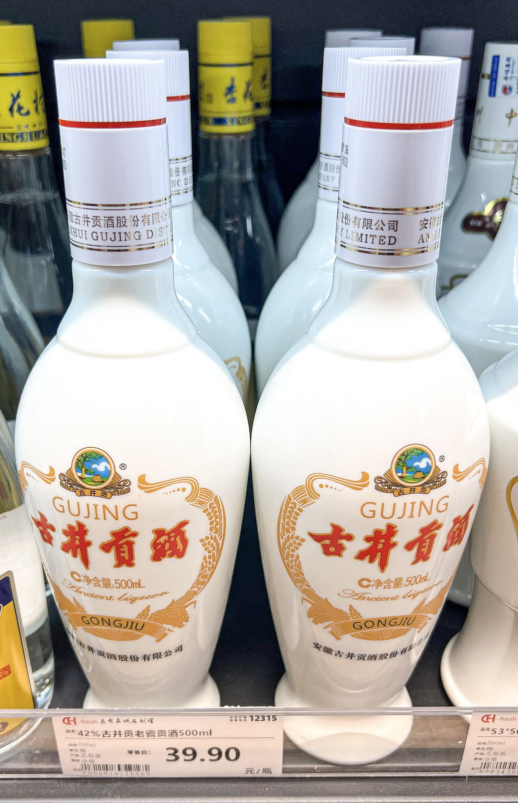

# Anhui Gujing Distillery Co., Ltd.

Anhui Gujing Distillery Co., Ltd. is a listed company whose main business is baijiu production and sales, with registered and office addresses in Gujing Town, Bozhou, Anhui. Public disclosures show A-share code 000596 and B-share code 200596, both listed on the Shenzhen Stock Exchange in 1996.

Figure: Related photograph of Anhui Gujing Distillery Co., Ltd.. Image: N509FZ, CC BY-SA 4.0, via Wikimedia Commons ([source page](https://commons.wikimedia.org/wiki/File:Gujing_Gongjiu_at_a_supermarket_in_Beijing_(20241109164639).jpg)).

## Company identity

This producer records producer identity: company name, registered place, listing information and main business. It does not evaluate product flavour and does not reproduce promotional copy. Verifiable company-level information, brand stories and product tasting are different levels; mixing them lets narrative be mistaken for fact.

"Gujing Gongjiu" is both a brand and part of the company name. The company holds the brand, while product lines carry its market expression. Understanding this prevents treating "the company is listed" as "a particular bottle is better".

## Listing and governance

Dual A- and B-share listing means the company discloses periodic reports, related-party transactions and major matters under regulatory requirements. Public disclosures are a reliable source for company identity and business information, but disclosure is not a product-quality rating.

Governance structure, management and shareholding change over time, so this producer does not list them one by one and risk stale information. Readers should use the latest exchange and company announcements. This producer gives no investment advice.

## Production and site

Production and office addresses are in Gujing Town, Bozhou. Gujing Town is a core strong-aroma baijiu site, with water, pits and qu-making environment forming the production base. Specific plant layout, capacity and process parameters are company information with limited public detail.

Producer and origin are two concepts: registration in Gujing Town does not mean every product is bottled at the same plant; contract production, repackaging and multiple sites should be checked against the plant address on the label. The label is the most direct way to verify origin.

The qu-making, brewing, storage and bottling areas within a plant connect into a long production cycle. Baijiu production needs steady water, steam and power, and larger producers often build or share supporting facilities; large sites also need grain storage, boiler capacity and logistics, which shape the surrounding industrial landscape, and that is one reason industrial clusters form.

## Brand and product levels

[Gujing Gongjiu](ref:gujing) is the brand within the company system, while specific product lines and specifications belong to other entities. The brand record covers the name, brand relationships and public entry point; product records cover specific products, strength, specification and brand; this producer keeps only verifiable company-level information.

Layering is not needless complexity; it prevents conflating company, brand and product. A company may hold several brands, a brand may have several series, and a series may have products of different strengths and volumes. Clear levels make information checkable.

## Relation to the region

The company is located in [Bozhou](ref:bozhou), part of the Anhui baijiu region. Pharmacy and distilling coexist in Bozhou, giving the city a distinctive industrial profile; the region page covers geography, climate and industry in more detail.

The pits and continued mash of [strong-aroma baijiu](ref:strong-aroma) are part of the regional tradition. The company organises production and brand operation on top of that tradition. A region is not one factor: climate, water, raw materials, process and long practice work together, and the company turns those conditions into consistent products.

## Visiting and places

Bozhou also has a separate visitor record: the [Gujing Wine Culture Museum](ref:museum). The museum is a place entity connected to the producer by a relationship; "the company is here" does not mean "the museum is currently open", and opening information should follow the place page and official notices.

Respect factory and museum rules while visiting, do not enter closed areas and do not photograph prohibited facilities. For purchases, use official channels and check anti-counterfeit information. This producer gives no opening hours, tickets or transport promises, to avoid misleading stale information.

## Limits of public information

This producer covers only verifiable company identity, address, listing information and level relationships. Revenue, profit, share price, capacity and market share change over time and need full context, so they are not expanded here. Readers should consult periodic reports and regulatory disclosures.

Titles such as "China Time-honoured Brand" need a specific issuing body and year to be verified, and this producer does not state them as fact. Legendary elements of brand history should be presented separately from verifiable archives.

## Common misconceptions

First, equating a listing with product quality. They are judgments at different levels.
Second, treating the company name as the brand. Company, brand and product are three levels.
Third, equating the registered address with the origin of every product. Check the plant address on the label.
Fourth, using promotional copy in place of public disclosure. They are different in nature.
Fifth, treating a museum visit as a production tour. Exhibition and production areas differ.

**At a glance:** A baijiu producer based in Gujing Town, Bozhou, Anhui, and the production entity behind the Gujing Gongjiu brand. This producer separates company identity, brand and specific products.

Start with the range it makes. From there, consider the site and the owner, then the bottler named on the label. That is how a practical judgment about Anhui Gujing Distillery Co., Ltd. is built.

Setting [Bozhou](ref:bozhou)'s company history beside [Gujing Gongjiu](ref:gujing)'s production assets makes the boundary between them visible.

A common mistake is to treat Anhui Gujing Distillery Co., Ltd. as a sub-brand. Start with what it is, then check what the label says. If they conflict, trust the more specific source.

The listed company is the distillery arm of Gujing Group and produces Gujing Gongjiu in Bozhou, Anhui.

**Key facts.**

| Item | Detail |
| --- | --- |
| In one line | A baijiu producer based in Gujing Town, Bozhou, Anhui, and the production entity behind the Gujing Gongjiu brand. This producer separates company identity, brand and specific products. |
| Founded | 1996 |
| Type | Listed company |
| Official site | gujing.com |

**Sources and limits.** The key claims about Anhui Gujing Distillery Co., Ltd. are checked against the following sources: Industry body (company identity, registered address and listing information; public company and brand information), Oxford University Press (Consulted for entries on the Chinese baijiu industry), company profile and listing information (Migrated from the former reference list at the end of the article; access date not re-verified). For current products, addresses or opening status, use gujing.com. Prices, batches and status change; the body is project-written and does not reproduce source text.

## Further reading

- [Gujing Gongjiu](ref:gujing): the brand and product entry within the company system.
- [Bozhou](ref:bozhou): regional geography, industry and visitor information.
- [Gujing Wine Culture Museum](ref:museum): the visitor site and its exhibitions.
- [Strong-aroma baijiu](ref:strong-aroma): the process framework behind the regional tradition.
