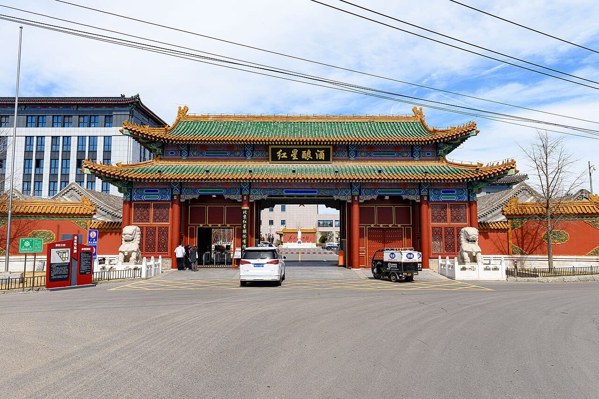

# Beijing Red Star Co., Ltd.

Beijing Red Star Co., Ltd. is based in Huairou, Beijing, and works mainly in baijiu. Its predecessor, the Huabei Liquor Monopoly Experimental Factory, was founded in May 1949 and was the first state-run distillery in Beijing. Its main products belong to [baijiu](ref:baijiu); representative products appear under [Red Star Erguotou Blue Bottle](ref:blue-bottle) and the [Red Star](ref:brand) brand entry.

Figure: Beijing Red Star Co., Ltd.. Image: N509FZ, CC BY-SA 4.0, via Wikimedia Commons ([source page](https://commons.wikimedia.org/wiki/File:Beijing_Red_Star_Distillery_(20250321124229).jpg)).

## Company identity

This producer records the producer layer: company name, site, founding date and organisational form. Red Star is the production and operating entity, holding the trademark, running production and selling into the market. When discussing "Red Star", first separate the company, the brand and a single bottle.

Public material places the direct starting point in May 1949. Before that, er-guotou brewing in Beijing was largely carried out by private distilleries. After the factory was set up in 1949, the company absorbed twelve old distilleries including Yuanshenghao, concentrating scattered workshop craft in a state-run plant. This absorption process is the key to understanding where Red Star's craft comes from.

## Production area and site

Beijing sits at the northern end of the North China Plain, and the alluvial plains of the Chaobai and Yongding rivers provide grain and water. Er-guotou craft took shape and continued in Beijing; the old urban site was around Jianguo Road, where only the Red Star Building remains today, while the main production area is in Huairou district, where the Beijing Erguotou Liquor Museum also stands at 1 Hongxing Road.

"Production area" here is not only geography but also the relationship between a city and a craft. Beijing is not a classic centre of baijiu production, yet er-guotou created a distinct local tradition through a light-aroma route, a crisp palate and the mass price band.

## Brands and products

The main brand is [Red Star](ref:brand), with er-guotou at the core and products across strengths, volumes and price bands. [Red Star Erguotou Blue Bottle](ref:blue-bottle) is one of the more widely distributed products, commonly 43% ABV in 500 mL on a light-aroma route.

The company also makes other series and gift packs. Aroma type, standard and raw-material structure can differ between lines, and one product cannot describe the whole company. Buyers should check producer, aroma type, strength, net volume and standard on the bottle label.

## Craft tradition

The core of the traditional Beijing er-guotou craft is "cut the head and tail, keep the middle". The first spirit off the still (the head) and the last (the tail) are handled separately, and the middle cut becomes the base spirit. Traditionally the spirit that flows after the second change of cooling water is the reference, which is where the name "er-guotou" (second pot head) comes from.

Red Star's public material describes the route as follows: red sorghum as raw material, a qu made from barley and peas as the saccharifying and fermenting agent, mixed steaming and mixed firing with the five-pot process, low-temperature collection, and reading the foam to cut the run, followed by storage in ceramic jars and blending. This route is related to the "clean steaming, clean firing" tradition of light-aroma baijiu, but exact parameters vary by product line.

In 2008 the traditional brewing craft of Beijing er-guotou liquor, nominated by Red Star, entered the national intangible cultural heritage list. Heritage designation applies to the craft and the lineage of practitioners, not to the quality of any single bottle.

## Company history

In May 1949 the Huabei Liquor Monopoly Experimental Factory was founded and produced the first Red Star Erguotou as a gift for the founding of the People's Republic; public material says Red Star was the only liquor company that took part in the founding ceremony. The company then gradually consolidated Beijing's er-guotou production into a product system centred on er-guotou.

In 2008 the traditional craft entered the national intangible heritage list, and Gao Jingyan, a former factory director, was recognised as the national representative inheritor. Since then the company has turned the craft into a public cultural resource through its museum, industrial tourism and an expanded product range.

## Timeline

- 1680: the Zhao brothers founded Yuanshenghao and reformed the distillation method, later seen as the origin of er-guotou craft.
- 1949: the Huabei Liquor Monopoly Experimental Factory was founded, absorbed twelve old distilleries and made the first Red Star Erguotou.
- 2008: the traditional brewing craft of Beijing er-guotou liquor entered the national intangible cultural heritage list.

## Visiting information

The Beijing Erguotou Liquor Museum is at 1 Hongxing Road, Huairou district, Beijing. Built by the company, it presents the traditional er-guotou craft and is listed in public material as a national AAA scenic area. Opening hours, booking and tickets follow the operator's current notice; this producer gives no unverified phone number or tour price.

## Common misconceptions

First, treating 1949 as the start of er-guotou craft. The craft traces to Yuanshenghao in 1680; 1949 is the start of the state-run factory.
Second, treating "er-guotou" as exclusive to Red Star. It is a craft and category name that other companies may also use.
Third, treating national intangible heritage as a product quality certificate. It covers the craft and its lineage.
Fourth, treating Red Star as an open-bottle company only. It also makes higher-priced and gift products.
Fifth, judging authenticity by price or packaging. Anti-counterfeit marks, channels and labels are more reliable.

**Short definition:** A baijiu producer in Huairou, Beijing, whose predecessor, the Huabei Liquor Monopoly Experimental Factory, was founded in May 1949; it was the first state-run distillery in Beijing and is known for Red Star Erguotou and the traditional Beijing er-guotou craft.

To read Beijing Red Star Co., Ltd., start with the range it makes, then the site and the owner, then the bottler named on the label; no single check settles it.

[China](ref:china) explains company history; [Red Star](ref:brand) adds production assets. Put Beijing Red Star Co., Ltd. between them before deciding what it is.

**Key facts.**

| Item | Detail |
| --- | --- |
| In one line | A baijiu producer in Huairou, Beijing, whose predecessor, the Huabei Liquor Monopoly Experimental Factory, was founded in May 1949; it was the first state-run distillery in Beijing and is known for Red Star Erguotou and … |
| Founded | 1949 |
| Type | Baijiu producer |
| Official site | redstarwine.com |

**Sources and limits.** The key claims about Beijing Red Star Co., Ltd. are checked against the following sources: Industry body (the 1949 founding, the absorption of old distilleries and the gift-liquor account; the founding date of the Huabei Liquor Monopoly Experimental Factory and the old site). For current products, addresses or opening status, use redstarwine.com. Prices, batches and status change; the body is project-written and does not reproduce source text.

## Further reading

- [Red Star](ref:brand): brand structure and product lines.
- [Red Star Erguotou Blue Bottle](ref:blue-bottle): specification, process and flavour.
- [Baijiu](ref:baijiu): the broad category and aroma types.
- [Erguotou](ref:erguotou): craft and category background for comparable products.
- [China](ref:china): the Chinese drinks map and how production areas are organised.
