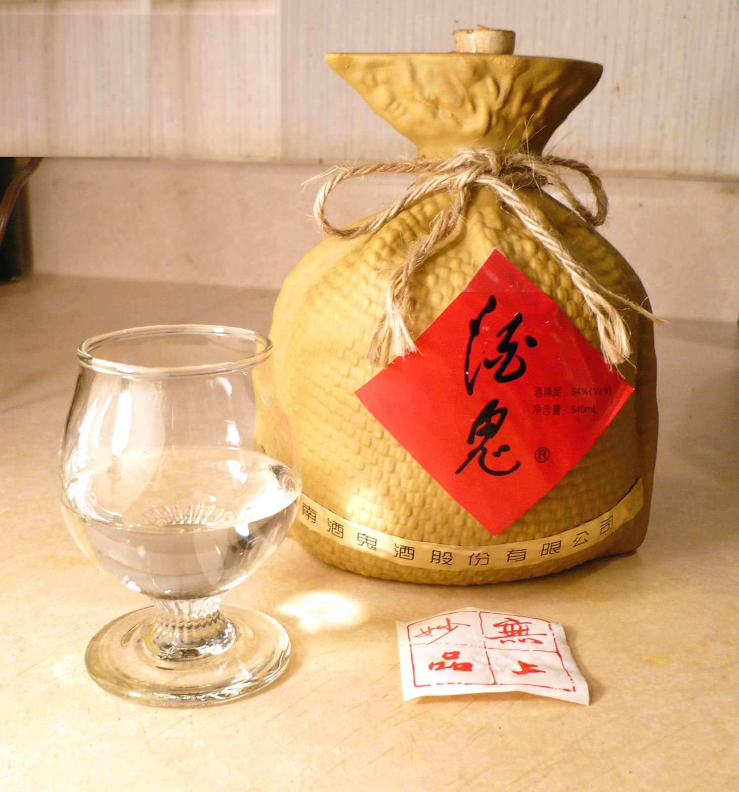

# Jiugui Liquor Co., Ltd.

Jiugui Liquor Co., Ltd. is a fuyu-aroma baijiu producer in Jishou, Hunan. Its predecessor, the Jishou distillery, was founded in 1956; the company listed on the Shenzhen Stock Exchange in 1997 and became a member of the COFCO group in 2016. The core brand is Jiugui, with the Neican, Jiugui and Xiangquan series.

Figure: Related photograph of Jiugui Liquor Co., Ltd.. Image: Badagnani, CC BY 3.0, via Wikimedia Commons ([source page](https://commons.wikimedia.org/wiki/File:Jiugui.jpg)).

## Company identity

This producer records the producer layer: company name, registered place, founding date and organisational form. The joint-stock company is the listed entity and handles production, sales and disclosure; COFCO became the actual controller through the ownership chain and influences governance and channels.

"Jiugui" is at once the company's short name, the brand name and a product name. A discussion should first establish whether the subject is the listed company, the brand or a specific bottle. The company is registered in Jishou, Hunan, while production and bottling sites should be checked on the label.

## Site and region

Jishou lies in western Hunan, in the Wuling mountains, with a humid subtropical climate: rugged terrain, high humidity and distinct seasons. Several ethnic groups live in western Hunan, and local food and distilling traditions provide the cultural background for the brand narrative.

Regional conditions affect raw materials and the microbial environment but do not determine quality by themselves. Fuyu aroma depends on the ingredient ratio, qu, pits and storage method, and the specific process belongs to the company's technical system rather than to the word "Xiangxi".

A site in Jishou does not mean every product uses the same workshop or the same batch of base liquor. Product lines differ in raw materials, storage time and blending, and specific information should be taken from the label and public company material.

## Brands and products

The core brand is Jiugui. Public product material lists the main series as Neican, Jiugui and Xiangquan. Neican targets the high end, Jiugui serves business and gifting, and Xiangquan reaches a broader consumer group. The three share a production system but differ in price band and channel.

Strength, volume, packaging and price change by year and channel, and some products have commemorative or regional versions. Buyers should check the product name, strength, net content, ingredients, producer and standard on the label rather than the ceramic bottle or packaging shape.

For Jiugui Liquor Co., Ltd., the brand-to-product relation is one-to-many: one brand has several series and price points, and a price band is market positioning, not a quality grade.

## Craft and style

Fuyu aroma is the style position the company stresses in public material, and its route is usually described as combining features of strong, light and sauce aroma: multi-grain blending, qu making, solid-state fermentation in mud pits, distillation and fractional collection, ceramic-jar or cave storage and blending. Different combinations of these steps produce a layered profile described as strong aroma first, light aroma in the middle and sauce aroma at the end.

"Cave storage" is a storage feature in the company's public narrative: base liquor is stored in a specific environment. The storage environment affects volatilisation and maturation, but "cave storage" is not a legal grade, and the exact storage time and ratio are part of the company's formula.

For Jiugui Liquor Co., Ltd., a process description states a style route only and cannot replace a judgement about a specific product. Products at different prices and in different series within the same company may differ in base-liquor grade, storage time and blending ratio.

## History

In 1956 the Jishou distillery was established, one of the earlier workshop distilleries in Xiangxi. In 1997 the company listed on the Shenzhen Stock Exchange and entered the capital market. In 2016 China National Cereals, Oils and Foodstuffs Corporation (COFCO) became the actual controller, bringing the company into the central state-owned enterprise system.

Company material describes Jiugui as a founder of fuyu-aroma baijiu and a participant in standard setting, and presents ceramic packaging and cultural marketing as brand features. These statements describe positioning and cultural strategy, not a shared evaluation of every product.

## Timeline

- 1956: the Jishou distillery is established.
- 1997: listing on the Shenzhen Stock Exchange.
- 2016: COFCO becomes the actual controller.

## Common misconceptions

First, treating 1956 as the year the joint-stock company was founded. 1956 is the start of the predecessor distillery.
Second, treating "Jiugui" only as a brand. It is also the company's short name and a product name.
Third, treating fuyu aroma as another name for strong or sauce aroma. It is a separate style position.
Fourth, treating "cave storage" as a legal grade. It is a company storage description, and time and ratio should be checked against public material.
Fifth, treating the Jishou site as the raw-material origin of every product. Use the producer and origin on the label.

Jiuguijiu is based in Jishou, Hunan, and built its reputation around fu-yu aroma baijiu. Its predecessor, its listing and its membership in the COFCO group are company-history facts, not bottle-age claims. Fu-yu aroma describes a style that combines several aromatic directions; it does not mean that different finished liquors are simply poured together. Product grade still depends on raw materials, process and the declared standard.

**In brief:** A fuyu-aroma baijiu producer in Jishou, Hunan. Its predecessor, the Jishou distillery, was founded in 1956; the company listed on the Shenzhen Stock Exchange in 1997 and became a COFCO group member in 2016.

Start with the range it makes. From there, consider the site and the owner, then the bottler named on the label. That is how a practical judgment about Jiugui Liquor Co., Ltd. is built.

[China](ref:china) and [Qu making](ref:qu-making) answer different questions about Jiugui Liquor Co., Ltd.: company history and production assets. Read them as a pair, not as alternatives.

Jiugui is a Hunan baijiu producer known for its Jiugui series and a style that blends strong and sauce aromas.

**Key facts.**

| Item | Detail |
| --- | --- |
| In one line | A fuyu-aroma baijiu producer in Jishou, Hunan. Its predecessor, the Jishou distillery, was founded in 1956; the company listed on the Shenzhen Stock Exchange in 1997 and became a COFCO group member in 2016. |
| Founded | 1997 |
| Type | Baijiu producer (listed company) |

**Sources and limits.** The key claims about Jiugui Liquor Co., Ltd. are checked against the following sources: Jiugui Liquor 2025 annual report (the company name, listing venue and main products), Jiugui Liquor 2025 annual report summary (the ticker and Shenzhen Stock Exchange listing information), Qixinbao (the 1956 predecessor, the 1997 listing and the 2016 COFCO membership) and 4 sources in total. Prices, batches and status change; the body is project-written and does not reproduce source text.

## Further reading

- [China](ref:china): the broad context of China's drinks map and regions.
- [Baijiu](ref:baijiu): the category and basic process.
- [Qu making](ref:qu-making): the starting point of baijiu production.

Further reading: [Hubei Baiyunbian Distillery](ref:c-extra-1), [Beam Suntory](ref:c-extra-2).
