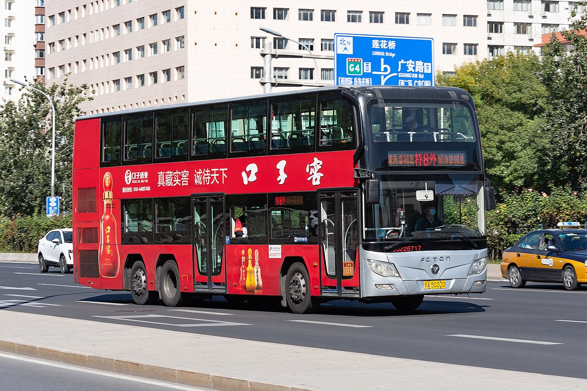

# Anhui Kouzi Distillery Co., Ltd.

Anhui Kouzi Distillery Co., Ltd. is a Jianxiang-aroma baijiu producer in Huaibei, Anhui. The company sits in the cultural belt of the Sui-Tang Grand Canal and the Huang-Huai river fine-liquor belt, and listed on the Shanghai Stock Exchange on 29 June 2015 as the first listed Jianxiang-aroma baijiu company. It owns the Kouzijiao, Lao Kouzi, Kouzifang and Kouzijiu brands.

Figure: Anhui Kouzi Distillery Co., Ltd.. Image: N509FZ, CC BY-SA 4.0, via Wikimedia Commons ([source page](https://commons.wikimedia.org/wiki/File:30226717_at_Liuliqiaonan_(20201017130410).jpg)).

## Company identity

This page records the producer layer: company name, registered place, founding date and organisational form. The joint-stock company is the listed entity and handles production, sales and disclosure; the brand is a market mark, and a product is a specific bottle. When discussing "Kouzijiao", first establish whether the subject is the company, the brand or a bottle.

"Kouzi" is a local term in the Huaibei area, linked to the geography of river junctions and market roads. "Kouzijiao" combines the place term with the fermentation pit, pointing both to origin and to craft tradition. Such names are cultural and brand resources and cannot replace checking the production entity and the label.

## Site and region

Huaibei lies in northern Anhui, on the southern edge of the Huang-Huai plain, with a warm-temperate semi-humid monsoon climate, distinct seasons and moderate rainfall. The company describes its region as the cultural belt of the Sui-Tang Grand Canal and the Huang-Huai river fine-liquor belt, stressing the area's historical transport and brewing tradition.

Regional conditions affect raw materials and the microbial environment but do not determine quality by themselves. Jianxiang-aroma flavour also depends on ingredient ratios, qu, pits, fermentation and storage. The raw materials and origin of a specific product should be taken from the label.

A site in Huaibei does not mean every product uses the same workshop or the same batch of base liquor. Product lines differ in raw materials, storage time and blending, and public company material and the label are the basis for judging a specific product.

## Brands and products

Public product material lists the Kouzijiao, Lao Kouzi, Kouzifang and Kouzijiu series. Kouzijiao sits higher and serves business and gifting; Lao Kouzi, Kouzifang and Kouzijiu cover mass banquets and everyday drinking.

For Anhui Kouzi Distillery Co., Ltd., strength, volume, packaging and price change by year and channel, and some products have regional or festive versions. Buyers should check the brand, product name, strength, net content, ingredients, producer and standard on the label rather than the packaging alone.

For Anhui Kouzi Distillery Co., Ltd., the brand-to-product relation is one-to-many: one brand has several series and price points, and a price band is market positioning, not a quality grade.

## Craft and style

The Jianxiang-aroma route usually combines features of strong and sauce aroma: multi-grain blending, qu making, fermentation in mud or stone pits, continued use of the fermented grain, basket distillation, fractional collection, ceramic-jar storage and blending. Companies differ in their combination of high-temperature qu, medium-temperature qu, fermentation cycles and storage methods.

"Jianxiang" is a style position, not a simple addition of strong and sauce aroma. Aroma layers, palate weight and length of finish depend on specific ingredients, qu and process parameters, and the style name alone cannot judge the liquid.

For Anhui Kouzi Distillery Co., Ltd., a process description states a style route only and cannot replace a judgement about a specific product. Products at different prices and in different series within the same company may differ in base-liquor grade, storage time and blending ratio.

## History

Company material traces the brand's origin to the brewing tradition around Suixi and takes the development since the plant was founded as the main line of corporate history. On 29 June 2015 Anhui Kouzi Distillery Co., Ltd. listed on the Shanghai Stock Exchange, becoming the 17th listed baijiu company on the A-share market and the first listed Jianxiang-aroma baijiu company.

These points describe the shift from a local distillery to a listed company. A listing date is not a plant-founding date and not the starting point of Suixi's brewing culture; when discussing brand history, keep corporate history, regional tradition and product iterations apart.

## Timeline

- 2015: listing on the Shanghai Stock Exchange.

## Common misconceptions

First, treating 2015 as the plant-founding year. 2015 is the listing year.
Second, treating "Jianxiang" as a simple blend of strong and sauce aroma. It is a separate style position and process combination.
Third, treating the length of Suixi's brewing tradition as the history of the modern company. Regional tradition and corporate history are different scales.
Fourth, treating "Kouzi" as a single brand. The company also has Lao Kouzi, Kouzifang and Kouzijiu series.
Fifth, treating price as a quality grade. Price is market positioning, not a process standard.

Kouzi Distillery is based in Huaibei, Anhui, and is known for jianxiang, or “combined-aroma”, baijiu. The company, the Kouzijiao brand and individual products are separate layers. A combined-aroma style is defined by its process and regional practice, not by the company’s position in the market. Not every product from the company necessarily shares the same aroma type or the same grade.

**At a glance:** A Jianxiang-aroma baijiu producer in Huaibei, Anhui. It listed on the Shanghai Stock Exchange in June 2015 and was the first listed Jianxiang-aroma baijiu company, with brands including Kouzijiao and Lao Kouzi. 

To read Anhui Kouzi Distillery Co., Ltd., start with the range it makes, then the site and the owner, then the bottler named on the label; no single check settles it.

Kouzi is a Jianxiang-aroma baijiu producer in Huaibei, Anhui, listed in 2015.

**Key facts.**

| Item | Detail |
| --- | --- |
| In one line | A Jianxiang-aroma baijiu producer in Huaibei, Anhui. It listed on the Shanghai Stock Exchange in June 2015 and was the first listed Jianxiang-aroma baijiu company, with brands including Kouzijiao and Lao Kouzi. |
| Type | Baijiu producer (listed company) |
| Official site | kouzi.com |

**Sources and limits.** The key claims about Anhui Kouzi Distillery Co., Ltd. are checked against the following sources: Kouzi official website — company profile (the Jianxiang-aroma positioning and the 2015 listing), Kouzi official website — congratulations on the successful A-share listing of Anhui Kouzi Distillery (the listing date, ticker and product series), Kouzi official website — brand origin (the Suixi brewing culture and the listing point) and 4 sources in total. For current products, addresses or opening status, use kouzi.com. Prices, batches and status change; the body is project-written and does not reproduce source text.

**Read alongside.** Put Anhui Kouzi Distillery Co., Ltd. next to Anhui, Baijiu, Qu making: the first fixes identity and boundary, the others provide a region, process or peer comparison. Read this page first, then return to those entries; the links become coordinates, not decoration.

## Further reading

- [Anhui](ref:anhui): the Hui liquor region and the baijiu map.
- [Baijiu](ref:baijiu): the category and basic process.
- [Qu making](ref:qu-making): the starting point of baijiu production.

Further reading: [Hubei Baiyunbian Distillery](ref:c-extra-1), [Beam Suntory](ref:c-extra-2).
