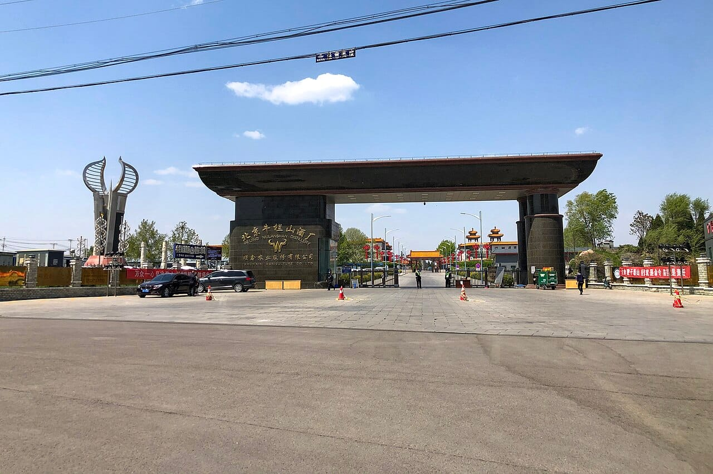

# Beijing Shunxin Agriculture Niulanshan Distillery

Beijing Shunxin Agriculture Niulanshan Distillery is a baijiu producer in Niulanshan town, Shunyi district, Beijing. Its predecessor was the state-run Niulanshan distillery founded in October 1952; it is now a branch of Shunxin Agriculture. Its main products belong to [baijiu](ref:baijiu), and the brand and product range are covered under [Niulanshan](ref:brand).

Figure: Beijing Shunxin Agriculture Niulanshan Distillery. Image: N509FZ, CC BY-SA 4.0, via Wikimedia Commons ([source page](https://commons.wikimedia.org/wiki/File:Niulanshan_Distillery_headquarters_(20200424130839).jpg)).

## Company identity

This producer records the producer layer: company name, site, founding date and organisational form. The distillery is a branch of Shunxin Agriculture responsible for production and product operations; the listed company is the capital and disclosure entity. When discussing "Niulanshan", first establish whether the subject is the listed company, the distillery, the brand or a bottle.

Public material places the founding in October 1952. Company narrative treats the post-1949 joint preparation of local old distilleries such as Gongli, Fushuncheng, Yixin and Kuisheng as the prehistory. Those old workshops are the source of craft and place tradition, not the registration date of the modern company.

## Production area and site

Shunyi lies in north-east Beijing, on the Chaobai River alluvial plain, where groundwater and grain supply suit brewing. Niulanshan town is named for its brewing tradition, and er-guotou craft has continued locally for centuries; company material lists this craft as national intangible cultural heritage.

"Production area" here is both geography and craft tradition. Beijing is not a classic centre in the usual baijiu-region narrative, yet er-guotou craft created a distinct market position through a light-aroma route and the mass price band. Excluding Beijing from baijiu regions ignores this local craft lineage.

## Products and process

The company's products run along several routes: light-aroma products built around er-guotou craft, strong-aroma products represented by Niulanshan Chenniang, and banquet and gift series such as Bainian Niulanshan. Different lines have different aroma types, standards and price bands, and one line cannot describe the whole company.

The key to er-guotou craft is cutting off the head and tail and keeping the middle of the distillate. The spirit collected after a second change of cold water is called "er-guotou". This approach emphasises cleanliness, crispness and value, and differs from the mud-pit, continued-mash strong-aroma route.

Strong-aroma products use mud-pit fermentation, continued mash and mixed steaming; the exact process and raw materials are governed by the product label. One company can make several aroma types at once; this is product structure, not a process contradiction.

## History and market

The state-run Niulanshan distillery was founded in 1952 and gradually built a product system centred on er-guotou. In 1998 the parent, Beijing Shunxin Agriculture Co., Ltd., listed on the Shenzhen Stock Exchange, and the distillery became an important production subject in its baijiu business.

Company material stresses the "time-honoured Chinese brand", "well-known Chinese trademark" and the national intangible heritage status of er-guotou craft. These designations concern the brand, trademark and craft, not a quality rating for a particular bottle.

Niulanshan has long been known for the mass price band and wide distribution, covering open-bottle spirits, banquet products and gifts. Prices move with channel and supply and demand, and this producer gives no figures. Treating sales volume as proof of quality, or "chenniang" as age, are common misreadings.

## Buying and storage

Buy through regular channels and check the anti-counterfeit mark, producer and batch. Different product lines have different aroma types and standards, so check the label rather than treating the three characters "Niulanshan" as one product. For a full case, also inspect the seal and storage conditions.

For Beijing Shunxin Agriculture Niulanshan Distillery, unopened baijiu should be kept upright, away from light, in a cool place without strong odours. Once opened, drink it reasonably soon; prolonged exposure to air costs aroma. A home cellar cannot reproduce distillery storage conditions, so the year of purchase should not be treated as an automatic quality gain.

## Common misconceptions

First, treating Niulanshan only as an er-guotou brand. The company also makes strong-aroma products.
Second, treating "chenniang" as a guarantee of age. It is a product name.
Third, treating the time-honoured brand title as product quality certification. It concerns the brand and craft.
Fourth, treating 1952 as the starting point of every product line. The lines formed at different times.
Fifth, judging authenticity by price or packaging. Anti-counterfeit marks, channels and labels are more reliable.

Niulanshan is a production unit under Shunxin Agriculture, located in Niulanshan town in Shunyi, Beijing. It is not an independent listed company. The brand covers erguotou and strong-aroma aged products, so the word “Niulanshan” alone does not identify the aroma type or the grade. Its identity as a producer and as a keeper of the erguotou process should be read alongside the specific product label.

**At a glance:** A baijiu producer in Niulanshan town, Shunyi district, Beijing. Its predecessor, the state-run Niulanshan distillery, was founded in 1952; it is now a branch of Shunxin Agriculture and is known for er-guotou craft and products such as Niulanshan Chenniang. 

Start with the range it makes. From there, consider the site and the owner, then the bottler named on the label. That is how a practical judgment about Beijing Shunxin Agriculture Niulanshan Distillery is built.

The usual confusion is to treat Beijing Shunxin Agriculture Niulanshan Distillery as a sub-brand. Check what it is first, then what the label claims; the two need not agree.

The Niulanshan distillery was founded in 1952 and is now part of Beijing Shunxin Agriculture; its er-guotou is a light-aroma baijiu made from sorghum.

The distillery's er-guotou is a light-aroma style, and the group also owns other baijiu and food businesses.

**Key facts.**

| Item | Detail |
| --- | --- |
| In one line | A baijiu producer in Niulanshan town, Shunyi district, Beijing. Its predecessor, the state-run Niulanshan distillery, was founded in 1952; it is now a branch of Shunxin Agriculture and is known for er-guotou craft and pr… |
| Founded | 1952 |
| Type | Baijiu producer (listed-company subsidiary) |
| Official site | shunxinholdings.com |

**Sources and limits.** The key claims about Beijing Shunxin Agriculture Niulanshan Distillery are checked against the following sources: Industry body (the founding date, branch relationship, time-honoured brand and intangible heritage information; the er-guotou craft and national intangible cultural heritage statement). For current products, addresses or opening status, use shunxinholdings.com. Prices, batches and status change; the body is project-written and does not reproduce source text.

## Further reading

- [Niulanshan](ref:brand): brand structure and product lines.
- [Baijiu](ref:baijiu): the broad category and aroma types.
- [China](ref:china): the Chinese drinks map and regional organisation.
- Er-guotou: the tradition of cutting the head and tail and keeping the middle.
- Light-aroma baijiu: the aroma route of er-guotou craft.
- [Strong-aroma baijiu](ref:strong-aroma): the aroma route of Niulanshan Chenniang.
