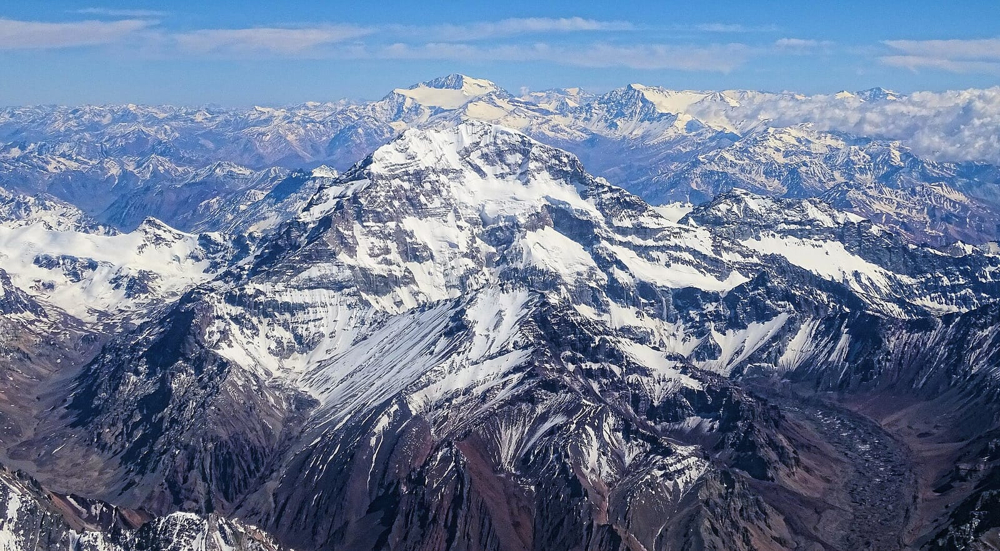

# Aconcagua Valley

The Aconcagua Valley is the inland wine sub-region of Chile's Aconcagua region, north of Santiago. It is led by Cabernet Sauvignon, Carmenère and Syrah reds and also makes Chardonnay and Sauvignon Blanc. The Aconcagua River runs from the Andes to the Pacific, and the valley's terrain and sea-land winds create a temperature gradient.

Figure: Related photograph of Aconcagua Valley. Image: Bjørn Christian Tørrissen, CC BY-SA 4.0, via Wikimedia Commons ([source page](https://commons.wikimedia.org/wiki/File:Aconcagua2016.jpg)).

## Definition and scope

Under Chile's Decree No. 464, Aconcagua is a region containing the Valle del Aconcagua, Valle de Casablanca, Valle de San Antonio and other sub-regions. The Aconcagua Valley is the Valle del Aconcagua sub-region, covering the provinces of San Felipe de Aconcagua, Los Andes and Quillota.

Inside the sub-region, municipal boundaries define areas including Panquehue, Quillota and Hijuelas. Casablanca and San Antonio are separate sub-regions at the same level and are not part of the Aconcagua Valley.

On Wines of Chile's variety figures, the Aconcagua Valley's main varieties total about 1,500 hectares: Cabernet Sauvignon 402 hectares, Carmenère 219, Sauvignon Blanc 202, Syrah 189, Chardonnay 171 and Pinot Noir 154, plus Petit Verdot, Merlot and Malbec. SAG counted 7,738.9 hectares for the whole Aconcagua region in 2024, including Casablanca and San Antonio, a different basis.

## History

Vineyards were recorded in the Aconcagua Valley in the nineteenth century, and its irrigation and transport links made it one of Chile's early wine regions. In the late twentieth century the region went through variety renewal and export expansion, with Cabernet Sauvignon and Merlot gaining area.

From the 1990s Syrah drew attention on warm inland sites, and Carmenère was re-identified and planted more widely. The region's modern image is tied to Andean foothill gravels, a large day-night range and premium reds.

## Geography and climate

The Aconcagua River flows north from the Andes and then west to the sea, and the valley runs from foothills through terraces to coastal lowland. The inland valley is higher and sunnier, warm by day with sharp night cooling and a large day-night range; the coastal Quillota and Hijuelas area is lower and moderated by sea breezes and morning fog, ripening more slowly.

The Mediterranean climate brings dry summers and concentrated winter rain. Irrigation depends on river and groundwater, and water allocation in dry years affects yield and ripening. Altitude, aspect and distance to the sea together set the mesoclimate, and areas within one sub-region differ clearly.

Soils are mainly river alluvium, foothill colluvium and weathered rock on slopes. Valley soils are deep and hold water better; foothill sites with more gravel and rock drain quickly and suit Cabernet Sauvignon and Syrah roots. These differences form the basis of [terroir](ref:terroir).

## Legal areas

The Aconcagua Valley's areas follow municipal boundaries:

- Panquehue: on the Andean foothills, where altitude and gravels bring a marked day-night range and strong reds.
- Quillota: coastal lowland with stronger maritime influence and a milder temperature.
- Hijuelas: between inland and coast, with varied sites and both red and white varieties.

For Aconcagua Valley, areas are legal geographic names, not quality grades. A more specific place name usually means a more concentrated source, but not necessarily higher quality.

## Varieties and raw material

Cabernet Sauvignon is the valley's largest variety, often showing cassis, spice and mineral notes; Carmenère shows red fruit, green pepper and spice with soft tannin; Syrah is full-bodied on warm inland sites with blackberry, pepper and floral notes. Merlot, Petit Verdot and Malbec are often blended.

Whites are mainly Sauvignon Blanc, Chardonnay and Pinot Noir, with coastal sites better for fresh styles. The raw material is [grape](ref:grape). The variety structure reflects altitude, irrigation and market demand and is not a guarantee of style.

## Winemaking

Reds are destemmed and [fermented](ref:fermentation) with temperature control. Cabernet Sauvignon and Syrah often see longer maceration and pumpovers, then age in French or American [oak](ref:oak-ageing). Blend proportions, picking date and maceration strength are the main sources of style difference.

Whites ferment cool. Some Chardonnay sees oak and lees stirring; Sauvignon Blanc is mostly fermented in stainless steel to keep acidity and aroma.

## D.O. and labelling

For Aconcagua Valley, Chilean origin labelling is governed by Decree No. 464 and related rules. A D.O. wine must come from the delimited region; when a label names a variety, traditional varieties must make up at least 85% of a blend. Reserva and Gran Reserva have no uniform ageing or quality requirement and are not statutory quality grades.

Región, Subregión, Zona and Área are legal geographic names at different levels. The Aconcagua Valley is a sub-region, and Casablanca and San Antonio are separate sub-regions at the same level, so the names cannot be used interchangeably.

## Labels and serving

The label should be checked for the D.O. name, variety, [vintage](ref:vintage), [alcohol](ref:abv), volume and bottler. A wine labelled as a [single variety](ref:single-varietal) must meet the variety share; blends must list their varieties under the rules. Cabernet Sauvignon and Syrah are served at about 16–18 degrees Celsius, Carmenère at about 16–18, Chardonnay at about 10–12 and Sauvignon Blanc at about 8–10.

Cabernet Sauvignon and Syrah suit red meat, grilled dishes and spiced food; Carmenère suits stews and poultry; Chardonnay suits seafood and creamy dishes; Sauvignon Blanc suits seafood and salads. Refrigerate after opening and finish soon. Excessive drinking harms health and minors should not drink.

## Common misconceptions

First, confusing the Aconcagua Valley with Casablanca. Both are sub-regions of the Aconcagua region, but their boundaries and climates differ.
Second, thinking the Aconcagua Valley makes only reds. Coastal areas also make whites and fresh-style reds.
Third, treating Reserva as a quality grade. Chile has no uniform Reserva ageing standard.
Fourth, assuming higher altitude is always better. Altitude changes temperature and range, but quality depends on matching variety and vintage.
Fifth, taking an area name for a brand. An area is a legal geographic name; winery names and brands are separate.

[Wine](ref:wine) and [Red wine](ref:red-wine) are the two useful reference points for Aconcagua Valley. [Wine](ref:wine) sets out geographic boundary; [Red wine](ref:red-wine) brings in climate and soil. Read them together.

**At a glance:** The Valle del Aconcagua sub-region of Chile's Aconcagua region, covering the provinces of San Felipe de Aconcagua, Los Andes and Quillota, with legal areas including Panquehue, Quillota and Hijuelas. On Wines of Chile's variety figures the main varieties total about 1,500 hectares, led by Cabernet Sauvignon, Carmenère, Sauvignon Blanc and Syrah. The Aconcagua River runs from the Andes to the Pacific, with a warm inland valley and a large day-night range, and a cooler coastal fringe. Soils are mainly alluvial and colluvial. Reserva is not a quality grade.

SAG revised the Valle del Aconcagua boundaries in 2018.

## Further reading

- [Wine](ref:wine): an overview of wine categories, vintages and origin rules.
- [Red wine](ref:red-wine) and [white wine](ref:white-wine): the two main categories in the Aconcagua Valley.
- [Cabernet Sauvignon](ref:cabernet), [Syrah](ref:syrah) and [Merlot](ref:merlot): the core red varieties.
- [Chardonnay](ref:chardonnay), [Sauvignon Blanc](ref:sauvignon-blanc) and [Pinot Noir](ref:pinot-noir): coastal whites and fresh reds.
- [Grape](ref:grape): the structure of wine grapes and ripeness measures.
- [Fermentation](ref:fermentation): red maceration and cool white fermentation.
- [Acidity](ref:acidity): how the day-night range and sea breezes affect acidity.
- [Terroir](ref:terroir): alluvium, colluvium and weathered rock on slopes.
- [Oak ageing](ref:oak-ageing): barrel ageing for Cabernet Sauvignon and Syrah.
- [Dry](ref:dry): the dry style of Chilean whites.
- [Vintage](ref:vintage): vintage variation and drought in the Aconcagua Valley.
- [Single varietal](ref:single-varietal): the variety labelling share.
- [Alcohol by volume](ref:abv): what % vol means on a label.

## Related images

Image: Merlot. Credit: Felloni claire, CC BY-SA 4.0, via Wikimedia Commons ([source page](https://commons.wikimedia.org/wiki/File:Merlot.jpg)). Related image for Aconcagua Valley.

Image: Acidity. Credit: Chemicalinterest, Public domain, via Wikimedia Commons ([source page](https://commons.wikimedia.org/wiki/File:Zn_reaction_with_HCl.JPG)). Related image for Aconcagua Valley.
