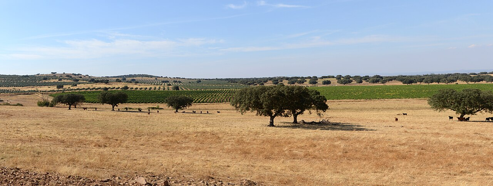

# Alentejo

A large region in south-central Portugal with a hot, dry climate and soils from granite to schist and clay; led by Aragonez (Tempranillo), Trincadeira and Alicante Bouschet, it is one of Portugal’s most overlooked and best-value red regions.

Figure: Alentejo: Alentejo September 2013-1 (Wikimedia Commons). Image: Alvesgaspar, CC BY-SA 3.0, via Wikimedia Commons ([source page](https://commons.wikimedia.org/wiki/File:Alentejo_September_2013-1.jpg)).

## Definition and boundaries

Alentejo lies in south-central [Portugal](ref:portugal), bordering Beira to the north, Spain to the east and the Algarve to the south; it covers about a third of the country and spans the three districts of Beja, Évora and Portalegre, making it one of Portugal’s largest wine regions. Its wines sit in two tiers: eight PDO (DOC) sub-regions — Portalegre, Borba, Redondo, Reguengos, Évora, Vidigueira, Granja-Amareleja and Moura — plus the region-wide Alentejano PGI (formerly Vinho Regional Alentejano).

PDO rules set stricter limits on permitted varieties, yields and ageing; the PGI rules are looser and allow international varieties such as Syrah, Cabernet Sauvignon and Petit Verdot to be blended with local grapes. Several modern estates deliberately use the PGI label for freedom in variety and winemaking; when a label says only Alentejo without a sub-region, the fruit may come from several zones.

For drinkers, the sub-region, parcel and producer name indicate style more reliably than the broad regional name; within one plain, a full-bodied dry-land blend and a fresh high-altitude white can taste far apart.

## History and naming

Archaeological evidence shows wine was part of daily life here before the Romans reached southern Portugal. The Tartessians are thought to have first domesticated vines and introduced winemaking; Phoenicians and Greeks later left amphora traces, but the Romans were the ones who systematised local viticulture and methods, and the clay-vessel (talha de barro) fermentation and storage tradition they brought has survived in Alentejo to this day.

After the Moors entered the Iberian Peninsula in the 8th century, wine culture faded; once the Kingdom of Portugal was established, the crown and new religious orders brought vines back. In the 16th century the Peramanca wines of Évora, the whites of Beja and the palhetes of Alvito, Viana and Vila de Frades were in demand; in the 17th century Alentejo wines ranked among Portugal’s most famous, alongside those of Beira and Estremadura. After the Marquis of Pombal created the Douro general company, measures forced vine uprooting across many areas including Alentejo, and the region fell into obscurity.

A mid-19th-century campaign to bring heathland under cultivation revived the vineyards. In 1888 a white wine from Quinta das Relíquias in Vidigueira won the Grand Medal of Honour at the Berlin Exhibition; in 1895 Portugal’s first social winery (an early cooperative) was founded in Viana do Alentejo. Phylloxera, the two world wars, successive economic crises and the wheat “bread basket” campaign then shrank the vineyard. Recovery began under the late-1940s national wine board; ATEVA was established in 1983, the first Alentejo DOCs were regulated in 1988, and PROVA set up the quality-control system in 1997; Touriga Nacional was introduced to the region in the 1980s.

## Geography and terroir

The landscape is a gently rolling plain and low hills, with cork oak woodland, olive groves and vineyards interspersed. The climate is continental-Mediterranean: hot, dry summers with highs around 40°C, mild winters, and a wide diurnal range on the interior plain; Atlantic breezes temper the heat around Vidigueira.

Soils vary widely. Northern Portalegre is mostly granite with small schist patches, vines climbing the foothills of the Serra de São Mamede, with some steep slopes above 1,000 m; Borba has marble outcrops and red schist; Redondo is sheltered by the Serra d’Ossa, whose peaks exceed 600 m; Reguengos sits on poor schist and stony ground; Évora has brown Mediterranean soil; Vidigueira is mainly granite and schist; Granja-Amareleja and Moura have clay, schist and limestone with thin topsoil and little rain.

Altitude, aspect, drainage and proximity to the Alqueva reservoir split the large plain into stylistically distinct parcels; in dry years water management and yield control show up directly in concentration and balance.

## Raw materials and styles

Red grapes account for about 65%; the leading varieties are Aragonez (local name for [Tempranillo](ref:tempranillo)), Trincadeira, Alicante Bouschet, Touriga Nacional and Castelão, alongside Moreto, Tinta Caiada and international Syrah, Cabernet Sauvignon and Petit Verdot. Among whites, Antão Vaz is the most important local variety; official statistics put the white vineyard area at 4,872.2 ha, of which Antão Vaz covers 1,251.2 ha (25.7%), Síria/Roupeiro 872.4 ha (17.9%) and Arinto 776.5 ha (15.9%), with Rabo de Ovelha, Fernão Pires, Verdelho and Gouveio making up the rest.

Blending is traditional: Aragonez supplies structure and dark fruit, Trincadeira acidity and spice, Alicante Bouschet colour and tannin. In recent years single-varietal wines, [oak](ref:oak) barrel ageing and the traditional clay-vessel style have run in parallel. The talha method dates to Roman times: vessels reach 2 m in height and 2,000 L in capacity, sealed inside with natural pine resin (pês); the resulting wine shows direct fruit with little new-oak trace.

The common style is full-bodied, solidly structured and smoothly tannic with generous fruit. Whites split into two routes: Antão Vaz gives tropical fruit and body, while Arinto-led blends carry citrus acidity and mineral character. Unlike Port and other [fortified](ref:fortified) wines of the Douro, Alentejo’s main line is still table wine; the region produces almost no Port-style product.

## Representative producers and wines

Herdade do Esporão, near Reguengos de Monsaraz, had its boundaries first fixed in 1267; José Roquette and Joaquim Bandeira bought the property in 1973 and started the winemaking project, and the landholding covers about 1,800 ha. Its Reserva red, the estate’s first wine from 1985, blends Alicante Bouschet, Aragonez, Syrah, Trincadeira, Cabernet Sauvignon and Touriga Franca and spends 12 months in oak barrels.

Cartuxa, in Évora, belongs to the Eugénio de Almeida Foundation, founded in 1963; its name comes from the Carthusian monastery where monks lived from 1598, and the estate’s wine was first produced in 1986. Its red blends Alicante Bouschet, Trincadeira and Aragonez on granite and schist soils.

Cortes de Cima, in Vidigueira, was settled by Danish-American couple Carrie and Hans Jorgensen after their arrival in the 1980s; the first vineyards were planted in 1991, the first harvest came in 1996, and the first wine was released in 1998. The contiguous landholding covers about 400 ha, and most wines are made under the looser PGI rules, led by Syrah and multi-variety blends. Other names to watch include Quinta do Mouro in Estremoz and Herdade dos Grous in Alandroal; cooperatives, family estates and outside capital have long coexisted here.

## How to drink and pair

Alentejo [reds](ref:red) are full-bodied with rounded tannins, pairing well with local roast lamb, stews, sausages and hard cheeses; high-acid Trincadeira blends suit roast poultry and spiced dishes. Antão Vaz whites go with seafood, white meat and soft cheese, while Arinto blends work as aperitifs with cold dishes.

Traditional clay-vessel wines are natural in style with direct fruit and are served slightly cooler than heavily oaked reds; oaked wines can be decanted briefly after opening. Local dishes of wild boar stew, black beans, sausages, olive oil and bread share the same ingredients and seasoning as the local wines.

For temperature and glass, full-bodied reds sit around 16–18°C and whites at 10–12°C; a wide glass opens the aromas, and young fruity wines need no long decanting.

## Labels, buying and misreadings

Read the label by distinguishing a PDO sub-region name from the Alentejano PGI, then look at variety, vintage and producer; Reserva and similar ageing grades carry legal requirements in Portugal. A PGI label is not a lower tier: many leading modern estates choose it for variety and winemaking freedom.

Vintage variation matters on the plain too: heatwaves and harvest rain alter ripeness; comparing two producers’ same variety in one vintage teaches more about parcel and soil than jumping across years. Prices usually sit below Douro and Port, with everyday table wines and age-worthy cuvées side by side.

For storage, stable temperature comes first; after opening, light whites usually last 1–3 days, structured reds longer.

## Around and routes

The Rota dos Vinhos do Alentejo links the wine villages; the classic route runs from the UNESCO old city of Évora through Reguengos de Monsaraz to Vidigueira, with the hill town of Monsaraz overlooking the Alqueva reservoir as the best viewpoint stop.

Distances inside the region are long: a regional centre to a hill estate often takes 30–60 minutes, and a tasting 60–90 minutes, so three stops in one day is already tight. Harvest runs in the Northern Hemisphere autumn, September to October, when estates are busiest; weekend opening hours vary widely, so confirm bookings and fees through the official website or regional association beforehand.

For visits, book ahead, arrive on time, do not drink and drive, and stay out of working cellars and parcels; cork oak woodland, olive groves and historic towns can be combined with estate stops.

- Related: [portugal](ref:portugal), [tempranillo](ref:tempranillo), [red-wine](ref:red), [oak-ageing](ref:oak), [fortified-wine](ref:fortified).
