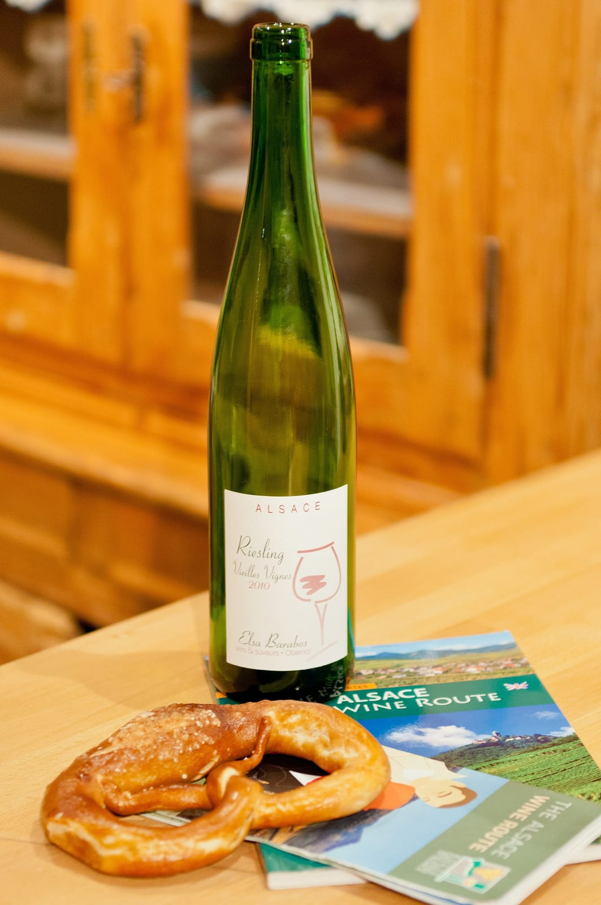
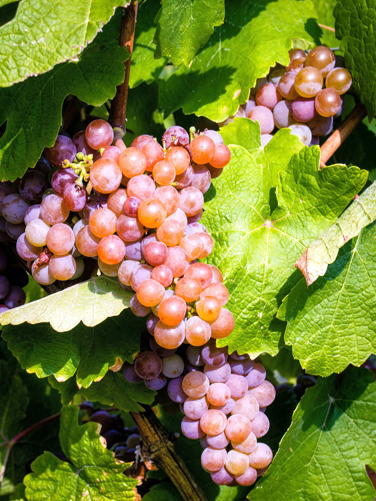

# Alsace

Alsace is a wine region in north-eastern France, east of the Vosges and on the west bank of the Rhine, facing Germany across the river. It is dominated by white wines, often labelled by variety rather than by place, and has Grand Cru, late-harvest and botrytised-selection tiers.

Figure: Alsace. Image: Jorge Franganillo from Barcelona, Spain, CC BY 2.0, via Wikimedia Commons ([source page](https://commons.wikimedia.org/wiki/File:Colmar_(32350846618).jpg)).

## Geography and climate

The region forms a narrow north-south band, with Bas-Rhin in the north and Haut-Rhin in the south, the Vosges to the west and the Rhine plain to the east. The Vosges block moist air from the Atlantic and create a rain shadow, making Alsace one of the drier parts of France, with generous sunshine and a dry autumn.

This climate suits late-ripening varieties and lets noble rot develop in suitable years. A dry autumn lengthens the harvest window, so growers can pick in several passes and wait for the ripeness and botrytis level they want. Mountains, aspect and altitude create differences between sites, and plots in the same village can ripen at different times.

## Sub-regions

- Bas-Rhin: the northern part of the region, including Marlenheim, Molsheim and the Obernai area.
- Haut-Rhin: the southern part, including Colmar, Rouffach, Guebwiller and the Thann area.
- Alsace Grand Cru: specific sites in several villages, numbering more than fifty, each with a legal name and stricter rules.
- Crémant d'Alsace: sparkling wine made by the traditional method from permitted varieties of the same region.

Grand Cru is a site designation, not an estate grade. Labelling a Grand Cru requires compliance with rules on variety, yield and ripeness, with the exact terms set by regulation and the bottle.

## Varieties and styles

The four most important varieties are [Riesling](ref:riesling), [Gewürztraminer](ref:gewurztraminer), Pinot Gris and Muscat. There are also Pinot Blanc, Sylvaner, Chardonnay (mainly for Crémant) and Pinot Noir, the region's rare red variety.

Alsace wines are usually labelled by variety, unlike most French regions, which label by place. Dry is the mainstream, but sweetness spans a wide range, from dry and off-dry to late harvest (Vendanges Tardives, VT) and botrytised selection (Sélection de Grains Nobles, SGN). VT and SGN are regulated tiers for late-picked and botrytis-affected concentrated fruit, not marketing terms.

[White wine](ref:white-wine) here is generally aromatic, medium to high in acidity and light to full in body. Riesling shows citrus, white flowers and flint, developing a petrol note with age; Gewürztraminer is known for lychee, rose and spice, with lower acidity and a bold aroma. Variety pages describe potential; wine pages describe specific bottles.

## Classification and rules

Alsace belongs to the French AOC/AOP system, administered by INAO within the EU framework. The tiers include Alsace, Alsace Grand Cru and Crémant d'Alsace. Labelling a variety requires compliance with variety proportions and naming rules; labelling a Grand Cru requires stricter rules on site, variety, yield and ripeness.

VT and SGN have legal minimum ripeness levels that differ from those of standard wines. When reading a label, separate the variety name, site name, tier name and estate name, since they are different levels of naming and are not interchangeable.

## Representative wines and producers

[Alsace Riesling](ref:alsace-riesling) is one of the region's signature white wines, mostly dry, with high acidity and clear aromatics; [Alsace Gewürztraminer](ref:alsace-gewurztraminer) represents the aromatic side, made as dry, late-harvest and botrytised styles. Both share the same regional rules but differ in variety and style.

The region is dominated by family estates, alongside négociants and cooperatives. Estates vary greatly in size; some own their plots and bottle their own wine, while others buy grapes or wine to blend. The bottler information on the label is the key to telling estate wine from négociant wine.

## Market and drinking

Alsace wines are mostly sold by variety, so consumers can choose a style by grape. Dry Riesling and Gewürztraminer suit pork, poultry, cheese and dishes with spice; sweet wines, VT and SGN suit foie gras, blue cheese or dessert. Serving temperature follows body and sweetness, and sweet wines usually need to be colder.

For Alsace, begin with the appellation and its permitted varieties. Then look at the vintage and the producer, and finally ask how the wine is labelled. The answers point to different choices, not to a single score.

## Common misconceptions

First, treating Alsace as the same as a German region. The two are neighbours with overlapping varieties, but the country, rules and labelling systems differ.
Second, assuming Alsace wines are all sweet. Dry is the mainstream, and sweet styles must be declared.
Third, equating Gewürztraminer with sweet wine. Dry Gewürztraminer is common, and sweetness depends on the designation and the winemaking.
Fourth, thinking Alsace makes only white wine. The region also makes red wine from Pinot Noir and sparkling Crémant.
Fifth, treating VT and SGN as ordinary marketing words. They carry legal ripeness and labelling rules.

## Scope note

This region describes the geography, varieties and rules of Alsace and does not assess individual estates or vintages. The parent region is [France](ref:france).

**In brief:** A wine region in north-eastern France, east of the Vosges and on the west bank of the Rhine, known for Riesling, Gewürztraminer, Pinot Gris and Muscat, mostly labelled by variety and with Grand Cru, late-harvest (VT) and botrytised selection (SGN) tiers. 

It is tempting to treat Alsace as an administrative place name. Its identity and use are separate questions.

Sources for Alsace include INAO, European Union, Oxford University Press.

Alsace lies east of the Vosges and west of the Rhine, and its rain shadow makes it one of France's driest wine regions; the wines are mostly single-variety whites, with Riesling, Gewürztraminer, Pinot Gris and Muscat as the noble four. Grand Cru sites are on granite, limestone and marl slopes, and VT and SGN label late-harvest and botrytised wines. The region's Germanic history shows in bottle shapes and place names, but the appellation rules are French.

**Key facts.**

| Item | Detail |
| --- | --- |
| In one line | A wine region in north-eastern France, east of the Vosges and on the west bank of the Rhine, known for Riesling, Gewürztraminer, Pinot Gris and Muscat, mostly labelled by variety and with Grand Cru, late-harvest (VT) and… |
| Level | other |
| Parent | France |
| Country code | FR |

**Sources and limits.** The key claims about Alsace are checked against the following sources: INAO (Used to check the French appellation system and its administering body), European Union (Used to check EU wine categories, geographical indications and labelling rules), Oxford University Press (Consulted for entries on the Alsace region, its grands crus and its sweet-wine designations) and 6 sources in total. Prices, batches and status change; the body is project-written and does not reproduce source text.

For Alsace, this region was last checked in 2026; prices, batches and availability change, so confirm them against the sources below.

## Related images

Image: Related photograph of Alsace Riesling. Credit: Michal Osmenda from Brussels, Belgium, CC BY-SA 2.0, via Wikimedia Commons ([source page](https://commons.wikimedia.org/wiki/File:2010_Riesling_Vieilles_Vignes_from_Elsa_Barabos,_Obernai,_Alsace_(6711020535).jpg)). Related image for Alsace.

Image: Related photograph of Alsace Gewürztraminer. Credit: Rolf Kranz, CC BY-SA 4.0, via Wikimedia Commons ([source page](https://commons.wikimedia.org/wiki/File:Gewurztraminer_(Andlau,_Alsace).jpg)). Related image for Alsace.
