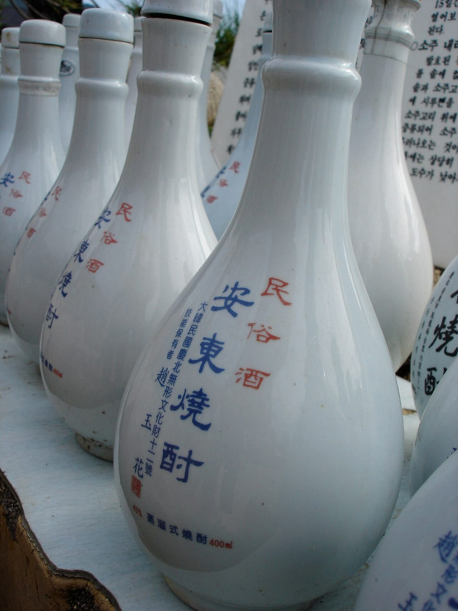
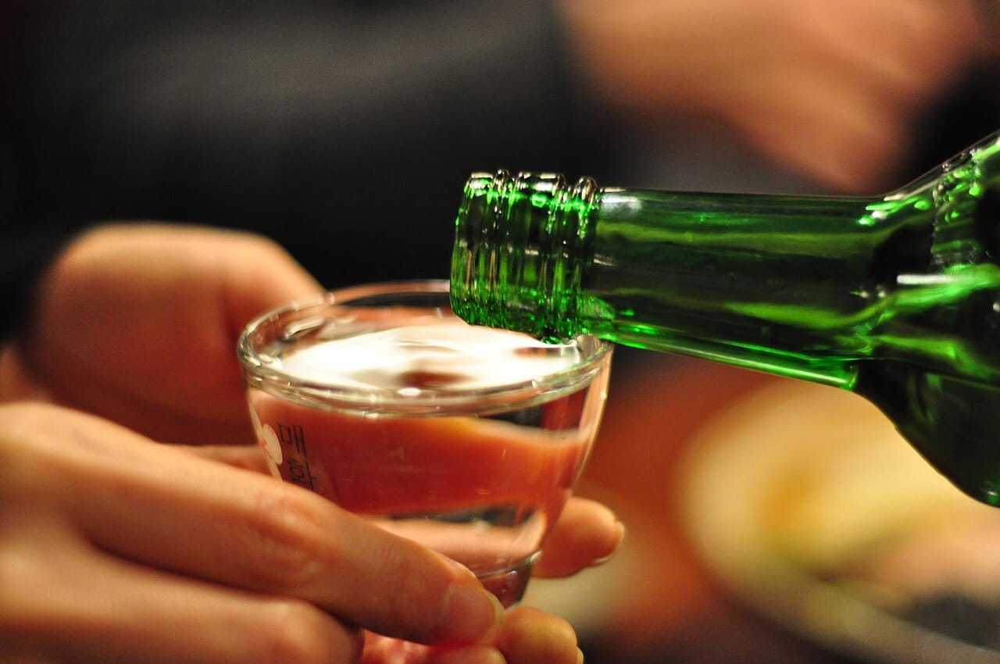

# Andong

A traditional soju region in Andong, North Gyeongsang Province, South Korea, built on rice, nuruk and pot distillation; Andong Soju is a designated intangible cultural heritage, high in alcohol and rich in rice and culture aroma, a representative of Korean traditional drink.

Figure: White ceramic bottles of Andong soju, with the name visible on the vessel. Image: Matt and Nayoung Wilson from Atlanta and surrounding, US, CC BY 2.0, via Wikimedia Commons ([source page](https://commons.wikimedia.org/wiki/File:Korean_distilled_liquor-Andong_soju-01.jpg)).

## Definition and boundaries

Andong soju is a traditional distilled drink from Andong in North Gyeongsang Province, made from rice fermented with nuruk and run through a pot still, usually above 40% alcohol. It is not the same product as modern diluted soju, which is built from neutral alcohol and flavourings; the traditional version keeps more grain aroma, body and length.

Here the place name marks a craft and a local tradition rather than a wine-style parcel. Before buying, check whether the label says traditional distillation, and read the ingredients and ABV; “Andong soju” alone does not prove the old method, and tourist-market blends may carry the name.

## History and naming

The history is usually traced to the Joseon period, when local families and workshops used rice and nuruk; Andong Soju is designated Gyeongsangbuk-do Intangible Cultural Heritage No. 12, and the Andong Soju Museum and inheritors keep the method visible.

The name is both a place and a reputation. Local soju grew around local rice, spring water and clay-jar storage; after industrial diluted soju took the mass market, traditional Andong soju became a small, protected craft.

## Geography and terroir

Andong sits inland in North Gyeongsang, among mountains and river valleys, and traditional distilling depends on local rice and clean groundwater; cold winters and humid summers make temperature control during fermentation a practical skill.

Terroir here is not a vineyard slope. It is the combination of rice, water, nuruk and clay jars. Two workshops using the same materials can still differ through steaming, culture temperature and fermentation length; read the process before the place name.

## Raw materials and styles

Rice is the base, and nuruk brings lactic and nutty notes; pot distillation keeps more grain aroma, so the spirit enters strong and finishes long. Aged versions round out in clay or other vessels and gain colour and deeper aroma.

Style turns on three choices: the share of rice, the kind of nuruk and fermentation time, and whether the spirit is aged. “Soju” is too broad a word; diluted soju, traditional Andong soju and local fruit drinks are different products with different uses.

## Representative producers and bottlings

Representative producers include the Andong Soju Museum and Andong Soju; the museum shows nuruk, stills and traditional fermentation, and some bottles sell only locally or through selected channels.

Judge a producer first by process, not by the word traditional: is it pot-distilled, what is the ABV, and is it aged? Traditional Andong soju is made in small volumes and costs more; treat it as a sipping spirit, not as something to drink in large shots.

## How to drink and pair

The traditional serve is closer to room temperature, in small cups; too cold mutes the rice and nuruk, too warm pushes alcohol forward. If it feels strong, add a little warm water rather than hiding it in a sweet mixer.

Pair it with salt, fat and fermented flavours: Andong salted fish, jeon, grilled meat, kimchi and tofu can carry the body. Light raw dishes and very sweet desserts make the spirit feel hotter; start with salt and fat, then sip.

## Labels, buying and misreadings

Read four things on the label: ingredients (rice or other grains), process (traditional distillation or dilution), ABV and producer. If “traditional” appears without a process note, treat it as branding rather than a guarantee.

The common misreadings are treating all Korean soju as the same low-alcohol product, or treating high ABV as quality. Andong soju is about rice and nuruk, not proof; after opening, keep it cold and dark and finish it before the aroma fades.

## Around and routes

Andong city, Hahoe Village and the Andong Soju Museum fit into one day: Hahoe and Confucian culture in the morning, a workshop visit in the afternoon, local food at night. Public transport is limited, so check times or arrange a car.

Book workshop visits, stay out of fermentation and distillation areas, and check the rules for carrying bottles. With only half a day, choose the museum plus one local meal; that explains the drink better than rushing through several stops.

**Short definition:** A traditional soju region in Andong, North Gyeongsang Province, South Korea, made from rice and distilled in a traditional pot still; Andong Soju is designated Gyeongsangbuk-do Intangible Cultural Heritage No. 12, high in alcohol and rich in style, a representative of Korean traditional drink. 

Start with the appellation and its permitted varieties. From there, consider the vintage and the producer, then how the wine is labelled. That is how a practical judgment about Andong is built.

[South Korea](ref:south-korea) explains geographic boundary; [Rice](ref:rice) adds climate and soil. Put Andong between them before deciding what it is.

**Key facts.**

| Item | Detail |
| --- | --- |
| In one line | A traditional soju region in Andong, North Gyeongsang Province, South Korea, made from rice and distilled in a traditional pot still; Andong Soju is designated Gyeongsangbuk-do Intangible Cultural Heritage No. 12, high i… |
| Level | province or region |
| Parent | South Korea |
| Country code | KR |

**Sources and limits.** The key claims about Andong are checked against the following sources: Korea Heritage Service, Korea Tourism Organization, Korea.net (the rice ingredient, distillation tradition and historical account of Andong soju) and 4 sources in total. Prices, batches and status change; the body is project-written and does not reproduce source text.

**Read alongside.** Put Andong next to South Korea, Soju, Rice: the first fixes identity and boundary, the others provide a region, process or peer comparison. Read this region first, then return to those entries; the links become coordinates, not decoration.

For Andong, this region was last checked in 2026; prices, batches and availability change, so confirm them against the sources below.

The traditional distillate is typically 40–50% ABV.

## Further reading

Further reading: placing Andong soju within Korea’s traditional drinks is more useful than tasting one bottle alone. It does not share a production line with diluted soju, Gyeongju beopju or Jeonju pear-and-ginger wine: some are diluted, some rely on fermentation and infusion. Compare materials and process first, then ABV and sweetness, and only then aroma. In Andong, the museum and Hahoe Village fit one day, but do not read “traditional” as a quality guarantee; batch, age and storage often decide the glass more than the place name.

A final note: the best traditional bottles are often small batches, not the loudest advertisement; buy a small bottle before committing to a case.

- Related: [south-korea](ref:south-korea), [soju](ref:soju), [rice](ref:rice), [fermentation](ref:fermentation), [terroir](ref:terroir).
- This region provides no map, prices or opening hours; confirm before travelling.

## Related images

Image: Soju. Credit: Graham Hills, CC BY 2.0, via Wikimedia Commons ([source page](https://commons.wikimedia.org/wiki/File:Soju.jpg)). Related image for Andong.

Image: Terroir. Credit: Friedrich Petersdorff, CC BY-SA 2.0 de, via Wikimedia Commons ([source page](https://commons.wikimedia.org/wiki/File:080110_zell_mosel.JPG)). Related image for Andong.
