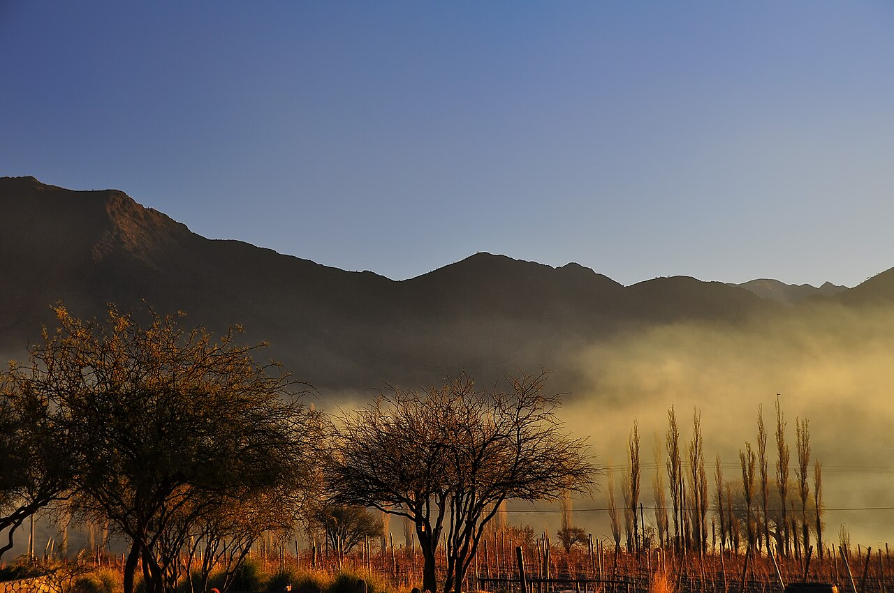

# Argentina

Argentina is South America’s second-largest wine producer and the world’s fifth-largest by volume. Its vineyards run along the eastern foothills of the Andes, from high-altitude northwest valleys down to the cool river valleys of Patagonia. Malbec is the international calling card, while Torrontés, Cabernet Sauvignon, Chardonnay, Syrah and sparkling wine complete the map.

Figure: Argentina: Miraluna Vineyard, Cachi, Argentina (7126977841) (Wikimedia Commons). Image: Rod Waddington from Kergunyah, Australia, CC BY-SA 2.0, via Wikimedia Commons ([source page](https://commons.wikimedia.org/wiki/File:Miraluna_Vineyard,_Cachi,_Argentina_(7126977841).jpg)).

## Definition and boundaries

Argentina’s wine map is a belt of irrigated oases along the Andes, not a single valley. Mendoza holds about 71.7% of the national vineyard, San Juan about 19.7%, La Rioja about 3.4% and Salta about 1.9%, with the rest in Patagonian provinces such as Neuquén and Río Negro. These provinces fall into three climatic belts — Cuyo, the northwest highlands and Patagonia — and a provincial name on a label says more about style than the blanket word “Argentina”.

Law 25.163, passed in 1999, fixed the GI system under the Instituto Nacional de Vitivinicultura (INV); provinces, valleys and districts such as the Uco Valley, Luján de Cuyo and Maipú are the common geographic units. A place name identifies fruit origin, not a quality ranking. Inside Mendoza there are further sub-zones: Maipú, Luján de Cuyo and the Uco Valley (Tupungato, Tunuyán, San Carlos). In the northwest, Salta centres on Cafayate, while Patagonia is known for the cooler styles of Neuquén and Río Negro.

## History and naming

In 1853, backed by Governor Sarmiento, the French agronomist Michel Aimé Pouget brought French varieties including Malbec to Mendoza for trial plantings. Malbec took root and, more than a century later, became Argentina’s signature red grape. Through much of the twentieth century, domestic wine served a mass market and the bulk trade, and high-yielding pink-skinned varieties such as Cereza and Criolla Grande occupied a large share.

Exports opened up after the 1970s, and in the 1990s Nicolás Catena systematically studied high-altitude growing; in 1994 he planted a Malbec vineyard at almost 1,500 metres in Gualtallary. In 1993 Luján de Cuyo became Mendoza’s first controlled district. After the 2000s, cool-climate Patagonian wines and high-altitude Salta Torrontés earned independent positions on international markets.

## Geography and terroir

The core districts share a dry, intense, irrigated setting. Mendoza receives less than 200 mm of rain a year, relies on Andean snowmelt and canals, and has close to 300 sunny days annually. Dry air lowers disease pressure, UV thickens skins, and the diurnal range preserves acidity. Mendoza vineyards mostly sit between 600 and 1,500 metres, some Uco Valley sites reach 900 to 1,700 metres, and Cafayate vineyards in Salta approach 3,000 metres.

Central sites are gravel and sand over clay, while high-altitude parcels are gravelly and sandy-alluvial, forcing roots deep for water. Riverside flats ripen early and give generous fruit; higher slopes ripen later with better acidity and texture. Summer hail is a common inland Mendoza risk, and spring frost occurs in the northwest highlands. Patagonia cools by latitude and suits Pinot Noir and Chardonnay; Salta cools by altitude, the classic setting for Torrontés and high-altitude Malbec.

## Raw materials and styles

INV figures for 2024 put Malbec at about 47,064 hectares nationwide, roughly 23.5% of the vineyard and the leading variety; about 84.7% of that Malbec sits in Mendoza. Other reds include Cabernet Sauvignon, Bonarda, Syrah, Tannat and Merlot; whites are led by Chardonnay and Torrontés, with Riesling and Sauvignon Blanc growing in cooler districts.

The classic Malbec shows dark fruit, violet perfume, soft tannin and a full body; high-altitude sites bring clearer acidity, minerality and a longer finish, while plainland fruit tends sweeter and higher in alcohol. Torrontés is aromatic and direct, with white blossom, citrus and honey notes. Chardonnay ranges from crisp and mineral to rich after barrel fermentation. Oak ageing (ref:oak) runs from a few months to more than two years, and premium wines have several years, often a decade or more, of cellaring potential.

## Representative producers and wines

Representative estates include Catena Zapata, a driver of high-altitude research and a reference for premium Malbec; Zuccardi, known for its Uco Valley range and terraced vineyards; and Achaval-Ferrer, focused on high-altitude single vineyards. Chacra in Patagonia represents the cool Pinot Noir and Chardonnay of Neuquén, while Colomé in Salta is an established northwest highlands estate.

These names are not an official classification but reference points formed by the market. Flagship and single-vineyard wines are scarce and expensive, entry wines from family estates are easier to find, and cooperatives plus large négociants carry much of the mass-market volume. Malbec (ref:malbec) is the starting point for Argentine red wine (ref:red), and Chardonnay (ref:chardonnay) lets buyers compare different altitudes.

## How to drink and pair

Reds are usually served at 16 to 18 °C: too warm and alcohol and ripe fruit take over, too cool and the tannins tighten. Young fruity wines do not need long decanting; structured flagships can be opened half an hour to an hour ahead. Whites and sparkling wines sit between 8 and 12 °C, with Torrontés at the cooler end.

Pairing revolves around grilled meat: asado beef, sausages, lamb chops, roast kid and empanadas go with Malbec or high-altitude blends, where fat and smoke meet blackberry, spice and soft tannin. Herb or chilli dishes call for riper fruit and softer tannins. Chardonnay suits roast poultry, seafood in cream sauce and pasta; Torrontés works with antipasti and seafood.

## Labels, buying and misreadings

Read labels from the broadest geography down: country, province, valley or district. Under “Mendoza”, separate the Uco Valley, Luján de Cuyo and Maipú. A listed single vineyard, block name or share of estate fruit says more than phrases such as “old vines” or “hand-picked”.

High alcohol is not proof of ripeness or quality: many reds sit around 14% alcohol, and balance depends on acidity, tannin and fruit arriving together. Malbec is no fixed flavour, and plainland, high-altitude and cool-climate examples differ greatly. Hail, heatwaves, frost and harvest rain all change vintage yield and ripeness, so check the importer and storage history when buying.

## Around and routes

Mendoza city is the main base: Luján de Cuyo lies about half an hour away, and the Uco Valley towns around an hour. Tastings are generally by appointment; allow 60 to 90 minutes per visit, and two or three estates plus lunch makes a comfortable day. Harvest, in the Southern Hemisphere from March to April, is the busiest season, so opening hours should be confirmed ahead.

To the northwest, Cafayate in Salta is reached along Ruta 40 through canyons and high-altitude vineyards. The Patagonian districts are farther from Mendoza and warrant a separate trip to Neuquén or Río Negro. Non-drivers can join small tours from Mendoza. Unpaved tracks and tasting-room thresholds are not always accessible; ask about step-free access and washroom facilities first.

- Related: [salta](ref:salta), [malbec](ref:malbec), [chardonnay](ref:chardonnay), [red-wine](ref:red), [oak-ageing](ref:oak).
- Inland Argentine districts depend on snowmelt irrigation; check current opening times and addresses on estate websites or the INV district directory before travelling.

To read Argentina, start with the appellation and its permitted varieties, then the vintage and the producer, then how the wine is labelled; no single check settles it.