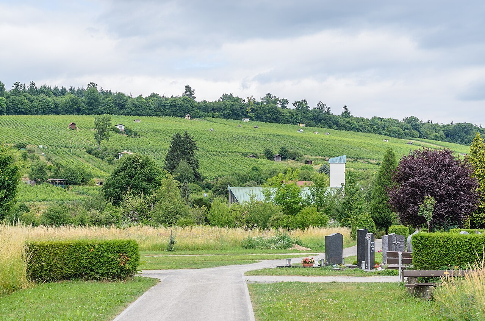

# Baden

Baden is the appellation of south-west Germany, running about 400 kilometres from Tauberfranken in the north along the Rhine plain to Lake Constance in the south and covering about 15,100 hectares in 2025. It is Germany's southernmost appellation and the third largest wine region in the country.

Figure: Baden. Photograph: File:Weingarten (Baden) vineyards and cemetery.jpg. Credit: Bradley Rentz, CC BY-SA 4.0, via Wikimedia Commons ([source](https://commons.wikimedia.org/w/index.php?curid=62119162)).

## Definition and scope

Baden is a protected appellation name, and its grapes must come from one of the nine demarcated sub-zones and be made within the region. The long, narrow shape means large differences in climate, soil and varieties, and a sub-zone on the label often says more about style than Baden alone.

Reds are prominent, with Spätburgunder the leading red variety; whites are mainly Müller-Thurgau, Gutedel, Riesling, Grauburgunder and Weißburgunder.

## History

Viticulture in Baden goes back to Roman times, and medieval monasteries and princely courts drove the clearing of slopes in the Rhine plain and the Kaiserstuhl. In the 19th century the Grand Duchy of Baden set up viticulture and winemaking institutions, and the cooperative system developed in the same period.

In the late 20th century Baden moved from a volume orientation towards quality grading, strengthening both the Spätburgunder red route and the local Gutedel white route. Today the region combines large cooperatives serving the mass market with small estates focused on sites and old vines.

## Geography and climate

Baden unfolds along the upper Rhine plain, with the Rhine and Alsace to the west and the Black Forest to the east. A narrow band of south-facing slopes lies between plain and hills, with ample sunshine and little rain, making it one of Germany's warmest regions.

Soils are highly varied: volcanic rock and ash in the Kaiserstuhl, limestone in Breisgau and Tuniberg, loess in the Kraichgau, gneiss and granite in Markgräflerland, and glacial gravel and clay around Lake Constance. Drainage, heat retention and pH differences show directly in body and acidity.

Lake Constance moderates the southern climate, lengthening the growing season and reducing frost risk, while Tauberfranken in the north is more continental and has a shorter ripening period.

## Nine sub-zones

Baden is divided into nine sub-zones, from north to south:

- Tauberfranken: the northern tip near Franconia, cooler, mainly whites and light reds.
- Badische Bergstraße: between Heidelberg and Mannheim, west-facing slopes of loess and granite.
- Kraichgau: hills between the Rhine and the Neckar, loess soils and larger volumes.
- Ortenau: from Baden-Baden to Offenburg, strong for Riesling and Spätburgunder.
- Breisgau: around Freiburg, limestone slopes, both reds and whites.
- Kaiserstuhl: volcanic hills in the Rhine plain, warm and dry, the core of Baden reds.
- Tuniberg: lower hills south of the Kaiserstuhl, limestone and loess, lighter in style.
- Markgräflerland: between Basel and Freiburg, the traditional home of Gutedel.
- Bodensee: the Lake Constance shore, glacial gravel and a lake-moderated climate.

For Baden, the sub-zones describe geography and style, not a ranking, and variation within a sub-zone is just as marked.

## Varieties and raw material

Spätburgunder (Pinot Noir) is Baden's most important red grape, especially in the Kaiserstuhl and Ortenau. Gutedel (Chasselas) has centuries of history in Markgräflerland, with light body and mild acidity, and is the local marker.

Whites also include Müller-Thurgau, Riesling, Grauburgunder, Weißburgunder and Chardonnay; reds include small amounts of Cabernet varieties and Merlot, mostly for blending. The raw material is [grape](ref:grape).

## Winemaking

Red grapes [ferment](ref:fermentation) with the skins, and maceration time and temperature decide colour, tannin and fruit; some estates use open vats and manual punching down, then age in old oak. Spätburgunder ranges from light and fruity to structured.

Whites ferment cool to keep aroma and [acidity](ref:acidity); Gutedel is usually bottled early for freshness, while Riesling and Grauburgunder may gain texture from lees contact. Here the [oak cask](ref:oak-ageing) is used more for red structure and white texture than for adding vanilla.

Reds usually allow malolactic fermentation to soften acidity, while whites depend on the style.

## Classification and rules

For Baden, German wine is divided into Wein, Landwein, Qualitätswein and Prädikatswein. Prädikatswein is graded by ripeness at harvest into Kabinett, Spätlese, Auslese, Beerenauslese, Trockenbeerenauslese and Eiswein; the level describes must weight and does not determine the sweetness of the finished wine.

Trocken on the label means residual sugar no higher than 9 g/L, halbtrocken means 9–18 g/L, and feinherb is a common but unregulated term. Most everyday Baden wines are dry, with sweet styles concentrated in the higher Prädikat levels and Eiswein.

Großes Gewächs and Erste Lage are private classifications of producer associations such as the VDP, not state grades, and should be read separately from the Prädikat level, sub-zone and site.

## Labels and serving

The label should be checked for Baden, the sub-zone (Bereich), village and site, variety, vintage, alcohol, volume and bottler. Spätburgunder may also appear as Blauer Spätburgunder, which is the same variety.

Spätburgunder is best at 14–16 degrees Celsius, and Gutedel and fresh whites at 8–10 degrees Celsius. Reds suit poultry, mushrooms, pork and medium-weight red meat; Gutedel suits fish, salads and light starters. Once opened, keep chilled and finish soon. Excessive drinking is harmful to health and minors should not drink.

## Common misconceptions

First, assuming Baden is only a red-wine region. Whites still hold a substantial share, with Gutedel and Müller-Thurgau as everyday staples.
Second, treating Kaiserstuhl volcanic soil as a guarantee of quality. Soil shapes style, but vintage, site and viticulture decide the final quality.
Third, treating Gutedel as a lowly variety. It has its own history and style tradition in Markgräflerland.
Fourth, reading Baden as a single style. The nine sub-zones from Tauberfranken to Lake Constance differ greatly.
Fifth, treating Großes Gewächs as a state grade. It is a private mark of producer associations.

**Short definition:** The appellation of south-west Germany, running about 400 kilometres from Tauberfranken along the Rhine plain to Lake Constance and covering about 15,100 hectares in 2025, the third largest wine region in Germany, in nine sub-zones; volcanic rock in the Kaiserstuhl, limestone in Breisgau and Tuniberg, gneiss in Markgräflerland and glacial gravel by Lake Constance create varied soils, Spätburgunder is the leading red variety and Gutedel is the local speciality of Markgräflerland.

Baden is best approached through the appellation and its permitted varieties, then the vintage and the producer, and then how the wine is labelled. One check alone will not settle it.

## Further reading

- [Germany](ref:germany): the national appellation framework that contains Baden.
- [Wine](ref:wine): an overview of wine categories, vintage and origin rules.
- [White wine](ref:white-wine): the category to which Gutedel and Müller-Thurgau belong.
- [Red wine](ref:red-wine): the category to which Spätburgunder belongs.
- [Grape](ref:grape): the structure and ripeness markers of wine grapes.
- [Fermentation](ref:fermentation): the roles of skin contact and malolactic fermentation.
- [Acidity](ref:acidity): how the acidity of Baden whites relates to food pairing.
- [Alcohol by volume](ref:abv): alcohol differences across varieties and styles on the label.
- [Oak ageing](ref:oak-ageing): the role of oak in Spätburgunder ageing.
