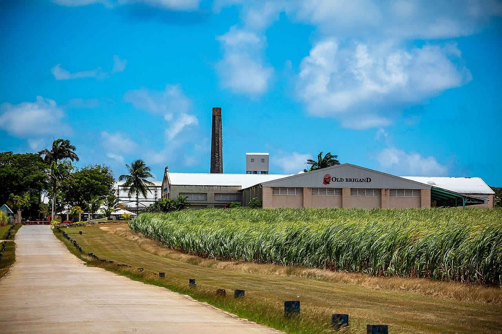

# Barbados

Barbados is an island country in the Lesser Antilles of the Caribbean and one of the oldest [rum](ref:rum) regions. It uses molasses, often blending pot and column distillation, then ages the spirit in a tropical climate to produce a more balanced, approachable body than Jamaica's high-ester style.

Figure: Barbados. Photograph: File:Foursquare Rum Distillery.jpg. Credit: Unknown author Unknown author, CC BY 2.5 ([source page](https://commons.wikimedia.org/wiki/File:Foursquare_Rum_Distillery.jpg)). Category image; not a claim that it shows the exact product, site or event.

## Geography and sugarcane

Barbados lies in the eastern Caribbean, with gentle terrain dominated by coral limestone. Groundwater is filtered through the rock and low in minerals. That water and the tropical climate suit sugarcane growing and sugar making, making molasses a steady raw material for the rum industry.

Sugarcane became the island's main crop in the 17th century as the Caribbean plantation economy expanded. The partnership between sugar factories and distilleries continues: molasses supply, fermentation management and distillation capacity together set the scale of the region. Island climate alone does not equal flavour, and fermentation and distillation still matter.

## Rum history

Barbados rum production is tied to 17th century sugar and Atlantic trade. Distilled molasses spirit was easy to transport, and rum became part of life for sailors, ports and the plantation economy. In the 18th century the trade expanded and Barbados developed a mature tradition of distillation and ageing.

Mount Gay is often described as one of the longest continuously operating rum brands, with origins traced to 1703. Such history shows continuity in the region but is not a quality ranking; brand history and the liquid in the bottle are separate things.

## Raw materials and fermentation

Barbados rum uses mainly molasses, diluted with water and inoculated with yeast for [fermentation](ref:fermentation). Fermentation time and yeast selection affect ester and acid formation, but the overall style is usually more restrained than Jamaica's: fruit is present without being dominated by intense solvent notes.

Some producers emphasise no added sugar and no caramel colouring, so sweetness and colour come more from raw material and barrel ageing; other products use small additions to adjust texture. Whether anything is added, and how it is declared, should be checked against the label and the producer's public statements rather than sweetness alone.

## Distillation and style

Barbados rum commonly combines pot and column distillation. Pot stills retain more esters and a heavier body, column stills give a lighter, cleaner product, and the blend ratio sets the final style. Compared with Jamaica's high-ester tradition, Barbados stresses balance, structure and drinkability.

Discussion of Barbados rum as a geographical indication involves requirements for raw materials, place of production and ageing, with the official text as the authority. A geographical indication confirms origin and compliance with rules, not a quality score; products that comply still differ in style and price.

## Producers and region

The main producers on the island include Mount Gay, Foursquare and the West Indies Rum Distillery. Distilleries differ clearly in stills, fermentation time and ageing strategy: some stress heavy pot-still body, some work mainly with column stills, and some are known for a no-added-sugar approach.

Producer names help place a style, but they are not a grade. Check raw materials, distillation method, ageing statement, alcohol content and any declared additions rather than the island name or brand alone.

## Ageing and drinking

Barbados rum ages in oak in a tropical climate, as described under [oak ageing](ref:oak-ageing). Heat and humidity accelerate evaporation, and a few years bring visible colour along with vanilla, caramel and dried fruit; barrel type and age affect tannin and spice.

Aged rum suits sipping or a little water; white rum suits mixing, commonly around 40% ABV with the label as the authority. Rum punch is a common local serve, where the balance of sugar, lime, water and spice matters more than strength. Colour depth alone does not indicate age.

## Common misconceptions

First, assuming all Barbados rum is sweet. Sweetness comes more from ageing, additions or the serve.
Second, treating brand history as a quality guarantee. History shows continuity, not preference.
Third, treating a place name as a grade. A geographical indication describes origin and rules.
Fourth, setting pot and column stills against each other. Blending both is common in the region.
Fifth, ignoring declared additions. Sugar and caramel colouring affect texture and appearance.

Barbados rum is shaped by molasses, a mix of pot and column distillation and fast tropical ageing. The island produces both heavy, ester-rich styles and lighter blended rums, so “Barbados” is not one flavour. The place name describes a production tradition and a regulatory context, not a grade. Read the raw material, still type, age and whether sugar was added before judging the bottle. Tropical ageing changes a rum quickly, but speed is not the same as quality. The balance of pot and column spirit, the decision to add sugar and the bottling strength all shape the final drink. The island name alone does not guarantee one style.

**Short definition:** A Caribbean island country and a major rum region, where molasses, blended pot and column distillation and tropical ageing produce a more balanced style; place names are not a grade.

Read Barbados through the appellation and its permitted varieties, then the vintage and the producer, and finally how the wine is labelled. The sequence matters.

It is tempting to treat Barbados as an administrative place name. Its identity and use are separate questions.

Barbados rum uses molasses and a mix of pot and column stills, and the island's tropical ageing gives a rounder, more aromatic style than European ageing; Foursquare is a benchmark.

The island's rum industry also produces lighter column-still rums for mixing, alongside the heavier pot-still styles.

The island's rum is also protected by a geographic indication, and its distilleries range from small pot stills to large column plants.

**Key facts.**

| Item | Detail |
| --- | --- |
| In one line | A Caribbean island country and a major rum region, where molasses, blended pot and column distillation and tropical ageing produce a more balanced style; place names are not a grade. |
| Level | country |
| Country code | BB |

**Sources and limits.** The key claims about Barbados are checked against the following sources: Barbados Rum (raw materials, distillation and ageing statements for Barbados rum; no original text is reproduced), WIRSPA (production background and geographical indication discussion in the Caribbean; no original text is reproduced), European Union (the raw material categories and minimum alcohol content for rum; no original text is reproduced) and 4 sources in total. Prices, batches and status change; the body is project-written and does not reproduce source text.

For Barbados, this region was last checked in 2026; prices, batches and availability change, so confirm them against the sources below.

## Further reading

- [Rum](ref:rum): the raw materials, distillation and category framework for rum.
- [Fermentation](ref:fermentation): how time and yeast shape aroma.
- [Distillation](ref:distillation): how pot and column stills differ.
- [Oak ageing](ref:oak-ageing): tropical ageing and flavour development.
