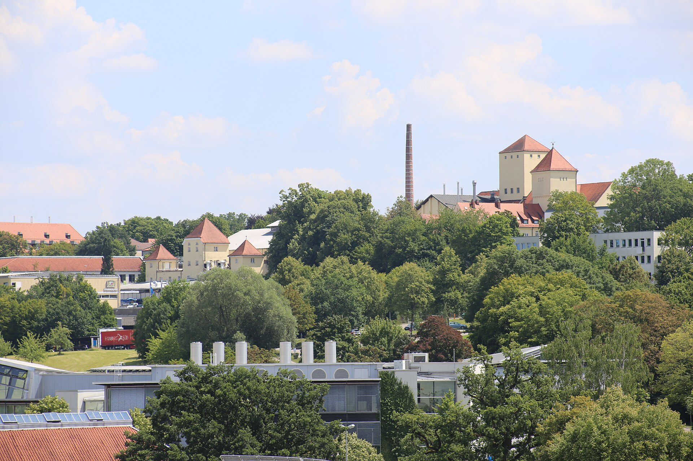
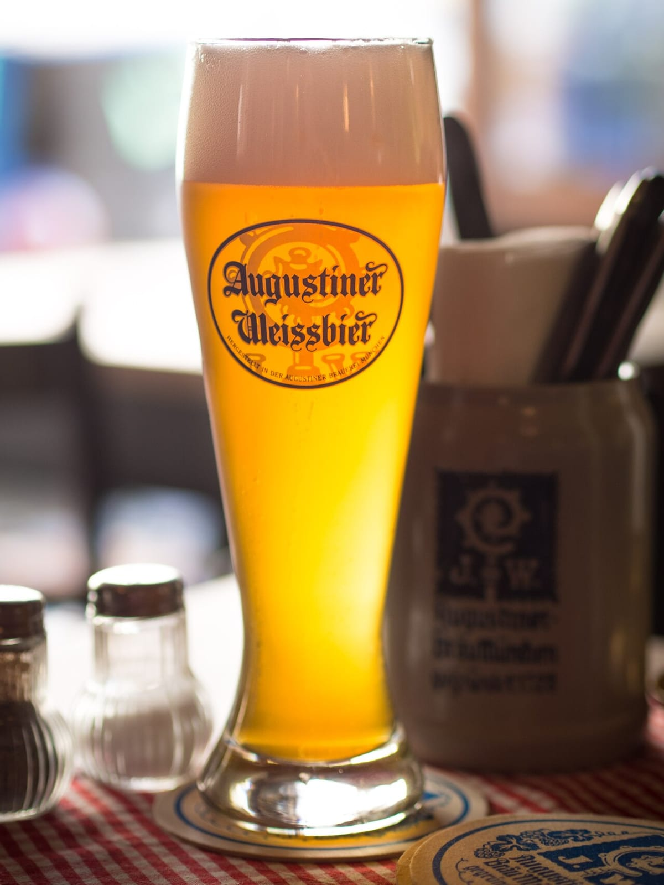

# Bavaria

Bavaria is the largest federal state in southern Germany and one of the world's most famous beer-law territories. Munich, Nuremberg, Bamberg and Bayreuth each have a clear brewing tradition, from pale lager to smoked beer, wheat beer and strong doppelbock. Bavarian beer has to be read through the 1516 Reinheitsgebot and also through the way that rule is now interpreted, excepted and worked around.

Figure: Bavaria. Photograph: File:Überblick der Bayerischen Staatsbrauerei Weihenstephan.jpg. Credit: Christian Schranner, CC BY-SA 4.0 ([source page](https://commons.wikimedia.org/wiki/File:%C3%9Cberblick_der_Bayerischen_Staatsbrauerei_Weihenstephan.jpg)). Category image; not a claim that it shows the exact product, site or event.

## Beer geography in southern Germany

Bavarian brewing has several centres. Upper Bavaria around Munich has large breweries with high export shares; Lower Bavaria and the Upper Palatinate keep many small and medium breweries; Franconia is the densest area, where village breweries and their own beer cellars still exist. Water north of the Alps is hard and carbonate-rich, historically better suited to dark lager; the granite and sandstone areas to the north and east have softer water, better for crisp pilsner. Water chemistry is the first key to local style.

## Origins of the Reinheitsgebot

In 1516 the Bavarian dukes Wilhelm IV and Ludwig X issued the Reinheitsgebot in Ingolstadt, limiting beer to barley, hops and water. It is often described as the world's earliest food-safety law, but it also served price and raw-material control: wheat and rye were reserved for bread, and brewing was not to compete for grain. The role of yeast was then unknown, and only after Pasteur's work in the 19th century was yeast formally added to the permitted ingredients.

## From local rule to federal law

In 1906 the purity rule took effect across the German Empire; the 1952 beer tax law wrote it into federal law; the 1993 Provisional Beer Law remains in force. Current rules distinguish bottom fermentation from top fermentation: bottom-fermented beer may use only water, malt, hops and yeast, while top-fermented beer may use other sugars and materials. This distinction is often overlooked but is the key to the real boundary of German beer law. Nor is the Reinheitsgebot an absolute command for all beer; single-market rules allow beer lawfully produced in other member states to be sold in Germany.

## Raw materials and water

Bavarian barley is mostly winter or spring barley, malted and kiln-dried before use; wheat beer uses wheat malt as the main grist, usually around half. Hops come mainly from the Hallertau, the world's largest contiguous hop-growing area at about 17000 ha, known for mild herbal and spicy aromas. Munich water is hard and suits dark malt and fuller bodies; softer water in northern Franconia makes it easier to brew clean pilsner and pale lager. Bottom-fermenting yeast works at low temperature over a long period for clean flavour, while wheat-beer yeast produces banana-like esters and clove-like phenols.

## Munich and the classic styles

Munich's signature style is Helles: pale gold, malty sweet, mildly bitter and made for volume drinking. Dunkel is defined by Munich malt, with toasted bread and cocoa; Märzen and Festbier are fuller and the mainstay of Oktoberfest. Pilsner is widely brewed in Bavaria too, usually drier and more bitter than the Czech version. Doppelbock comes from the monastic brewing tradition of Munich, strong and malty, often named with the suffix "-ator".

## Wheat beer

Weißbier is one of Bavaria's most recognisable styles, brewed with wheat malt and a bottom-fermenting yeast, showing banana, clove, bread and citrus. Traditional bottles keep the yeast and are gently swirled before pouring; filtered versions are clearer and easier to drink. Wheat beer has its own tavern culture in Bavaria, often served with white sausage and breakfast, unlike beer habits elsewhere in Germany.

## Franconia and smoked beer

Bamberg in Franconia is the home of Rauchbier. Malt is dried over an open fire and takes on smoke, giving a deep amber beer with ham, bonfire and toasted bread. Schlenkerla and Spezial are two historically important breweries often cited, the first known for continuous production and tavern culture, the second for a finer style. Franconia also has many village breweries, each making small volumes with a strong seasonal and local identity, in contrast with Munich's large industrial plants.

## Breweries, festivals and the market

Bavaria has one of the world's oldest still-operating breweries: Weihenstephan in Freising traces its history to 1040. Augustiner in Munich dates from 1328, the Hofbräuhaus from 1589 and Paulaner from 1634. In 1810 Munich held its first Oktoberfest, now one of the world's largest beer festivals. In the market, German beer consumption has fallen over the long term, with no-alcohol beer and craft styles growing; large Bavarian breweries rely on exports and brands, while small ones depend on local loyalty and cellar sales.

## Common misconceptions

First, that the Reinheitsgebot bans every other ingredient. Both top-fermented beer and modern law leave room. Second, that the rule guarantees quality. An ingredient list is not a measure of craft. Third, that Bavaria is only about wheat beer. Pale lager is the everyday staple. Fourth, that Munich's hard water represents all of Bavaria. Water in Franconia and the east is softer. Fifth, that smoked beer is a Bavarian-wide style. It is concentrated in Bamberg. Sixth, that Oktoberfest is the name of a beer style. Festbier is a distinct style, close to but not the same as Märzen.

**At a glance:** A federal state in southern Germany and one of the world's most famous beer-law territories. The 1516 Reinheitsgebot limited bottom-fermented beer to water, malt, hops and yeast, but modern law leaves room for top-fermented and imported beer, so Bavarian brewing is far more varied than a single rule suggests. 

Read Bavaria through the appellation and its permitted varieties, then the vintage and the producer, and finally how the wine is labelled. The sequence matters.

[Germany](ref:germany) and [Lager](ref:lager) answer different questions about Bavaria: geographic boundary and climate and soil. Read them as a pair, not as alternatives.

**Key facts.**

| Item | Detail |
| --- | --- |
| In one line | A federal state in southern Germany and one of the world's most famous beer-law territories. The 1516 Reinheitsgebot limited bottom-fermented beer to water, malt, hops and yeast, but modern law leaves room for top-fermen… |
| Level | other |
| Country code | DE |

**Sources and limits.** The key claims about Bavaria are checked against the following sources: Bavarian State Ministry, Deutscher Brauer-Bund (German beer law, styles and industry overview; no source text is copied), Oxford University Press (Consulted for entries on German beer, lager and wheat beer; no source text is copied; Migrated from the former reference list at the end of the article; access date not re-verified) and 5 sources in total. Prices, batches and status change; the body is project-written and does not reproduce source text.

## Further reading

- [Germany](ref:germany): the overall framework of German beer law and culture.
- [Beer](ref:beer) and [lager](ref:lager): the most common drinks in Bavaria.
- [Pilsner](ref:pilsner) and [wheat beer](ref:wheat-beer): two representative styles.
- [Barley](ref:barley), [wheat](ref:wheat) and [water](ref:water): the main raw materials.
- [Fermentation](ref:fermentation): the difference between bottom and top fermentation.

## Related images

Image: Wheat beer. Credit: Takeaway, CC BY-SA 3.0, via Wikimedia Commons ([source page](https://commons.wikimedia.org/wiki/File:2013_Augustiner_Weissbier_Munich_pub.jpg)). Related image for Bavaria.

Image: Category image for Germany. Credit: Renardo la vulpo, CC0, via Wikimedia Commons ([source page](https://commons.wikimedia.org/wiki/File:M%C3%BCnchen,_Oktoberfest_2022,_Fischer-Vroni_v_S,_1.jpeg)). Related image for Bavaria.
