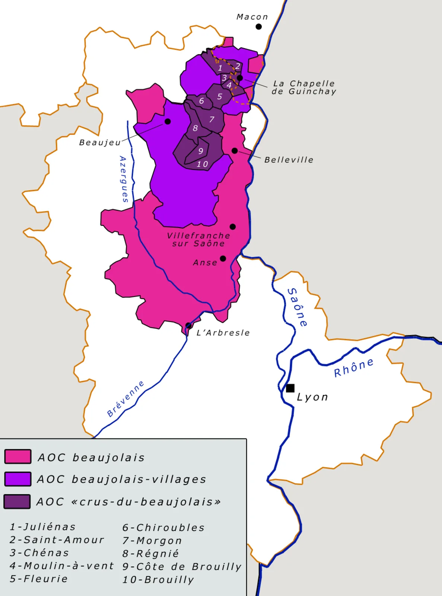

# Beaujolais

Beaujolais is a wine region in eastern France, west of the Saône and north of Lyon, south of [Burgundy](ref:burgundy). It makes mostly [red wine](ref:red-wine) from [Gamay](ref:gamay), with a small amount of [white wine](ref:white-wine) from [Chardonnay](ref:chardonnay). The region is divided from regional and Beaujolais-Villages up to ten village crus.

Figure: Beaujolais. Image: Cyril5555, CC BY-SA 3.0, via Wikimedia Commons ([source page](https://commons.wikimedia.org/wiki/File:Carte_vignoble_beaujolais.png)).

## Geography and climate

Beaujolais lies in eastern [France](ref:france), with vineyards on the hills and slopes west of the Saône, bordering the Mâconnais to the north and Lyon to the south. The region runs north to south in a narrow band, with more relief in the north and a gradual shift to gentler hills in the south.

The climate is semi-continental, with warm summers and a long autumn that lets Gamay ripen fully; the north is higher with a wider day-night range, while the south is warmer. Vintage differences change ripeness and acidity, and harvest rain is one of the main risks.

## History

Viticulture in Beaujolais dates back to the Middle Ages, but its market position is closely tied to urban demand in the 20th century. Restaurants and merchants in Lyon drove early sales, and Beaujolais Nouveau later pushed the region to a wider consumer market.

Beaujolais Nouveau is an early wine released in the same year as the harvest, historically on a fixed schedule, stressing fresh fruit rather than ageing. It and the village crus follow two different product logics and cannot replace each other.

## Sub-regions and crus

Beaujolais appellations fall roughly into three tiers: regional Beaujolais, Beaujolais-Villages and ten village crus. The ten crus are Saint-Amour, Juliénas, Chénas, Moulin-à-Vent, Fleurie, Chiroubles, Morgon, Régnié, Brouilly and Côte de Brouilly.

Most northern crus sit on granite slopes and have more structure and ageing potential; Brouilly and Côte de Brouilly in the south wrap around a hill with marked differences in soil and aspect. [Morgon](ref:morgon) lies in the north and is one of the larger, fuller styles among them.

## Tiers

Regional Beaujolais covers the whole region and accounts for the largest volume, with a fruit-driven style; Beaujolais-Villages comes from designated villages and usually shows more ripeness and structure; the ten crus each hold a separate appellation name and may be made only within the corresponding village.

The tiers are defined by appellation rules, not by market opinion. When a cru name appears on the label, the regional Beaujolais name is usually omitted; when buying, confirm the tier first, then the village and estate. Higher tiers usually carry stricter yield limits and ripeness requirements.

## Varieties and styles

Red wines use almost entirely [Gamay](ref:gamay), are purple-red in colour with light-to-medium tannin and clear acidity, and typically show red cherry, raspberry, violet and peony. Northern crus have a fuller body and tighter structure, while southern and village wines are lighter and more direct in fruit.

White wines are a small share, made from [Chardonnay](ref:chardonnay), with citrus, white flowers and minerality. Beaujolais also makes a little rosé and sparkling wine, but far less than red.

## Soils and terrain

Northern crus have mostly weathered granite sands, draining well and low in fertility, which encourages deep roots and controlled yields; some parcels mix schist and sandstone. The south has more clay and limestone, with more fertile soils and a softer body.

Aspect and altitude matter too: south- or south-east-facing slopes ripen more fully, and higher parcels keep better acidity. The combination of soil and terrain explains the style differences within Beaujolais from one variety.

## Labels and vintage

Labels usually carry the appellation, village or cru name, vintage, alcohol, net volume and bottler. Regional wines say Beaujolais, village wines say Beaujolais-Villages, and crus name the cru directly, such as Morgon or Fleurie.

Vintage reflects the weather of that year. Frost, hail and harvest rain change yield and ripeness; Beaujolais Nouveau stresses the fruit of the current year and is not for long keeping, while crus can age for years or longer. When buying, check tier, village, vintage and bottling information together.

## Market and drinking

Beaujolais has long been associated with Nouveau and everyday drinking, but the crus are positioned higher and priced higher. Differences within the region are wide, and one price range cannot describe all wines.

Reds are served a little below room temperature, and lighter wines can be lightly chilled; they suit poultry, charcuterie, mushrooms and soft cheese. After opening, refrigerate and finish soon; excessive drinking harms health and minors should not drink.

## Common misconceptions

First, equating Beaujolais with Beaujolais Nouveau. Nouveau is only a small part, and the crus are the structured, ageworthy side.
Second, treating Beaujolais as a sub-region of Burgundy. It is a separate wine region with its own rules and tiers.
Third, thinking Gamay can only make light reds. Northern crus can show structure and ageing potential.
Fourth, lumping the ten crus into one style. Soil, aspect and village tradition produce clear differences.
Fifth, judging quality by price alone. Tier, village, vintage and bottler information are more specific.

**In brief:** A wine region in eastern France, west of the Saône and north of Lyon, south of Burgundy and the Mâconnais. It is mostly red wine from Gamay, divided from regional and Beaujolais-Villages up to ten village crus, with clear differences in soil and style between north and south.

Beaujolais is best read by starting with the appellation and its permitted varieties, moving to the vintage and the producer, and ending with how the wine is labelled.

The comparison with [France](ref:france) and [Red wine](ref:red-wine) runs through geographic boundary and climate and soil. Each answers a different question.

Beaujolais is based on Gamay and includes three tiers: Beaujolais, Beaujolais-Villages and the ten crus.

**Key facts.**

| Item | Detail |
| --- | --- |
| In one line | A wine region in eastern France, west of the Saône and north of Lyon, south of Burgundy and the Mâconnais. It is mostly red wine from Gamay, divided from regional and Beaujolais-Villages up to ten village crus, with clea… |
| Level | other |
| Parent | France |
| Country code | FR |

**Sources and limits.** The key claims about Beaujolais are checked against the following sources: Inter Beaujolais (the sub-regions, ten crus and tiers of Beaujolais), INAO (the French appellation system and the areas of Beaujolais appellations), European Union (EU wine categories, geographical indications and labelling rules) and 4 sources in total. Prices, batches and status change; the body is project-written and does not reproduce source text.

## Further reading

- [France](ref:france): French wine law and appellations.
- [Burgundy](ref:burgundy): the neighbouring region to the north.
- [Red wine](ref:red-wine) and [white wine](ref:white-wine): the two basic types of Beaujolais.
- [Gamay](ref:gamay): the core variety of Beaujolais reds.
- [Chardonnay](ref:chardonnay): the variety used for Beaujolais whites.
- [Morgon](ref:morgon): a representative village cru in northern Beaujolais.
