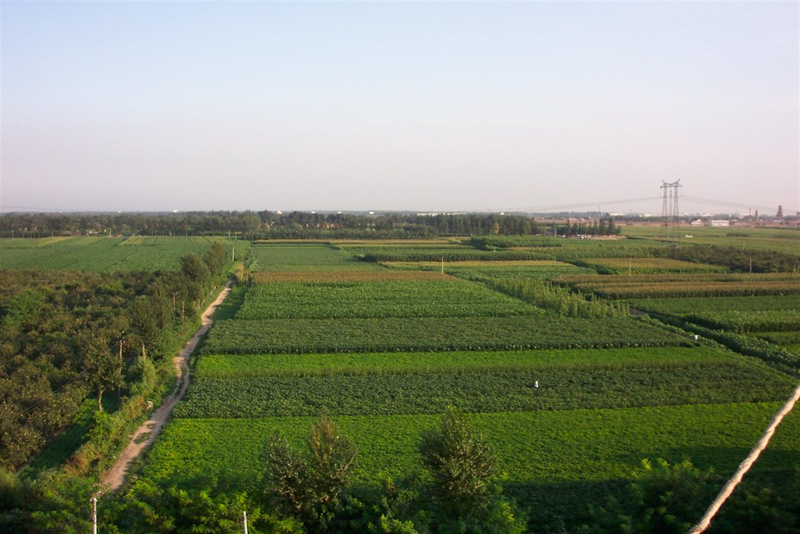

# Beijing

The Chinese capital’s wine and baijiu region, with vineyards in Fangshan and Miyun and the light-aroma baijiu producers Niulanshan and Red Star Erguotou in Shunyi; estate wineries on the urban edge and old distilleries make a rare “urban drinks region”.

Figure: Beijing. Photograph: Aerial View of Farmland. Credit: earth_photos, CC BY 2.0, via Flickr / Openverse ([source](https://www.flickr.com/photos/41078423@N00/79668034)).

## Definition and boundaries

Beijing is not a classic large wine region, but Fangshan, Miyun and Yanqing have vineyards; the shallow hills and valleys on the urban edge provide drainage and cooling.

In an official geographical indication, the boundaries of Beijing are not a decorative line but a legal and historical construction made of place names, parcels and maps. It may be a county, a group of villages, or a narrow strip along a river or mountain; the more specific the name, the less freely it can be used on a label.

Within Beijing, Fangshan, Miyun, Yanqing, Changping and Daxing are separate vineyard areas rather than one terroir. Fangshan’s gravel and sandy loam warm early and suit Cabernet; Miyun and Yanqing sit higher and colder, with shorter seasons and sharper acidity. A winery’s village and elevation explain more than the word Beijing.

## History and naming

Beijing is better known for baijiu: Niulanshan in Shunyi and Red Star Erguotou use light-aroma or Erguotou methods with sorghum, wheat and qu or daqu fermentation, at accessible prices for everyday drinking.

The name Beijing usually appears first in local archives, church records or tax rolls, and only later in modern regulations. The name often stabilises later than the boundary, which is why the same place can carry different spellings across languages and periods.

The modern wine industry dates from the 1980s, when vineyards appeared on the city’s outskirts; the 2000s brought boutique estates to Fangshan, Miyun and Yanqing. Erguotou has a separate history: Red Star was founded in 1949 and Niulanshan is based in Shunyi. Wine and baijiu share a city name but not a rulebook.

## Geography and terroir

Wine is mainly Cabernet Sauvignon, Merlot and Chardonnay, in small volumes and modest estates; limestone and gravel in Fangshan suit reds.

The vineyards and distilleries of Beijing sit at particular elevations, aspects and soil parent materials. Distance to the sea, mountain direction, diurnal range and harvest rain all change ripening and acidity; these conditions explain more about style than the name alone.

Beijing sits at the northern edge of the North China Plain, with the Yanshan and Taihang foothills to the west and north. Winters are cold and dry, summers hot and wet; vineyards occupy alluvial fans and river terraces where drainage and frost protection are the first concerns. The urban heat island adds another variable.

## Raw materials and styles

Beijing has four distinct seasons, cold winters and hot summers, so vines need winter burial; icewine and late harvest are attempted in some hill areas.

The grapes and grain of Beijing determine what can be made. The leading varieties or raw materials, permitted blends, minimum ripeness and maximum yields are usually written into rules; but rules are a floor, and the real style comes from picking dates, fermentation vessels and ageing.

The harvest window is short because autumn rain and early frost can arrive together. Growers pick Cabernet and Merlot before sugar climbs too far, and Chardonnay earlier still to keep acidity. In warm years the reds can taste broad and soft; early picking and canopy work are the main correctives.

## Representative producers and wines

Representative estates and brands include Chateau Bolongbao, Chateau Lion, Changyu AFIP, Niulanshan and Red Star; Beijing is also a centre of Chinese wine education and sommelier culture.

The representative wineries and distilleries of Beijing usually show the two poles of a region: long-established families or cooperatives with concentrated holdings, and newer arrivals working parcel by parcel. Tasting both explains the region better than a list of famous names.

The wine sector is made up of small private estates, some with restaurants and visitor rooms, rather than large cooperatives. The baijiu sector is dominated by state-owned or former state-owned plants such as Red Star and Niulanshan. Who grows the grapes, who owns the brand and who sells the bottle are often three different answers.

## How to drink and pair

To drink Beijing, start with alcohol, acidity and tannin or bitterness, then choose temperature and food. High acidity suits fat and salt, high tannin needs protein and fat, and high alcohol clashes with sweet or very spicy dishes; warmth pushes alcohol over aroma.

Serve Beijing reds at 16–18°C and whites at 10–12°C; Erguotou is usually drunk at room temperature from a small baijiu cup. Roast duck, grilled meat and home-style dishes suit the reds; fish, vegetables and light cheese suit the whites. Erguotou pairs with braised food and peanuts, not with sweet desserts.

## Labels, buying and misreadings

For Beijing, begin with the appellation and its permitted varieties, then the vintage and the producer, and finish with how the wine is labelled; that order keeps the account grounded.

Vintage matters more than the city name: a rainy summer can dilute reds, a cold spring can cut the crop, and a warm autumn can push alcohol. Erguotou is a blended, consistent product rather than a vintage drink. For wine, ask for the harvest year and the winery’s recent style before buying.

### Key dates and figures

- 1949: Hongxing distillery was founded in Beijing; Niulanshan in Shunyi followed the same sorghum-based erguotou tradition.
- 1980s: vineyards appeared on the city’s outskirts; by the 2000s, boutique wineries in Fangshan, Miyun and Yanqing turned Beijing into an urban-edge wine region.

## Around and routes

Putting Beijing into an itinerary means separating the regional centre from specific wineries and distilleries: the first is for landscape, markets and food, the second needs bookings, tastings and travel time. Too many stops in one day exhaust both palate and attention.

Fangshan is about an hour to ninety minutes from central Beijing; Miyun and Yanqing take two hours or more. A winery visit usually includes vineyard, cellar and tasting, so three stops in one day is already tight. Book ahead and do not try to combine a wine estate with a baijiu museum in the same afternoon.

- Related: [china](ref:china), [cabernet-sauvignon](ref:cabernet), [baijiu](ref:baijiu), [red-wine](ref:red), [white-wine](ref:white).
- This page provides no map, prices or opening hours; confirm before travelling.

**In brief:** The Chinese capital’s wine and baijiu region, with vineyards in Fangshan and Miyun and the light-aroma baijiu producers Niulanshan and Red Star Erguotou in Shunyi; estate wineries on the urban edge and old distilleries make a rare “urban drinks region”. 

[China](ref:china) and [Baijiu](ref:baijiu) are the two useful reference points for Beijing. [China](ref:china) sets out geographic boundary; [Baijiu](ref:baijiu) brings in climate and soil. Read them together.
